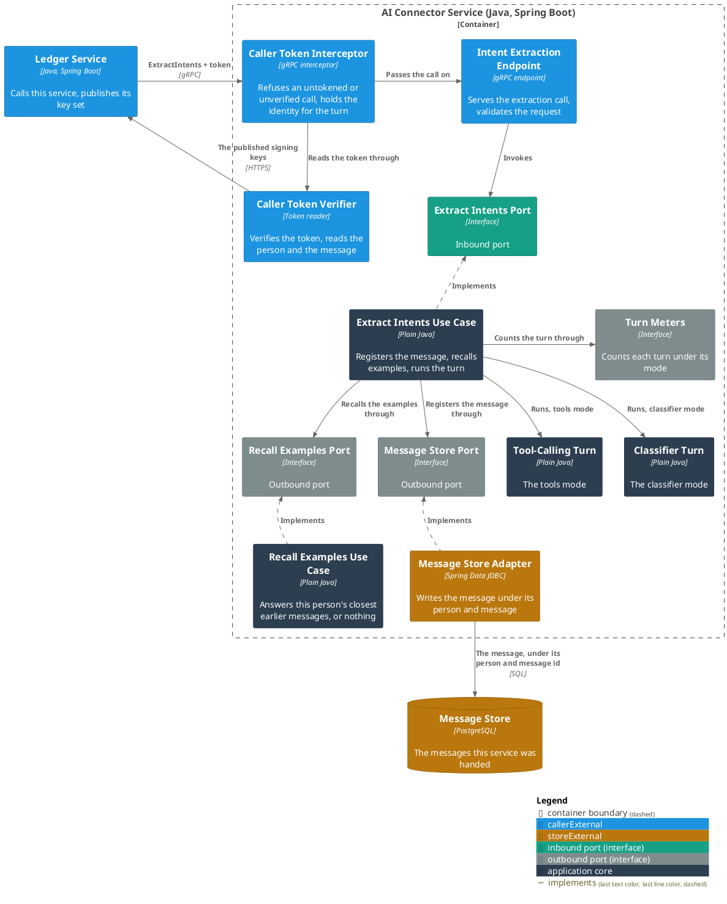
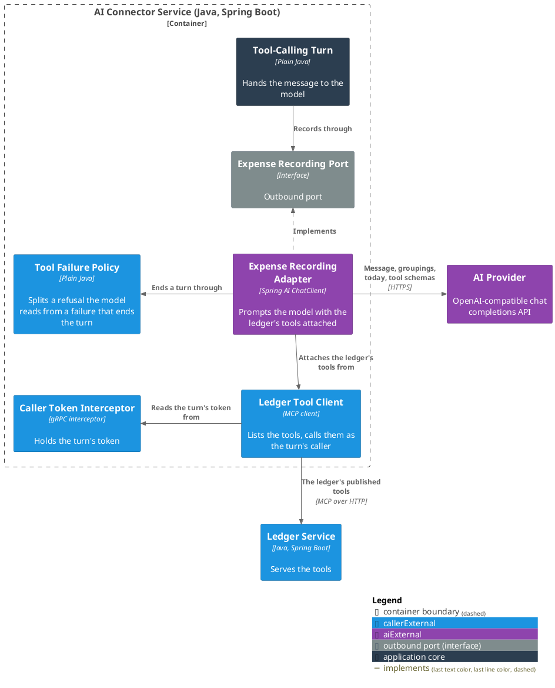
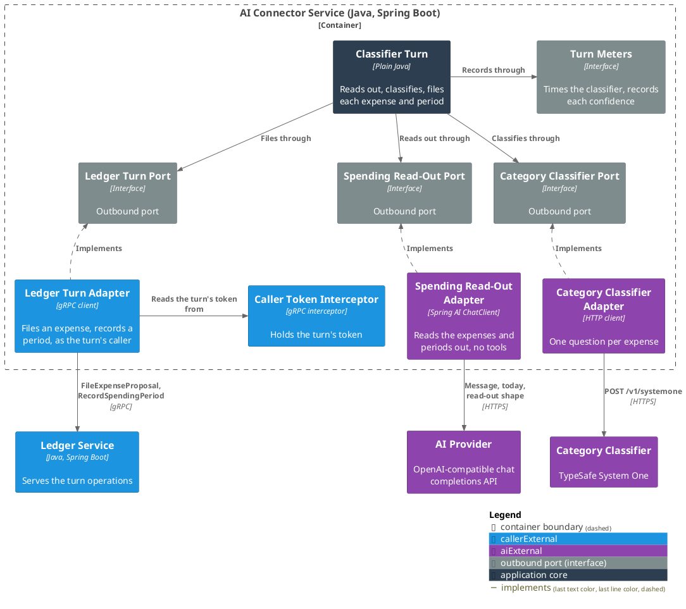
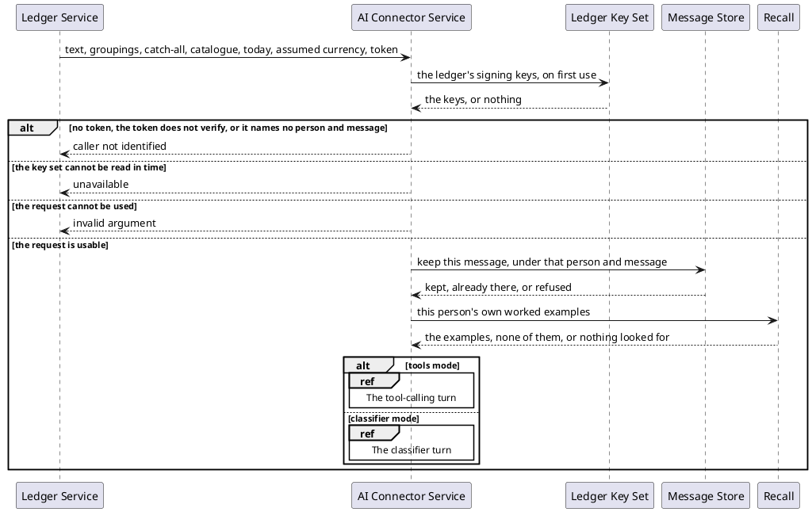
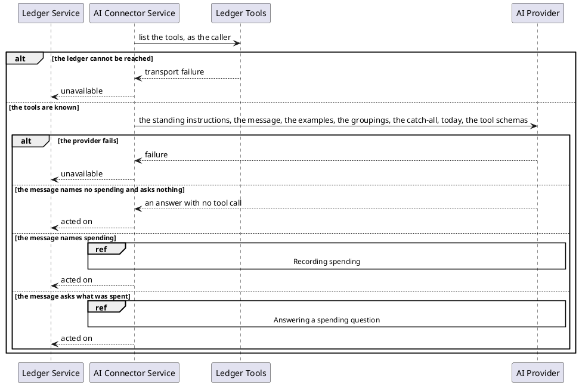
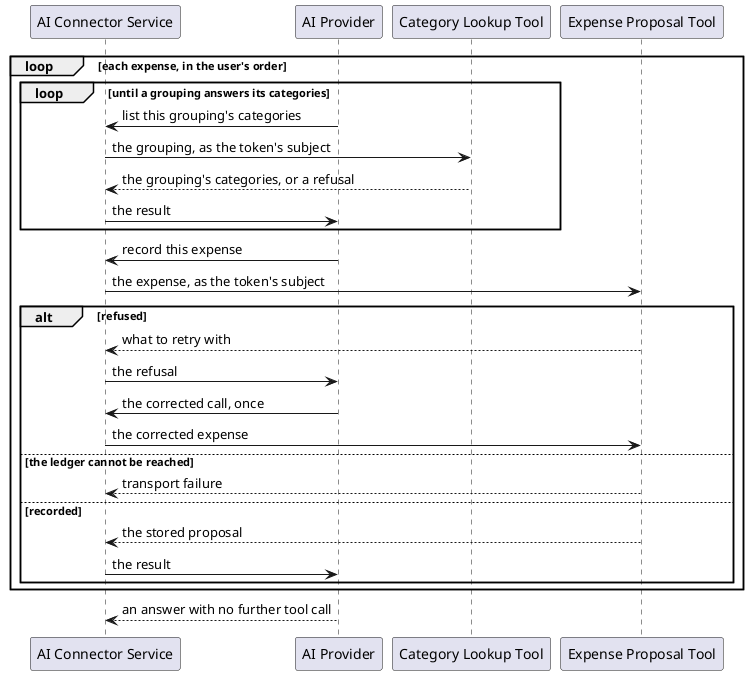
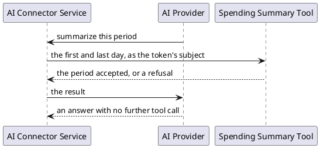
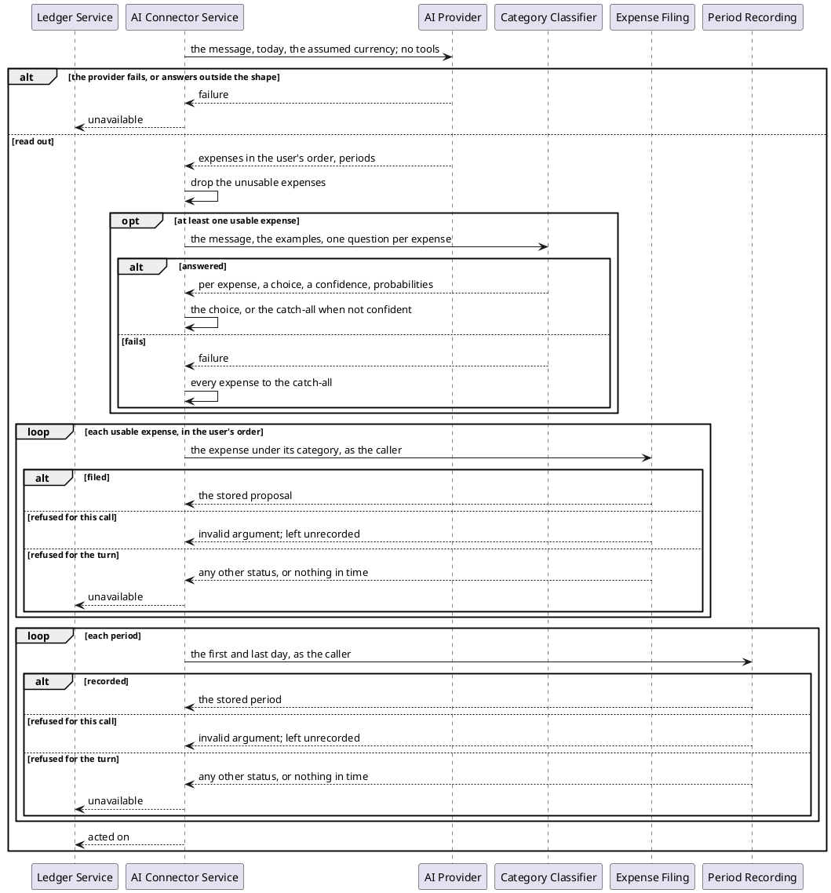

# Record the spending a user's message names

- **In:**
  - the user's text
  - the groupings their categories are filed under
  - the grouping to fall back on
  - every grouping's categories
  - the day the turn runs on
  - an assumed currency (optional)
  - the caller's token
- **Out:** nothing
- **Why:** a user records spending, and asks what they spent, by writing a sentence instead of filling a form

*Implemented by `ExtractIntentsUseCase`.*

Every turn runs in the [extraction mode](../domain/extraction-mode.md) `EXTRACTION_MODE` names:

| Mode                 | The turn                                                                                          |
|----------------------|---------------------------------------------------------------------------------------------------|
| `tools`, the default | the model files the spending itself, through the ledger's tools                                   |
| `classifier`         | the model reads the spending out, a classifier picks each category, this service files the result |

## Prerequisites

- The call carries a caller token.
- The token verifies against the ledger's published key set and names the person and the message it acts for.
- In the tools mode, the ledger serves the tools the model calls.
- In the classifier mode, the ledger serves its turn operations at `LEDGER_TURN_TARGET`.

## Collaborators

| Direction | Collaborator                                                                                         | Through                                                   | For                                                        |
|-----------|------------------------------------------------------------------------------------------------------|-----------------------------------------------------------|------------------------------------------------------------|
| in        | [Ledger Service, Telegram message](../../../ledger-service/docs/usecases/handle-incoming-message.md) | [Intent extraction](../contracts/in/intent-extraction.md) | acting on what a user typed, as that user                  |
| in        | [Ledger Service, web message](../../../ledger-service/docs/usecases/handle-written-message.md)       | [Intent extraction](../contracts/in/intent-extraction.md) | acting on what a user typed, as that user                  |
| out       | [Ledger key set](../../../ledger-service/docs/contracts/in/mcp.md#how-a-caller-authenticates)        | [Ledger tools](../contracts/out/ledger-mcp.md)            | reading who the token acts for                             |
| out       | [Message store](../contracts/out/database.md)                                                        | [Database](../contracts/out/database.md)                  | keeping the message the caller handed over                 |
| out       | [Recall the person's own worked examples](recall-examples.md)                                        | Recall Examples Port                                      | showing the model or the classifier how this person files  |
| out       | [AI Provider](../contracts/out/ai-provider.md)                                                       | [Chat completions](../contracts/out/ai-provider.md)       | acting on the message, or only reading it out              |
| out       | [Category Lookup Tool](../../../ledger-service/docs/usecases/list-categories.md)                     | [Ledger tools](../contracts/out/ledger-mcp.md)            | tools mode: learning which categories a grouping holds     |
| out       | [Expense Proposal Tool](../../../ledger-service/docs/usecases/create-an-expense-proposal.md)         | [Ledger tools](../contracts/out/ledger-mcp.md)            | tools mode: recording one expense                          |
| out       | [Spending Summary Tool](../../../ledger-service/docs/usecases/summarize-spending.md)                 | [Ledger tools](../contracts/out/ledger-mcp.md)            | tools mode: asking for the totals over a period            |
| out       | [Category Classifier](../contracts/out/classifier.md)                                                | [System One](../contracts/out/classifier.md)              | classifier mode: picking each expense's category           |
| out       | [Expense Filing](../../../ledger-service/docs/usecases/create-an-expense-proposal.md)                | [Ledger turn operations](../contracts/out/ledger-turn.md) | classifier mode: filing one expense                        |
| out       | [Period Recording](../../../ledger-service/docs/usecases/summarize-spending.md)                      | [Ledger turn operations](../contracts/out/ledger-turn.md) | classifier mode: recording a period the message asks about |

## Outcomes

### Either mode

| Outcome                 | When                                                                              | Result                                                                                       |
|-------------------------|-----------------------------------------------------------------------------------|----------------------------------------------------------------------------------------------|
| Message kept            | the token names a person and a message                                            | the message is stored under that pair before the model is called                             |
| Message already known   | the same person and message arrive a second time                                  | the first row and its text stand; the turn runs again                                        |
| Message not kept        | the store refuses the write                                                       | the turn runs as if it had been kept                                                         |
| Examples offered        | the recall answered examples                                                      | they reach the model in the tools mode, and the classifier in the classifier mode            |
| No examples to offer    | the recall answered no examples                                                   | the model is told this person has no comparable earlier message; the classifier is told none |
| Examples not looked for | the recall answered nothing at all                                                | the turn runs with no examples                                                               |
| Request unusable        | a required field is missing or unreadable, or the catalogue cannot be used        | refused before the provider is called                                                        |
| Caller not identified   | no token arrives, or the token does not verify, or it names no person and message | refused before the provider is called                                                        |
| Identity uncheckable    | the ledger's key set cannot be read within `LEDGER_JWKS_TIMEOUT`                  | refused before the provider is called; the caller is told the service is unavailable         |
| Turn counted            | the turn is acted on, or ends with the provider or the ledger unavailable         | [counted once](../contracts/in/operations.md#meters) under its mode and that outcome         |

What makes a request or a catalogue unusable is [the contract's](../contracts/in/intent-extraction.md#failures).

### Tools mode

| Outcome                 | When                                                                            | Result                                                        |
|-------------------------|---------------------------------------------------------------------------------|---------------------------------------------------------------|
| Turn acted on           | the model finished the turn                                                     | an empty answer                                               |
| Nothing recorded        | the message names no spending                                                   | an empty answer                                               |
| Summary asked for       | the message asks what was spent over a period                                   | an empty answer                                               |
| Expense left unrecorded | the ledger refused it and its one corrected retry, or the message under-said it | an empty answer; the rest of the message still recorded       |
| Provider unavailable    | the provider is unreachable or errors                                           | the turn stops; the caller is told the service is unavailable |
| Ledger unreachable      | a tool cannot be reached, or the token is refused there                         | the turn stops; the caller is told the service is unavailable |

### Classifier mode

| Outcome               | When                                                                                                             | Result                                                                                                         |
|-----------------------|------------------------------------------------------------------------------------------------------------------|----------------------------------------------------------------------------------------------------------------|
| Turn acted on         | every usable expense and every period was tried                                                                  | an empty answer                                                                                                |
| Nothing named         | the read-out holds no expense and no period                                                                      | an empty answer; neither the classifier nor the ledger is called                                               |
| Expense unusable      | a read-out expense is no [expense to file](../domain/expense-to-file.md), or has no currency and none is assumed | left unrecorded and never classified; one `WARN` naming its place in the read-out and the reason               |
| Currency assumed      | a read-out expense has no currency, and the request assumes one                                                  | filed in the assumed currency                                                                                  |
| Confident             | the expense's confidence is at or above `CLASSIFIER_MIN_CONFIDENCE`                                              | filed under the classifier's choice                                                                            |
| Not confident         | the expense's confidence is below it                                                                             | filed under the catch-all grouping, in its most probable category there                                        |
| Classifier failed     | the call [fails](../contracts/out/classifier.md#failures)                                                        | each expense under the catch-all grouping, in its first category; one `WARN` naming the person and the message |
| Classifier timed      | the classifier answers or fails                                                                                  | its duration [recorded](../contracts/in/operations.md#meters)                                                  |
| Confidence recorded   | the classifier answers                                                                                           | each expense's confidence [recorded](../contracts/in/operations.md#meters); each one not confident counted     |
| Period asked for      | the message asks what was spent over a period                                                                    | the period recorded once every expense was tried                                                               |
| Filing refused        | the ledger refuses one expense or period as an invalid argument                                                  | that one left unrecorded; one `WARN`; the rest still filed                                                     |
| Ledger fails the turn | the ledger answers any other status, or not [in time](../contracts/out/ledger-turn.md#deadlines)                 | the turn stops; nothing further is filed; what was filed stands; the caller is told the service is unavailable |
| Provider unavailable  | the provider fails, or its read-out does not fit the shape                                                       | the turn stops with nothing filed; the caller is told the service is unavailable                               |

## Components

### The front of the turn

### The tool-calling turn

### The classifier turn

## Flow

### The turn

### The tool-calling turn

#### Recording spending

#### Answering a spending question

### The classifier turn

## References

- [ADR 0008: The connector hands expense recording to the model](../../../docs/adr/0008-the-connector-hands-expense-recording-to-the-model.md) —
  why the tools mode records nothing itself
- [ADR 0021: In the classifier mode the connector reads with the model, picks each category with a classifier and files through the ledger's turn operations](../../../docs/adr/0021-in-the-classifier-mode-the-connector-reads-with-the-model-picks-each-category-with-a-classifier-and-files-through-the-ledgers-turn-operations.md) —
  why the classifier mode exists beside it
- [ADR 0017: The connector verifies its caller token and keeps the message it names](../../../docs/adr/0017-the-connector-verifies-its-caller-token-and-keeps-the-message-it-names.md) —
  why the token is verified here and what the store is for
- [ADR 0010: A message reference rides the caller token](../../../ledger-service/docs/adr/0010-a-message-reference-rides-the-caller-token-not-the-extraction-request.md) —
  why the request carries no message id
- [Learn what the ledger did with a message](learn-message-outcome.md) — what becomes of the message once the
  ledger has acted on it
- [Delete the messages kept past their age](purge-messages.md) — what removes a kept message again
