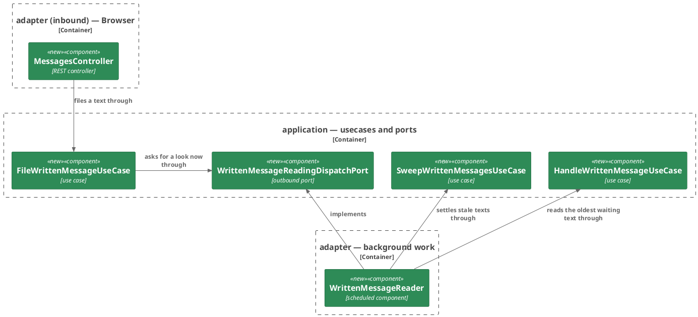
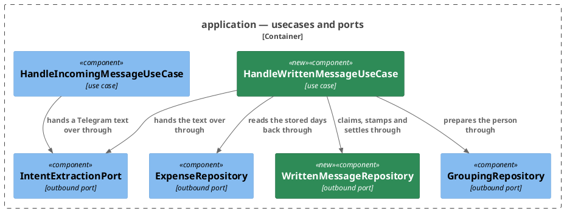

# Plan: File Expenses as Text from the Web — `ledger-service`

**Format:** 2
**Affected Modules:** `ledger-service`
**Spec:** [File Expenses as Text from the Web](../spec.md)

## Architecture Decisions

### Read filed texts in the ledger's own background work



**Placement:** The reader is an `adapter/async` component on a single scheduled thread of its own, apart from
report clearing (DF03, a reader of its own work); what a turn and a sweep decide stays in two `application` use
cases it drives through inbound ports.

### The web turn is a use case of its own beside the Telegram one



**Placement:** The web turn is `HandleWrittenMessageUseCase`, calling the outbound ports the Telegram turn calls;
`HandleIncomingMessageUseCase` is left as it is, since the web turn resolves the person by stored id, sends no
report (DN06, no Telegram report) and counts accepted entries too (DN20, every entry counts).

## Step-by-Step Implementation Map (To-Do List)

### Stabilization

#### Database

- [x] ST01 · Add the migration that creates the stored message of
  [Reading a written message](../reading-a-written-message.md#the-stored-message):
  - writes: `ledger-service/src/main/resources/db/migration/V012__create_written_message.sql`
  ```sql
  CREATE TABLE written_message (
      id         BIGSERIAL     PRIMARY KEY,
      user_id    BIGINT        NOT NULL REFERENCES app_user (id) ON DELETE CASCADE,
      text       VARCHAR(1000) NOT NULL,
      status     VARCHAR(10)   NOT NULL,
      outcome    VARCHAR(20),
      created_at TIMESTAMPTZ   NOT NULL,
      updated_at TIMESTAMPTZ   NOT NULL,
      CONSTRAINT ck_written_message_text CHECK (text ~ '\S'),
      CONSTRAINT ck_written_message_status CHECK (status IN ('WAITING', 'READING', 'DONE')),
      CONSTRAINT ck_written_message_outcome
          CHECK (outcome IN ('RECORDED', 'PARTIAL', 'NOTHING_IDENTIFIED', 'ANSWERED', 'FAILED')),
      CONSTRAINT ck_written_message_outcome_when_done CHECK ((status = 'DONE') = (outcome IS NOT NULL))
  );

  CREATE UNIQUE INDEX ux_written_message_one_unsettled_per_user
      ON written_message (user_id) WHERE status IN ('WAITING', 'READING');

  CREATE INDEX idx_written_message_waiting ON written_message (id) WHERE status = 'WAITING';
  ```

#### Interface-First / Build Stabilization

**Interface & Signature Sync**

- [x] ST02 · Add the domain types. Every stub's intent comment starts with `stub-intent:`.
  - writes: `ledger-service/src/main/java/bot/finance/domain/value/WrittenMessageStatus.java`,
    `ledger-service/src/main/java/bot/finance/domain/model/WrittenMessage.java`,
    `ledger-service/src/main/java/bot/finance/domain/exception/InvalidWrittenMessageException.java`,
    `ledger-service/src/main/java/bot/finance/domain/exception/WrittenMessageInProgressException.java`,
    `ledger-service/src/main/java/bot/finance/domain/exception/WrittenMessageNotFoundException.java`,
    `ledger-service/src/main/java/bot/finance/domain/value/IncomingMessageId.java`
  - `WrittenMessageStatus` — enum `WAITING`, `READING`, `DONE`.
  - `InvalidWrittenMessageException extends InvalidValueException`,
    `WrittenMessageInProgressException extends RuntimeException` and
    `WrittenMessageNotFoundException extends EntityNotFoundException` (entity type `"written message"`), each a
    plain subclass with a message constructor, as `ExpenseEntryNotFoundException` is.
  - `WrittenMessage extends Entity` — `userId`, `text`, `status`, `createdAt`, the factories
    `newMessage(long userId, String text, Instant now)` (status `WAITING`) and
    `stored(long id, long userId, String text, WrittenMessageStatus status, Instant createdAt)`, and accessors.
    The private constructor assigns the fields; its checks are a `stub-intent:` comment: a user id above 0, a
    text present and not blank, a status and a time present, each refused with `InvalidWrittenMessageException`.
    The text's length is the persistence adapter's to check.
  - `IncomingMessageId.ofWrittenMessage(long writtenMessageId)` — stub returning `null`, intent: the id
    `web:<id>` a web turn's entries carry, refusing an id below 1.
- [x] ST03 · Add the application records · after: ST02
  - writes: `ledger-service/src/main/java/bot/finance/application/dto/WrittenMessageView.java`,
    `ledger-service/src/main/java/bot/finance/application/dto/WrittenMessageAnswer.java`,
    `ledger-service/src/main/java/bot/finance/application/dto/FileWrittenMessageCommand.java`,
    `ledger-service/src/main/java/bot/finance/application/dto/ReadWrittenMessageCommand.java`,
    `ledger-service/src/main/java/bot/finance/application/dto/BrowseWrittenMessagesCommand.java`
  - `WrittenMessageView(long id, long userId, String text, WrittenMessageStatus status,
    Optional<ReportOutcome> outcome)` — the stored message as read, with
    `IncomingMessageId incomingMessageId()` returning `IncomingMessageId.ofWrittenMessage(id)`.
  - `WrittenMessageAnswer(WrittenMessageView message, List<LocalDate> days)`.
  - `FileWrittenMessageCommand(AuthenticatedUserId userId, String text)`,
    `ReadWrittenMessageCommand(AuthenticatedUserId userId, long messageId)` and
    `BrowseWrittenMessagesCommand(AuthenticatedUserId userId)`, each compact constructor a `stub-intent:` comment
    saying what it refuses: an absent caller with `InvalidUserException`, as `BrowseExpensesCommand` does; an
    absent text, and a message id below 1, with `InvalidWrittenMessageException`.
- [x] ST04 · Add the ports, each operation carrying the `@throws` javadoc its neighbours carry · after: ST03
  - writes: `ledger-service/src/main/java/bot/finance/application/port/FileWrittenMessagePort.java`,
    `ledger-service/src/main/java/bot/finance/application/port/ReadWrittenMessagePort.java`,
    `ledger-service/src/main/java/bot/finance/application/port/BrowseWrittenMessagesPort.java`,
    `ledger-service/src/main/java/bot/finance/application/port/HandleWrittenMessagePort.java`,
    `ledger-service/src/main/java/bot/finance/application/port/SweepWrittenMessagesPort.java`,
    `ledger-service/src/main/java/bot/finance/application/port/WrittenMessageRepository.java`,
    `ledger-service/src/main/java/bot/finance/application/port/WrittenMessageReadingDispatchPort.java`,
    `ledger-service/src/main/java/bot/finance/application/port/ExpenseRepository.java`
  - inbound: `WrittenMessageView file(FileWrittenMessageCommand)`,
    `WrittenMessageAnswer read(ReadWrittenMessageCommand)`,
    `List<WrittenMessageView> browse(BrowseWrittenMessagesCommand)`, `boolean handleNext()` answering whether a
    waiting text was claimed, and `int sweep()` answering how many texts it settled.
  - `WrittenMessageRepository`: `WrittenMessageView store(WrittenMessage)` throwing
    `WrittenMessageInProgressException` for a second unsettled text and `EntityNotFoundException` for an unknown
    user; `Optional<WrittenMessageView> findForUser(long userId, long messageId)`;
    `List<WrittenMessageView> findUnsettledForUser(long userId)`;
    `Optional<WrittenMessageView> claimOldestWaiting(Instant now)`;
    `boolean stampHandOver(long messageId, Instant now)` and
    `boolean settle(long messageId, ReportOutcome outcome, Instant now)`, each answering whether the message was
    still `READING`; `List<WrittenMessageView> findReadingUpdatedBefore(Instant cutoff)`.
  - `WrittenMessageReadingDispatchPort.dispatch()` — asks the reader to look for work now, never throwing.
  - `ExpenseRepository.findDaysByMessageReference(long userId, IncomingMessageId reference)` answering
    `List<LocalDate>` — the distinct UTC days of the caller's entries under that message, pending or recorded,
    oldest first.
- [x] ST05 · Stub the five use cases, each implementing its port, constructed as the conventions say and returning
  the minimum · after: ST04
  - writes: `ledger-service/src/main/java/bot/finance/application/usecase/FileWrittenMessageUseCase.java`,
    `ledger-service/src/main/java/bot/finance/application/usecase/ReadWrittenMessageUseCase.java`,
    `ledger-service/src/main/java/bot/finance/application/usecase/BrowseWrittenMessagesUseCase.java`,
    `ledger-service/src/main/java/bot/finance/application/usecase/HandleWrittenMessageUseCase.java`,
    `ledger-service/src/main/java/bot/finance/application/usecase/SweepWrittenMessagesUseCase.java`
  - `FileWrittenMessageUseCase(UserRepository, WrittenMessageRepository, WrittenMessageReadingDispatchPort, Clock,
    LoggerFactory)` — intent: resolve the caller by stored id, store a new message, then dispatch.
  - `ReadWrittenMessageUseCase(UserRepository, WrittenMessageRepository, ExpenseRepository)` — intent: resolve
    the caller, find their message or refuse, and read its days back only once it is `DONE`.
  - `BrowseWrittenMessagesUseCase(UserRepository, WrittenMessageRepository)` — intent: the caller's unsettled
    texts.
  - `HandleWrittenMessageUseCase(WrittenMessageRepository, GroupingRepository, UserPreferenceRepository,
    IntentExtractionPort, ExpenseRepository, SpendingQueryRepository, TurnMeters, Clock, LoggerFactory)` —
    intent: claim, prepare, stamp the hand-over, extract, read back, settle, as
    [Reading a written message](../reading-a-written-message.md#reading) draws it, logging a line at the claim
    and at the settle naming `web:<id>` and the person.
  - `SweepWrittenMessagesUseCase(WrittenMessageRepository, ExpenseRepository, Clock, Duration longestTurnLife,
    LoggerFactory)` — intent: settle every `READING` text older than the turn's longest life by what is stored,
    logging a warning per text it settles, naming `web:<id>`, the person and the outcome.
- [x] ST06 · Add the persistence side · after: ST04
  - writes: `ledger-service/src/main/java/bot/finance/adapter/persistence/WrittenMessageEntity.java`,
    `ledger-service/src/main/java/bot/finance/adapter/persistence/WrittenMessageEntityRepository.java`,
    `ledger-service/src/main/java/bot/finance/adapter/persistence/WrittenMessageRepositoryAdapter.java`,
    `ledger-service/src/main/java/bot/finance/adapter/persistence/UniqueViolations.java`,
    `ledger-service/src/main/java/bot/finance/adapter/persistence/ExpenseRepositoryAdapter.java`,
    `ledger-service/src/main/java/bot/finance/adapter/persistence/ExpenseEntityRepository.java`,
    `ledger-service/src/main/java/bot/finance/adapter/persistence/ColumnLimits.java`,
    `ledger-service/src/test/java/bot/finance/adapter/persistence/ColumnLimitsSchemaTest.java`
  - `WrittenMessageEntity` — `@Table("written_message")` record over the seven columns, with `toView()` and
    `fromDomain(WrittenMessage)` **implemented**: field-for-field copies, both times taken from the message's
    `createdAt`, never `Instant.now()`. `RI01` asserts every field they map.
  - `ColumnLimits` — a `WRITTEN_TEXT` of 1000, and `validateWrittenText(String text)` stubbed, intent: refuse a
    text longer than that, counted in UTF-16 code units, with `InvalidWrittenMessageException`. A nested case in
    `ColumnLimitsSchemaTest` reads `written_message.text`'s migrated width and asserts it equals `WRITTEN_TEXT`,
    as the other columns' cases do.
  - `WrittenMessageEntityRepository` — Spring Data JDBC, with derived `findByIdAndUserId` and these `@Query`
    methods:
    ```sql
    -- claimOldestWaiting, answering Optional<WrittenMessageEntity>
    UPDATE written_message
    SET status = 'READING', updated_at = :now
    WHERE id = (
        SELECT id FROM written_message
        WHERE status = 'WAITING'
        ORDER BY id
        LIMIT 1
        FOR UPDATE SKIP LOCKED
    )
    RETURNING *

    -- stampHandOver, @Modifying, answering the row count
    UPDATE written_message SET updated_at = :now WHERE id = :id AND status = 'READING'

    -- settle, @Modifying, answering the row count
    UPDATE written_message
    SET status = 'DONE', outcome = :outcome, updated_at = :now
    WHERE id = :id AND status = 'READING'

    -- findUnsettledForUser
    SELECT * FROM written_message
    WHERE user_id = :userId AND status IN ('WAITING', 'READING')
    ORDER BY id

    -- findReadingUpdatedBefore
    SELECT * FROM written_message
    WHERE status = 'READING' AND updated_at < :cutoff
    ORDER BY id
    ```
  - `WrittenMessageRepositoryAdapter` — `@Component` implementing `WrittenMessageRepository`, every method a
    stub whose intent comment names the statement it runs and, for `store`, the text's width checked through
    `ColumnLimits` before the write, then the classification: the `ux_written_message_one_unsettled_per_user`
    violation as `WrittenMessageInProgressException`, the `written_message_user_id_fkey` violation as
    `EntityNotFoundException`, anything else as `PersistenceFailedException`. Every `now` is truncated to
    microseconds before it is bound, as `acceptByIds` is.
  - `UniqueViolations` — a package-private final class shaped as `ForeignKeyViolations` is, its
    `static String constraintName(Throwable e)` a stub returning `null` with intent: the constraint a unique
    violation (SQLState `23505`) names in its message.
  - `ExpenseEntityRepository.findCreatedAtByMessageReference(Long userId, String incomingMessageId)` answering
    `List<Instant>`:
    ```sql
    SELECT created_at FROM expense
    WHERE user_id = :userId AND incoming_message_id = :incomingMessageId
    ORDER BY created_at
    ```
    and `ExpenseRepositoryAdapter.findDaysByMessageReference` stubbed, intent: those instants as distinct UTC
    days, converted in Java, oldest first.
- [x] ST07 · Add the web side · after: ST05
  - writes: `ledger-service/src/main/java/bot/finance/adapter/web/MessagesController.java`,
    `ledger-service/src/main/java/bot/finance/adapter/web/WrittenMessageWebMapper.java`,
    `ledger-service/src/main/java/bot/finance/adapter/web/WebExceptionHandler.java`
  - `MessagesController` — `@RestController` implementing the generated `MessagesApi`, taking
    `FileWrittenMessagePort`, `ReadWrittenMessagePort` and `BrowseWrittenMessagesPort`; each overridden operation
    a stub returning `null`, intent: build the command with `AuthenticatedCaller.authenticatedUserId()`, call the
    port, answer through the mapper — `202` for filing, `200` otherwise.
  - `WrittenMessageWebMapper` — a static mapper carrying `toFileWrittenMessageCommand(request,
    AuthenticatedUserId)` and `toReadWrittenMessageCommand(Long id, AuthenticatedUserId)` implemented, each one
    command constructor over the request's fields; and, stubbed, `toBrowseWrittenMessagesCommand(state,
    AuthenticatedUserId)`, `toResponse(WrittenMessageView)`,
    `toResponse(WrittenMessageAnswer)` and `toResponses(List<WrittenMessageView>)`, over whatever request,
    response and parameter types the generator emitted; `toBrowseWrittenMessagesCommand`'s intent refuses any
    state but `READING`.
  - `WebExceptionHandler` — four handlers: `WrittenMessageInProgressException` answering 429,
    `WrittenMessageNotFoundException` answering 404 and `InvalidWrittenMessageException` answering 400, each with
    the exception's own message, as `onExpenseEntryNotFound` and `onInvalidExpenseAcceptance` answer; and
    `MissingServletRequestParameterException` answering 400 naming the parameter, as `onTypeMismatch` names its
    own. Every `InvalidWrittenMessageException` message the domain, the commands and `ColumnLimits` compose names
    `text`, `id` or `state`.
- [x] ST08 · Add the reader · after: ST04
  - writes: `ledger-service/src/main/java/bot/finance/adapter/async/WrittenMessageReader.java`,
    `ledger-service/src/main/java/bot/finance/adapter/async/WrittenMessageReaderConfiguration.java`,
    `ledger-service/src/main/java/bot/finance/adapter/async/WrittenMessageReaderProperties.java`,
    `ledger-service/src/main/java/bot/finance/adapter/cdc/ReplicationSlotMonitor.java`
  - `WrittenMessageReaderProperties` — `@ConfigurationProperties("written-message.reader")` record of
    `Duration pollInterval` and `Duration sweepMargin`.
  - `WrittenMessageReaderConfiguration` — `@EnableConfigurationProperties(WrittenMessageReaderProperties.class)`
    and a `@Bean(destroyMethod = "shutdown") ScheduledExecutorService writtenMessageReaderExecutor()`, one
    thread named `written-message-reader-`, as `ChangeStreamConfiguration.slotMonitorExecutor()` is.
  - `WrittenMessageReader` — `@Component` implementing `SmartLifecycle` and
    `WrittenMessageReadingDispatchPort`, constructed from `ScheduledExecutorService writtenMessageReaderExecutor`,
    `HandleWrittenMessagePort`, `SweepWrittenMessagesPort`, `WrittenMessageReaderProperties` and
    `LoggerFactory`; `start`, `stop`, `isRunning` and `dispatch` stubbed, intent: one pass every poll interval
    from start, and one more on dispatch, each pass sweeping and then reading until nothing waits, every failure
    logged and swallowed.
  - `ReplicationSlotMonitor` — rename the constructor parameter `scheduledExecutorService` to
    `slotMonitorExecutor`; the field and its use stay as they are.
**Configuration**

- [x] ST09 · Add the settings the sweep's timing reads, and give the validator's leeway a setting of its own
  - writes: `ledger-service/src/main/java/bot/finance/adapter/security/AccessTokenProperties.java`,
    `ledger-service/src/main/java/bot/finance/adapter/security/SecurityConfiguration.java`,
    `ledger-service/src/test/java/bot/finance/common/fixtures/McpTokens.java`,
    `ledger-service/src/main/resources/application.yaml`, `ledger-service/src/test/resources/application-test.yaml`,
    `ledger-service/docs/configuration.md`
  - `AccessTokenProperties` gains `Duration clockSkew`; `mcp.token.clock-skew: ${MCP_JWT_CLOCK_SKEW:60s}`. The MCP decoder's timestamp validator is built with
    `properties.clockSkew()`; the session decoder's is left as it is. `McpTokens.properties()` passes
    `Duration.ofSeconds(60)`.
  - `written-message.reader.poll-interval: ${WRITTEN_MESSAGE_READER_POLL_INTERVAL:10s}` and
    `written-message.reader.sweep-margin: ${WRITTEN_MESSAGE_SWEEP_MARGIN:30s}`; `application-test.yaml` sets the
    poll interval to `1s`.
  - A row per new variable in `ledger-service/docs/configuration.md`, in that table's shape.
- [x] ST10 · Declare the five beans in `UseCaseConfiguration`, each with `Clock.systemUTC()` where it takes a
  clock, as every bean there does. `SweepWrittenMessagesPort`'s `longestTurnLife` is
  `AccessTokenProperties.ttl()` plus `AccessTokenProperties.clockSkew()` plus
  `WrittenMessageReaderProperties.sweepMargin()`, each read from the bean that holds it · after: ST05, ST08, ST09
  - writes: `ledger-service/src/main/java/bot/finance/adapter/config/UseCaseConfiguration.java`
- [x] ST11 · Add `POST /api/v1/messages`, `GET /api/v1/messages` and `GET /api/v1/messages/*` to
  `SecurityConfiguration`'s web-session chain as `.authenticated()`, beside the matchers there and ahead of
  `anyRequest().denyAll()` · after: ST09
  - writes: `ledger-service/src/main/java/bot/finance/adapter/security/SecurityConfiguration.java`

**Shared Test Infrastructure**

- [x] ST12 · Add `bot.finance.common.rows.WrittenMessageRowUtils` — stores a `written_message` row for a user
  under a given status, outcome and `updated_at`, answering its id, and reads one row back by id — and list it in
  [Testing Conventions](../../../ledger-service/docs/conventions/testing.md#package-structure) beside the other
  `rows` helpers. `RI01`, `RI02`, `RI03` and every system step seed through it · after: ST06
  - writes: `ledger-service/src/test/java/bot/finance/common/rows/WrittenMessageRowUtils.java`,
    `ledger-service/docs/conventions/testing.md`

#### Closing item

- [x] ST13 · Confirm `bot.finance.architecture.CleanArchitectureTest` passes and the pre-existing suite is green:
  `tools/agent-test/agent-test.sh --module ledger-service`. This group disables no test.
  - writes: none

### Red Phase

#### TDD Unit Red Phase

- [x] RU01 · `IncomingMessageId` · test: `IncomingMessageIdTest` · covers: `ofWrittenMessage()` · scenarios: AC13
  - `ofWrittenMessage()`:
    - given: a written message id of 42
      when: ofWrittenMessage() is called
      then: the id's value is `web:42`
    - given: an id of 0, and one below 0
      when: ofWrittenMessage() is called for each
      then: `InvalidIncomingMessageException` is thrown
- [x] RU02 · `WrittenMessage` · test: `WrittenMessageTest` · covers: `newMessage()`, `stored()` · scenarios: AC02
  - `newMessage()`:
    - given: a user id, `coffee 3.40, taxi home 14` and an instant
      when: newMessage() is called
      then: the message is `WAITING`, carries no id, and carries that user, text and instant
    - given: an absent text, an empty one, and one of only spaces, tabs and line breaks
      when: newMessage() is called for each
      then: `InvalidWrittenMessageException` is thrown
    - given: a user id of 0, and an absent instant
      when: newMessage() is called for each
      then: `InvalidWrittenMessageException` is thrown
  - `stored()`:
    - given: an id, a user, a text, `READING` and an instant
      when: stored() is called
      then: the message carries that id and status
    - given: an absent status
      when: stored() is called
      then: `InvalidWrittenMessageException` is thrown
- [x] RU03 · `FileWrittenMessageCommand` · test: `FileWrittenMessageCommandTest` · covers: `FileWrittenMessageCommand()` · scenarios: AC01
  - the compact constructor:
    - given: a caller and a text
      when: the command is constructed
      then: it carries both unchanged
    - given: an absent caller
      when: the command is constructed
      then: `InvalidUserException` is thrown
    - given: an absent text
      when: the command is constructed
      then: `InvalidWrittenMessageException` is thrown
- [x] RU04 · `ReadWrittenMessageCommand` · test: `ReadWrittenMessageCommandTest` · covers: `ReadWrittenMessageCommand()` · scenarios: AC11
  - the compact constructor:
    - given: a caller and a message id of 1
      when: the command is constructed
      then: it carries both unchanged
    - given: an absent caller
      when: the command is constructed
      then: `InvalidUserException` is thrown
    - given: a message id of 0, and one below 0
      when: the command is constructed for each
      then: `InvalidWrittenMessageException` is thrown
- [x] RU05 · `BrowseWrittenMessagesCommand` · test: `BrowseWrittenMessagesCommandTest` · covers: `BrowseWrittenMessagesCommand()` · scenarios: AC12
  - the compact constructor:
    - given: a caller
      when: the command is constructed
      then: it carries the caller
    - given: an absent caller
      when: the command is constructed
      then: `InvalidUserException` is thrown
- [x] RU06 · `UniqueViolations` · test: `UniqueViolationsTest` · covers: `constraintName()` · scenarios: AC07
  - `constraintName()`:
    - given: an exception whose cause chain holds an `SQLException` with SQLState `23505` and the message
      `duplicate key value violates unique constraint "ux_written_message_one_unsettled_per_user"`
      when: constraintName() is called
      then: it answers `ux_written_message_one_unsettled_per_user`
    - given: a chain whose `SQLException` carries SQLState `23503`
      when: constraintName() is called
      then: it answers `null`
    - given: a chain holding no `SQLException`, and one whose `23505` exception carries no message
      when: constraintName() is called for each
      then: it answers `null`
- [x] RU07 · `FileWrittenMessageUseCase` · test: `FileWrittenMessageUseCaseTest` · covers: `file()` · scenarios: AC01, AC02, AC05, AC06, AC07
  - `file()`:
    - given: a stored user for the caller, a repository answering the stored message, and a fixed clock
      when: file() is called with `coffee 3.40, taxi home 14`
      then: the repository stores a `WAITING` message carrying the stored user id, that text and the clock's
      instant, the answer is the stored message, and the reader is dispatched once, after the store
    - given: no user row for the caller
      when: file() is called
      then: `EntityNotFoundException` is thrown, nothing is stored and nothing is dispatched
    - given: a text of only spaces
      when: file() is called
      then: `InvalidWrittenMessageException` is thrown, nothing is stored and nothing is dispatched
    - given: a repository throwing `WrittenMessageInProgressException`, and one throwing
      `PersistenceFailedException`
      when: file() is called for each
      then: that exception reaches the caller and nothing is dispatched
    - given: an absent command
      when: file() is called
      then: `InvalidWrittenMessageException` is thrown
- [x] RU08 · `ReadWrittenMessageUseCase` · test: `ReadWrittenMessageUseCaseTest` · covers: `read()` · scenarios: AC08, AC09, AC10, AC11
  - `read()`:
    - given: the caller's message 42, `DONE` with `RECORDED`, and the expense repository answering one day
      when: read() is called
      then: the answer carries that message and that day, and the days were read for the caller's stored id and
      `web:42`
    - given: the caller's message, `DONE` with `NOTHING_IDENTIFIED`, and no day stored
      when: read() is called
      then: the answer carries the message and no days
    - given: the caller's message still `WAITING`, and one `READING`
      when: read() is called for each
      then: the answer carries no days, and the expense repository is never asked
    - given: a repository finding nothing for the caller's stored id and that message id
      when: read() is called
      then: `WrittenMessageNotFoundException` is thrown
    - given: no user row for the caller
      when: read() is called
      then: `EntityNotFoundException` is thrown and no message is looked for
- [x] RU09 · `BrowseWrittenMessagesUseCase` · test: `BrowseWrittenMessagesUseCaseTest` · covers: `browse()` · scenarios: AC12
  - `browse()`:
    - given: a stored user and a repository answering one `READING` message for that user's stored id
      when: browse() is called
      then: the answer is that one message
    - given: a repository answering none for the caller's stored id
      when: browse() is called
      then: the answer is empty, and the repository was asked for that stored id
    - given: no user row for the caller
      when: browse() is called
      then: `EntityNotFoundException` is thrown and the repository is never asked for messages
- [x] RU10 · `HandleWrittenMessageUseCase` · test: `HandleWrittenMessageUseCaseTest` · covers: `handleNext()` · scenarios: AC13, AC14, AC15, AC16, AC17, AC18, AC35
  - `handleNext()`:
    - given: a claim answering nothing
      when: handleNext() is called
      then: it answers `false`, the claim was asked with the clock's instant, and nothing else is asked of any
      port
    - given: a claimed message 42 of user 7, groupings holding the catch-all, a stamp answering `true`, an
      extraction that returns, one day under `web:42` and no period
      when: handleNext() is called
      then: it answers `true`; the extraction request carries the text, the groupings, the catch-all, user 7,
      `web:42` and the clock's date; the message is settled `RECORDED`; the turn meter counts `RECORDED`
    - given: the same, with no day and no period under `web:42`
      when: handleNext() is called
      then: the message is settled `NOTHING_IDENTIFIED`
    - given: the same, with no day and one period under `web:42`
      when: handleNext() is called
      then: the message is settled `ANSWERED`, and the periods under `web:42` are discarded for user 7
    - given: the same, with discarding the periods throwing `PersistenceFailedException`
      when: handleNext() is called
      then: the message is still settled `ANSWERED`
    - given: an extraction throwing `IntentExtractionFailedException`, and no day under `web:42`
      when: handleNext() is called
      then: the message is settled `FAILED`
    - given: an extraction throwing `IntentExtractionFailedException`, and one day under `web:42`
      when: handleNext() is called
      then: the message is settled `PARTIAL`
    - given: an extraction throwing `IntentExtractionFailedException`, no day under `web:42`, and one period
      under it
      when: handleNext() is called
      then: the message is settled `FAILED`
    - given: a groupings read throwing `PersistenceFailedException`, and groupings lacking the catch-all
      when: handleNext() is called for each
      then: the message is settled `FAILED`, the turn meter counts `FAILED`, and neither the stamp nor the
      extraction is ever called
    - given: a default currency read throwing `PersistenceFailedException`
      when: handleNext() is called
      then: the extraction is still called, carrying no default currency
    - given: a stamp answering `false`
      when: handleNext() is called
      then: it answers `true`, and the extraction and the settle are never called
    - given: a stamp throwing `PersistenceFailedException`
      when: handleNext() is called
      then: the extraction is never called, and the message is settled `FAILED`
    - given: a settle throwing `PersistenceFailedException` after the extraction returned
      when: handleNext() is called
      then: that exception reaches the caller
    - given: a settle answering `false`
      when: handleNext() is called
      then: nothing is thrown, and the turn meter counts nothing
    - given: the days read throwing `PersistenceFailedException` after the extraction returned
      when: handleNext() is called
      then: that exception reaches the caller, and the message is never settled
- [x] RU11 · `SweepWrittenMessagesUseCase` · test: `SweepWrittenMessagesUseCaseTest` · covers: `sweep()` · scenarios: AC20, AC21, AC34, AC35
  - `sweep()`:
    - given: a fixed clock, a longest turn life of 3 minutes 30 seconds, and no stale message
      when: sweep() is called
      then: it answers 0, the stale messages were asked for with the clock's instant less 3 minutes 30 seconds,
      and nothing is settled
    - given: one stale message 42 of user 7 with one day under `web:42`
      when: sweep() is called
      then: message 42 is settled `PARTIAL`, and it answers 1
    - given: one stale message with nothing under it
      when: sweep() is called
      then: it is settled `FAILED`
    - given: two stale messages, one with a day under it and one with none
      when: sweep() is called
      then: each is settled by what is under its own id, `PARTIAL` and `FAILED`, and it answers 2
    - given: a stale message whose settle answers `false`
      when: sweep() is called
      then: it answers 0
    - given: the stale messages read throwing `PersistenceFailedException`, and in another case a settle throwing
      it
      when: sweep() is called for each
      then: that exception reaches the caller
- [x] RU12 · `WrittenMessageWebMapper` · test: `WrittenMessageWebMapperTest` · covers: `toResponse()`, `toResponses()`, `toBrowseWrittenMessagesCommand()` · scenarios: AC01, AC08, AC09, AC10, AC12
  - `toResponse()`:
    - given: a `WAITING` message, and a `READING` one
      when: each is mapped
      then: the state is `READING`, with its id and text, the outcome `null` and the days empty
    - given: an answer for a `DONE` message settled `RECORDED`, with two days
      when: it is mapped
      then: the state is `DONE`, the outcome `RECORDED`, and the days are those two, oldest first
    - given: an answer for a `DONE` message settled `NOTHING_IDENTIFIED`, with no days
      when: it is mapped
      then: the outcome is `NOTHING_IDENTIFIED` and the days are present and empty
  - `toResponses()`:
    - given: one `READING` message
      when: it is mapped
      then: the list holds that one, as `READING`
    - given: no message
      when: it is mapped
      then: the list is empty
  - `toBrowseWrittenMessagesCommand()`:
    - given: the state `READING` as the generated parameter carries it
      when: it is mapped
      then: the command carries the caller
    - given: an absent state, and any other value the generated parameter can carry
      when: each is mapped
      then: `InvalidWrittenMessageException` is thrown
    - (added) given: the state `reading`, an empty state, and a blank one
      when: each is mapped
      then: `InvalidWrittenMessageException` is thrown
- [x] RU13 · `WrittenMessageReader` · test: `WrittenMessageReaderTest` · covers: `start()`, `stop()`, `dispatch()` · scenarios: AC01, AC22, AC36
  - `start()`:
    - given: a mocked scheduled executor and a poll interval of 10 seconds
      when: start() is called
      then: one pass is scheduled with a fixed delay of 10 seconds and no initial delay, and the reader is
      running
    - given: the pass start() scheduled, a sweep, and a handle port answering `true`, `true`, then `false`
      when: the pass runs
      then: the sweep runs once, then handleNext() three times
    - given: a sweep throwing `PersistenceFailedException`
      when: the pass runs
      then: nothing propagates, and handleNext() still runs
    - given: a handleNext() throwing `PersistenceFailedException` on the first pass and answering `false` after
      when: the pass runs twice
      then: neither run propagates anything, and the second run calls handleNext() again
  - `stop()`:
    - given: a started reader
      when: stop() is called
      then: the scheduled pass is cancelled, and the reader is not running
  - `dispatch()`:
    - given: an executor running what it is handed at once
      when: dispatch() is called
      then: one pass ran, sweeping and then handling
    - given: an executor refusing the work
      when: dispatch() is called
      then: the executor was handed one pass, nothing propagates, and neither port is called

#### TDD Integration Red Phase

- [x] RI01 · `WrittenMessageRepositoryAdapter` · test: `WrittenMessageRepositoryAdapterTest` · covers: `store()`, `findForUser()`, `findUnsettledForUser()`, `claimOldestWaiting()`, `stampHandOver()`, `settle()`, `findReadingUpdatedBefore()` · scenarios: AC01, AC02, AC06, AC07, AC11, AC12, AC20, AC21, AC34, AC35
  - `store()`:
    - given: a stored user with no message
      when: store() is called with a new message
      then: the answer carries a generated id and `WAITING`, and the row holds the text, `created_at` and
      `updated_at` equal to the message's instant, and no outcome
    - given: the user has a message `WAITING`, and in another case one `READING`
      when: store() is called with a new one for each
      then: `WrittenMessageInProgressException` is thrown, and the user still holds one row
    - given: the user's earlier message is `DONE`, and another person has one `READING`
      when: store() is called with a new one
      then: it is stored
    - given: a user id naming no stored user
      when: store() is called
      then: `EntityNotFoundException` is thrown
    - given: a text of 998 letters followed by one character outside the Basic Multilingual Plane, 1000 UTF-16
      code units in all, and one of 999 letters and that character, 1001 code units
      when: store() is called with each
      then: the first is stored, and the second throws `InvalidWrittenMessageException` with nothing stored
  - `findForUser()`:
    - given: the caller's message, `DONE` with `PARTIAL`
      when: findForUser() is called with its id
      then: the answer carries its text, `DONE` and `PARTIAL`
    - given: another person's message, and an id naming nothing
      when: findForUser() is called with each
      then: the answer is empty
  - `findUnsettledForUser()`:
    - given: the caller holds one `DONE` message and one `WAITING`, and another person one `READING`
      when: findUnsettledForUser() is called for the caller
      then: the answer is the caller's `WAITING` message alone
  - `claimOldestWaiting()`:
    - given: two `WAITING` messages of two users, and one `READING`
      when: claimOldestWaiting() is called with an instant
      then: the older `WAITING` message is answered as `READING`, its `updated_at` is that instant, and the
      other stays `WAITING`
    - given: no `WAITING` message
      when: claimOldestWaiting() is called
      then: the answer is empty
  - `stampHandOver()`:
    - given: a `READING` message
      when: stampHandOver() is called with an instant
      then: it answers `true`, and `updated_at` is that instant
    - given: a `DONE` message
      when: stampHandOver() is called
      then: it answers `false`, and the row is unchanged
  - `settle()`:
    - given: a `READING` message
      when: settle() is called with `RECORDED` and an instant
      then: it answers `true`, and the row is `DONE` with `RECORDED` and that `updated_at`
    - given: a message already `DONE` with `FAILED`, and one still `WAITING`
      when: settle() is called with `RECORDED` for each
      then: it answers `false`, and each row is unchanged
  - `findReadingUpdatedBefore()`:
    - given: a `READING` message updated before the cutoff, a `READING` one updated after it, and a `WAITING` and
      a `DONE` one updated before it
      when: findReadingUpdatedBefore() is called with the cutoff
      then: the answer is the first message alone
  - failures, in a `WithAMockedStore` class:
    - given: an entity repository throwing `QueryTimeoutException`
      when: store(), findForUser(), claimOldestWaiting() and settle() are called
      then: each throws `PersistenceFailedException` carrying it as the cause
    - given: an entity repository throwing `DataIntegrityViolationException` naming a constraint other than the
      two `store()` classifies
      when: store() is called
      then: `PersistenceFailedException` is thrown carrying it as the cause
- [x] RI02 · `WrittenMessageRepositoryAdapter` · test: `WrittenMessageRepositoryAdapterConcurrencyTest` · covers: `claimOldestWaiting()`, `store()` · scenarios: AC07, AC19
  - `claimOldestWaiting()`:
    - given: one committed `WAITING` message
      when: two threads call claimOldestWaiting() at the same moment
      then: exactly one answers the message, the other answers empty, and the row is `READING`
  - `store()`:
    - given: a user with no unsettled message
      when: two threads store a message for that user at the same moment
      then: exactly one is stored, the other throws `WrittenMessageInProgressException`, and the user holds one
      row
- [x] RI03 · `ExpenseRepositoryAdapter` · test: `ExpenseRepositoryAdapterTest` · covers: `findDaysByMessageReference()` · scenarios: AC09, AC10, AC33
  - `findDaysByMessageReference()`:
    - given: under `web:42`, a pending entry stored on one UTC day and a recorded one on the day before
      when: findDaysByMessageReference() is called for `web:42`
      then: it answers both days, the earlier first
    - given: two entries under `web:42` on one UTC day
      when: it is called
      then: it answers that day once
    - given: one entry at 23:59 UTC and one at 00:01 UTC the next day
      when: it is called
      then: it answers two days
    - given: another person's entry under `web:42`, and the caller's entry under another message
      when: it is called for the caller and `web:42`
      then: it answers no day
    - given: an entity repository throwing `QueryTimeoutException`, in the `WithAMockedStore` class
      when: it is called
      then: `PersistenceFailedException` is thrown carrying it as the cause
- [x] RI04 · `MessagesController` · test: `MessagesControllerTest` · covers: `POST /api/v1/messages`, `GET /api/v1/messages/{id}`, `GET /api/v1/messages` · mocks: `FileWrittenMessagePort`, `ReadWrittenMessagePort`, `BrowseWrittenMessagesPort` · scenarios: AC01, AC02, AC03, AC04, AC07, AC08, AC09, AC11, AC12
  - Happy Path:
    - given: the file port answering message 42 `WAITING`
      when: `coffee 3.40, taxi home 14` is posted with a session and a CSRF token
      then: 202 with id 42, `READING` and the text, and the port received the session's user and the text
    - given: the read port answering message 42 `DONE` with `RECORDED` and one day
      when: `/api/v1/messages/42` is asked for
      then: 200 with `DONE`, `RECORDED`, the text and that day, and the port received the session's user and 42
    - given: the read port answering message 42 `READING` with no days
      when: `/api/v1/messages/42` is asked for
      then: 200 with `READING` and the text, `outcome` `null` and `days` empty
    - given: the browse port answering one `READING` message
      when: `/api/v1/messages?state=READING` is asked for
      then: 200 with a list of that one, and the port received the session's user
  - Error Mapping:
    - given: the file port throwing `WrittenMessageInProgressException`
      when: a text is posted
      then: 429 with a `message`
    - given: the file port throwing `InvalidWrittenMessageException` with a message naming `text`
      when: a text of only ideographic spaces is posted
      then: 400 with that message
    - given: the read port throwing `WrittenMessageNotFoundException`
      when: a message is asked for by id
      then: 404 with the exception's message, not the one saying the caller is unknown
    - given: no session cookie
      when: a text is posted, a message is asked for by id, and the list is asked for
      then: each answers 401, and no port is called
    - given: a session and no CSRF header
      when: a text is posted
      then: 403, and the file port is never called
  - Validation: `text` — absent, empty, only spaces and line breaks, 999 letters and one character outside the
    Basic Multilingual Plane (1001 UTF-16 code units), and a body that is not JSON, each 400 naming `text` where
    a field is named and the port never called; 998 letters and that character (1000 code units) accepted.
    `id` — 0, -1 and `abc`, each 400. `state` — absent, `DONE` and `reading`, each 400.

#### TDD System Test Red Phase

- [x] RS01 · `FileWrittenMessageSystemTest` · covers: `POST /api/v1/messages` · scenarios: AC01, AC07, AC09, AC13
  - Happy Path:
    - given: a person signed in, and the stub connector armed to make two create-expense-proposal tool calls
      back into `/mcp`, one per expense
      when: they file `coffee 3.40, taxi home 14`
      then: 202 with `READING`; asking for it by id comes to `DONE` with `RECORDED` and today's UTC day; two
      pending entries are stored under `web:<id>` for that person; and no proposal report is stored for them
  - Unhappy Path:
    - given: a person signed in, with a `READING` message seeded for them
      when: they file a text
      then: 429, and they still hold one message row
- [x] RS02 · `ReadWrittenMessageSystemTest` · covers: `GET /api/v1/messages/{id}` · scenarios: AC09, AC11
  - Happy Path:
    - given: a person signed in, a `DONE` message settled `RECORDED` seeded for them, and a pending entry under
      `web:<id>` stored on a known UTC day
      when: they ask for that message by id
      then: 200 with `DONE`, `RECORDED`, its text and that day
  - Unhappy Path:
    - given: a person signed in, and a message seeded for another person
      when: they ask for it by id
      then: 404
- [x] RS03 · `BrowseWrittenMessagesSystemTest` · covers: `GET /api/v1/messages` · scenarios: AC12
  - Happy Path:
    - given: a person signed in with a `READING` message, and another person with one too
      when: the person asks for their texts being read
      then: 200 with a list of their one message
  - Unhappy Path:
    - given: a person signed in, whose user row is then deleted
      when: they ask for their texts being read
      then: 404
- [x] RS04 · `WrittenMessageReadingSystemTest` · covers: `WrittenMessageReader.start()` · scenarios: AC13, AC16, AC22
  - Happy Path:
    - given: a `WAITING` message `coffee 3.40, taxi home 14` seeded directly for a stored person, as one stored
      before a restart, and the stub connector armed to make two create-expense-proposal tool calls
      when: the reader's schedule comes round
      then: the message comes to `DONE` with `RECORDED`, two pending entries are stored under `web:<id>`, and no
      proposal report is stored for that person
  - Unhappy Path:
    - given: a `WAITING` message seeded directly, and the stub connector failing every extraction as unavailable
      when: the reader's schedule comes round
      then: the message comes to `DONE` with `FAILED`, and no entry is stored under `web:<id>`

### Green Phase

#### TDD Unit Green Phase

- [ ] GU01 · `IncomingMessageId` · test: `IncomingMessageIdTest`
- [ ] GU02 · `WrittenMessage` · test: `WrittenMessageTest`
- [ ] GU03 · `FileWrittenMessageCommand` · test: `FileWrittenMessageCommandTest`
- [ ] GU04 · `ReadWrittenMessageCommand` · test: `ReadWrittenMessageCommandTest`
- [ ] GU05 · `BrowseWrittenMessagesCommand` · test: `BrowseWrittenMessagesCommandTest`
- [ ] GU06 · `UniqueViolations` · test: `UniqueViolationsTest`
- [ ] GU07 · `FileWrittenMessageUseCase` · test: `FileWrittenMessageUseCaseTest` · after: GU02, GU03
- [ ] GU08 · `ReadWrittenMessageUseCase` · test: `ReadWrittenMessageUseCaseTest` · after: GU01, GU04
- [ ] GU09 · `BrowseWrittenMessagesUseCase` · test: `BrowseWrittenMessagesUseCaseTest` · after: GU05
- [ ] GU10 · `HandleWrittenMessageUseCase` · test: `HandleWrittenMessageUseCaseTest` · after: GU01
- [ ] GU11 · `SweepWrittenMessagesUseCase` · test: `SweepWrittenMessagesUseCaseTest` · after: GU01
- [ ] GU12 · `WrittenMessageWebMapper` · test: `WrittenMessageWebMapperTest` · after: GU03, GU04, GU05
- [ ] GU13 · `WrittenMessageReader` · test: `WrittenMessageReaderTest`

#### TDD Integration Green Phase

- [ ] GI01 · `WrittenMessageRepositoryAdapter` · test: `WrittenMessageRepositoryAdapterTest` · after: GU02, GU06
- [ ] GI02 · `WrittenMessageRepositoryAdapter` · test: `WrittenMessageRepositoryAdapterConcurrencyTest` · after: GU02, GU06
- [ ] GI03 · `ExpenseRepositoryAdapter` · test: `ExpenseRepositoryAdapterTest` · after: GU01
- [ ] GI04 · `MessagesController` · test: `MessagesControllerTest` · covers: `POST /api/v1/messages`, `GET /api/v1/messages/{id}`, `GET /api/v1/messages` · mocks: `FileWrittenMessagePort`, `ReadWrittenMessagePort`, `BrowseWrittenMessagesPort` · after: GU12

#### TDD System Test Green Phase

- [ ] GS01 · `FileWrittenMessageSystemTest` · covers: `POST /api/v1/messages`
- [ ] GS02 · `ReadWrittenMessageSystemTest` · covers: `GET /api/v1/messages/{id}`
- [ ] GS03 · `BrowseWrittenMessagesSystemTest` · covers: `GET /api/v1/messages`
- [ ] GS04 · `WrittenMessageReadingSystemTest` · covers: `WrittenMessageReader.start()`

### Post-Implementation Steps

#### Manual Request Files

- [ ] PI01 · Add one request file per new operation under `ledger-service/docs/requests/messages/`, named after
  the operation as the other tags' files are, each shaped as `preferences/replace-preferences.http` is
  - writes: `ledger-service/docs/requests/messages/file-written-message.http`,
    `ledger-service/docs/requests/messages/read-written-message.http`,
    `ledger-service/docs/requests/messages/list-written-messages.http`

## Open Questions

None.
