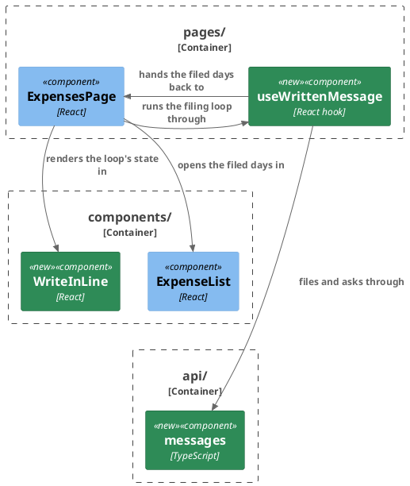

# Plan: File Expenses as Text from the Web — `web-app`

**Format:** 2
**Affected Modules:** `web-app`
**Spec:** [File Expenses as Text from the Web](../spec.md)

## Architecture Decisions

### The filing loop is a page hook, the line a presentational component

**Placement:** The loop of [the write-in line](../the-write-in-line.md#the-loop) is a hook in `pages/`, since it
calls `api/` and reads the session; the line is a presentational component in `components/`; reading the filed
days back stays in `ExpensesPage`, the one holder of the listing and its filter.

## Step-by-Step Implementation Map (To-Do List)

### Stabilization

#### Interface-First / Build Stabilization

**Interface & Signature Sync**

- [x] ST01 · Add a `writeIn` namespace to `src/i18n/en.ts` holding the wording of
  [the write-in line](../the-write-in-line.md#wording) verbatim (DN19, the proposed wording): `label`,
  `placeholder`, `file`, `hint`, `readingMark`, `readingSpoken` as `Reading your text: {{text}}`, `heldSpoken`,
  `recordedSpoken`, `listIncomplete`, `outOfView`, `nothingFound`, `onlyQuestion`, `couldNotBeRead` and
  `filingRefused`. Widen `refusalText`'s `refusedKey` union in `src/pages/errorText.ts` by
  `'writeIn.filingRefused'`; its logic is unchanged.
  - writes: `web-app/src/i18n/en.ts`, `web-app/src/pages/errorText.ts`
- [x] ST02 · Stub `src/api/messages.ts`: export `WrittenMessage` and `WrittenMessageOutcome` from
  `./generated/ledger-api`, and `fileMessage(text: string): Promise<WrittenMessage>`,
  `readMessage(id: number): Promise<WrittenMessage>` and `listReadingMessages(): Promise<WrittenMessage[]>`, each
  calling nothing yet, with a `stub-intent:` comment naming its request — `POST /api/v1/messages` with the text
  as JSON, `GET /api/v1/messages/{id}`, `GET /api/v1/messages?state=READING` — through `request` from
  `./client`.
  - writes: `web-app/src/api/messages.ts`
- [x] ST03 · Stub `src/components/WriteInLine.tsx`, exporting `WriteInNote` —
  `{ tone: 'pencil' | 'refusal'; message: string }` — `WriteInLineProps` and `WriteInLine`. The props are `text`,
  `onTextChange(text)`, `onFile()`, `held`, `reading` (the text being read, or `null`), `note` (a `WriteInNote`
  or `null`) and `announcement` (a spoken outcome, or `null`). The stub renders a labelled multi-line field and
  nothing else; its `stub-intent:` comment names what the line will hold, in
  [the field's rules](../the-write-in-line.md#the-field), and cites no decision or finding by id · after: ST01
  - writes: `web-app/src/components/WriteInLine.tsx`
  - the field, `maxLength` 1000, three lines high, its height set from its scroll height on each change and
    bounded at eight lines, scrolling past them; read-only while `held`, described by `heldSpoken`;
  - Enter files unless Shift is held or an input method is composing; Shift+Enter breaks a line;
  - beneath it one row that always stands: the hint, shown only where the pointer is fine through the
    stylesheet's `pointer-fine:` variant, and the file control, disabled while the text is blank or the line
    held;
  - beneath that, at most one of: the reading line — the `readingMark`, then at most three lines of the text,
    breaking an unbroken string anywhere, named by `readingSpoken`, its mark animating only under
    `motion-safe:`; a pencil note in `text-pencil`; or a refusal as `ErrorBanner`;
  - a polite `role="status"` region carrying the note's message or the announcement.
- [x] ST04 · Stub `src/pages/useWrittenMessage.ts`, exporting `WriteIn` — `text`, `onTextChange`, `held`,
  `reading`, `note`, `announcement` and `onFile()`, the props `WriteInLine` takes — and
  `useWrittenMessage(onEntriesFiled: (days: string[]) => boolean): WriteIn`, returning an empty, editable line.
  Its `stub-intent:` comment names [the loop](../the-write-in-line.md#the-loop): the load-time ask, filing,
  asking every 5 seconds, and the outcome table's rows, with `onEntriesFiled` answering whether the listing could
  show any of the days · after: ST03
  - writes: `web-app/src/pages/useWrittenMessage.ts`
- [x] ST05 · Add `openedDays?: ReadonlySet<string>` to `ExpenseListProps`, passed to each `ExpenseDaySection` as
  `opened={openedDays?.has(day.day) ?? false}`, as `postedDays` is; add `opened?: boolean` to
  `ExpenseDaySectionProps`, read by nothing yet, with a `stub-intent:` comment: the day opens when it becomes
  `true`, and the person can still close it.
  - writes: `web-app/src/components/ExpenseList.tsx`, `web-app/src/components/ExpenseDaySection.tsx`
- [x] ST06 · Add `listingCanShow(page: ExpensePage, filter: ExpenseFilter, day: string): boolean` to
  `src/components/expenseDays.ts`, returning `false`, with a `stub-intent:` comment carrying the rule of
  [the outcomes](../the-write-in-line.md#outcomes): a day already on the page, or any day when the page is the
  first and the filter's period and status include it. The comment cites no finding by id.
  - writes: `web-app/src/components/expenseDays.ts`

**Shared Test Infrastructure**

- [x] ST07 · Add `aWrittenMessage(overrides)` to `src/testing/fixtures.ts`, answering a `READING` message with an
  id and a text, `outcome` `null` and `days` empty, beside the other `a…` builders. Widen `stubSignedIn` in
  `src/App.test.tsx` to answer `/api/v1/messages` with an empty list · after: ST02
  - writes: `web-app/src/testing/fixtures.ts`, `web-app/src/App.test.tsx`

#### Closing item

- [x] ST08 · Confirm the module type-checks and the pre-existing suite, `src/conventions.test.ts` included, stands
  where the baseline left it: `npm --prefix web-app run typecheck`, then
  `tools/agent-test/agent-test.sh --module web-app`. Nothing is disabled.
  - writes: none

### Red Phase

#### TDD Unit Red Phase

- [x] RU01 · `messages` · test: `messages.test.ts` · covers: `fileMessage()`, `readMessage()`, `listReadingMessages()` · scenarios: AC01, AC08, AC12
  - `fileMessage()`:
    - given: a stubbed fetch answering 202 with a `READING` message, and a CSRF cookie the ledger set
      when: fileMessage() is called with `coffee 3.40, taxi home 14`
      then: it sends POST to `/api/v1/messages` with `{"text": "coffee 3.40, taxi home 14"}` as JSON and the CSRF
      token in the header, and answers the message the body carried
    - given: a stubbed fetch answering 429 with a problem body
      when: fileMessage() is called
      then: it rejects with an `ApiError` carrying 429
  - `readMessage()`:
    - given: a stubbed fetch answering 200 with a `DONE` message carrying `RECORDED` and one day
      when: readMessage() is called with 42
      then: it requests `/api/v1/messages/42` with GET, and answers that message
    - given: a stubbed fetch answering 404
      when: readMessage() is called
      then: it rejects with an `ApiError` carrying 404
  - `listReadingMessages()`:
    - given: a stubbed fetch answering 200 with a list of one message
      when: listReadingMessages() is called
      then: it requests `/api/v1/messages?state=READING` with GET, and answers that list
- [x] RU02 · `WriteInLine` · test: `WriteInLine.test.tsx` · covers: `WriteInLine` · scenarios: AC23, AC27, AC29, AC40
  - the field:
    - given: an editable line
      when: the person types into the field found by the label `Write what you spent`
      then: `onTextChange` receives what they typed, and the field shows the placeholder while empty
    - given: an editable line holding a text
      when: the person presses Enter
      then: `onFile` is called once, and no line break reaches `onTextChange`
    - given: an editable line holding a text
      when: the person clicks the file control named `File`
      then: `onFile` is called once
    - given: an editable line holding a text
      when: the person presses Shift+Enter
      then: `onTextChange` receives the text with a line break, and `onFile` is never called
    - given: an editable line holding a text, and an input method composing
      when: Enter is pressed during the composition, and again after it ends
      then: `onFile` is not called for the first, and is called once for the second
    - given: an editable line holding 999 characters
      when: the person types two more
      then: the field holds exactly 1000 characters, and `onTextChange` never receives more
    - given: a line holding only spaces, and one held
      when: the file control is read, and Enter is pressed in the field
      then: the file control is disabled, and `onFile` is never called
    - given: a line holding a text, with focus in the field
      when: it is rendered again held
      then: the field is read-only, keeps focus, and is described as `A text is being read`
  - beneath the line:
    - given: a text being read, `coffee 3.40, taxi home 14`
      when: the line is rendered
      then: a reading line named `Reading your text: coffee 3.40, taxi home 14` stands, showing `Reading…`
    - given: a pencil note `Nothing to file was found in this text.`
      when: the line is rendered
      then: the note is shown and is not an alert, and the status region carries it
    - given: a refusal `This text could not be read. Try filing it again.`
      when: the line is rendered
      then: the refusal is shown as an alert, and no reading line stands
    - given: the announcement `Filed. The new entries await a decision.` and no note
      when: the line is rendered
      then: the status region carries the announcement
    - given: the catalogue substituted
      when: the line is rendered with a text being read
      then: the label, the placeholder, the file control, the hint and the reading mark read the catalogue's
      text
- [x] RU03 · `useWrittenMessage` · test: `useWrittenMessage.test.tsx` · covers: `useWrittenMessage()` · scenarios: AC23, AC24, AC25, AC26, AC27, AC28, AC29, AC30, AC31, AC32, AC37, AC38, AC39
  - the load-time ask, with `api/messages` mocked and the hook mounted inside a hand-built auth context:
    - given: `listReadingMessages` held unanswered
      when: the hook mounts
      then: the line is held, with no reading line
    - given: `listReadingMessages` answering one message, `lunch 12.50`
      when: the hook mounts and 5 seconds pass
      then: the reading line holds `lunch 12.50`, the line is held, and `readMessage` was asked for its id
    - given: `listReadingMessages` held, then answering an empty list
      when: the hook mounts and the answer arrives
      then: the line is held before the answer and editable after it, and nothing is read
    - given: `listReadingMessages` held, then rejecting with an `ApiError` carrying 503, one carrying 404, and a
      network failure
      when: the hook mounts and the refusal arrives, for each
      then: the line is held before the refusal and editable after it, with no reading line and no note
    - given: `listReadingMessages` rejecting with an `ApiError` carrying 401
      when: the hook mounts
      then: `sessionExpired` is called on the auth context
  - filing:
    - given: an editable line holding `coffee 3.40, taxi home 14`, and `fileMessage` answering message 42
      when: file() is called
      then: `fileMessage` received the text, the line is cleared and held, and the reading line holds the text
    - given: `fileMessage` held unanswered
      when: file() is called, and called again
      then: the line is held and still holds the text, and `fileMessage` was called once
    - given: an editable line holding only spaces, a held line holding a text, and an editable line holding a
      text
      when: file() is called for each
      then: `fileMessage` is called only for the last
    - given: `fileMessage` rejecting with an `ApiError` carrying 400, 403, 404 and 503 in turn, and a network
      failure
      when: file() is called for each
      then: the text stays in the editable line, a refusal reads the catalogue's `filingRefused` for each
      `ApiError` and the error's own message for the network failure, and no reading line stands
    - given: `fileMessage` rejecting with an `ApiError` carrying 429, and `listReadingMessages` then answering
      message 9, `taxi 14`
      when: file() is called and 5 seconds pass
      then: the reading line holds `taxi 14`, the line still holds the new text and is held, and `readMessage`
      was asked for 9
    - given: `fileMessage` rejecting with an `ApiError` carrying 429, and `listReadingMessages` then answering an
      empty list, and in another case rejecting with 503
      when: file() is called for each
      then: the line holds the new text and is editable, with no reading line and no note
    - given: a text resumed behind a 429 while the line holds `taxi 14`, and `readMessage` answering `DONE`,
      `NOTHING_IDENTIFIED`, carrying the resumed text
      when: 5 seconds pass
      then: the line still holds `taxi 14`, editable, and a pencil note says nothing to file was found
    - given: `fileMessage` rejecting with an `ApiError` carrying 401
      when: file() is called
      then: `sessionExpired` is called on the auth context
  - asking every 5 seconds, after a filing of `coffee 3.40, taxi home 14` answered as message 42:
    - given: `readMessage` answering `READING`, then `READING`, then `DONE`
      when: 20 seconds pass
      then: `readMessage` was asked for 42 three times, once every 5 seconds, and not again after `DONE`
    - (added) given: a filing answered as message 42
      when: 4999 ms pass, then 1 ms more
      then: `readMessage` is not asked before 5 seconds, and is asked at 5 seconds
    - given: `readMessage` rejecting with an `ApiError` carrying 503, then a network failure, then answering
      `READING`
      when: 15 seconds pass
      then: the reading line stands throughout, and `readMessage` was asked three times
    - given: `readMessage` answering `DONE`, `RECORDED`, with two days, and `onEntriesFiled` answering `true`
      when: 5 seconds pass
      then: `onEntriesFiled` received both days, the reading line is gone, the line is empty and editable, no
      note stands, and the announcement is `Filed. The new entries await a decision.`
    - given: the same with `onEntriesFiled` answering `false`
      when: 5 seconds pass
      then: a pencil note says `Filed, but the list on screen does not show those days.`
    - given: `readMessage` answering `DONE`, `PARTIAL`, with one day, and `onEntriesFiled` answering `true`
      when: 5 seconds pass
      then: `onEntriesFiled` received that day, and a pencil note says the list may be incomplete
    - given: `readMessage` answering `DONE`, `PARTIAL`, with one day, and `onEntriesFiled` answering `false`
      when: 5 seconds pass
      then: the pencil note says the list may be incomplete, not that the list does not show those days
    - given: `readMessage` answering `DONE`, `NOTHING_IDENTIFIED`, carrying the filed text
      when: 5 seconds pass
      then: the reading line is gone, the text is back in the editable line, a pencil note says nothing to file
      was found, and `onEntriesFiled` is never called
    - given: `readMessage` answering `DONE`, `ANSWERED`
      when: 5 seconds pass
      then: the text is back in the editable line, and a pencil note says only spending is filed here
    - given: `readMessage` answering `DONE`, `FAILED`, and in another case rejecting with an `ApiError` carrying
      404
      when: 5 seconds pass for each
      then: the text is back in the editable line, and a refusal says it could not be read
    - given: `readMessage` rejecting with an `ApiError` carrying 401
      when: 5 seconds pass
      then: `sessionExpired` is called on the auth context
    - given: a pencil note standing from an earlier outcome, asserted present
      when: a new text is filed
      then: the note is gone
    - given: a reading line standing, and `readMessage` asked once after 5 seconds
      when: the hook unmounts and 10 seconds pass
      then: `readMessage` was still asked once
- [x] RU04 · `expenseDays` · test: `expenseDays.test.ts` · covers: `listingCanShow()` · scenarios: AC25, AC39
  - `listingCanShow()`:
    - given: a page holding an entry on `2026-10-01`, at offset 20, under a period ending `2026-09-30`
      when: listingCanShow() is called for `2026-10-01`
      then: it answers `true`
    - given: a page holding nothing on `2026-10-01` under an empty filter, at offset 20 and at offset 0
      when: listingCanShow() is called for `2026-10-01` for each
      then: it answers `false`, then `true`
    - given: the first page and an empty filter
      when: listingCanShow() is called for a day not on it
      then: it answers `true`
    - given: the first page under the status `RECORDED`, and under `PENDING`
      when: listingCanShow() is called for a day not on it
      then: it answers `false`, then `true`
    - given: the first page under the period `2026-09-01` to `2026-09-30`
      when: listingCanShow() is called for `2026-09-01`, `2026-09-30` and `2026-10-01`
      then: it answers `true`, `true` and `false`
- [x] RU05 · `ExpenseDaySection` · test: `ExpenseDaySection.test.tsx` · covers: `ExpenseDaySection` · scenarios: AC25
  - opening:
    - given: a day rendered with `opened` false
      when: it is rendered again with `opened` true
      then: the day's header is expanded and its entries are shown, none of them ticked
    - given: a day opened that way
      when: the person activates its header
      then: the day closes
- [x] RU06 · `ExpensesPage` · test: `ExpensesPage.test.tsx` · covers: `ExpensesPage` · scenarios: AC23, AC25, AC26, AC32, AC39
  - the write-in line:
    - given: the listing, categories and groupings answered with a pending entry, no text being read, and an
      acceptance that reported entries already moved on
      when: the page is rendered and the acceptance answered
      then: the field labelled `Write what you spent` stands after the filters' controls, and before the
      "moved on" line, the awaiting headline and the first day's header
  - an outcome, with `api/messages` mocked, a filed text answered as message 42 and 5 seconds passing:
    - given: the listing's first page under an empty filter, not holding `2026-10-01`, and `readMessage`
      answering `RECORDED` with that day
      when: the outcome arrives
      then: `listExpenses` is asked for `2026-10-01` alone, with no offset and under the filter on screen; that day
      is merged and opened, showing its new pending entry; nothing is ticked, no action counts any, and focus
      stays in the field
    - given: the listing at offset 20, holding nothing on the day `readMessage` answers `RECORDED` with
      when: the outcome arrives
      then: nothing is read back, and a pencil note says the list on screen does not show those days
    - given: `readMessage` answering `PARTIAL` with a day on the page
      when: the outcome arrives
      then: that day is read back and opened, and a pencil note says the list may be incomplete
    - given: `readMessage` answering `RECORDED` with a day the page can show, and the read back rejecting with an
      `ApiError` carrying 503
      when: the outcome arrives
      then: the listing's refusal banner is shown, as for an acceptance's read back, and the list on screen
      stands
    - given: the same, with the read back rejecting with an `ApiError` carrying 401
      when: the outcome arrives
      then: `sessionExpired` is called on the auth context
  - update: premise — the page asks `api/messages` for the text being read as it loads · a test rendering the
    page needs that module mocked in the file's `vi.mock`, with `listReadingMessages` set in the file's
    `beforeEach` to answer an empty list unless the test says otherwise

### Green Phase

#### TDD Unit Green Phase

- [ ] GU01 · `messages` · test: `messages.test.ts`
- [ ] GU02 · `WriteInLine` · test: `WriteInLine.test.tsx`
- [ ] GU03 · `useWrittenMessage` · test: `useWrittenMessage.test.tsx`
- [ ] GU04 · `expenseDays` · test: `expenseDays.test.ts`
- [ ] GU05 · `ExpenseDaySection` · test: `ExpenseDaySection.test.tsx`
- [ ] GU06 · `ExpensesPage` · test: `ExpensesPage.test.tsx` · after: GU02, GU03, GU04, GU05

## Open Questions

None.
