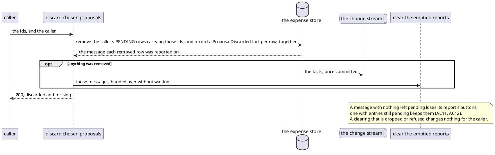

# Discarding the Chosen Proposals

Each refusal ends the request with one answer and changes nothing.

| Checked, in order                                  | Refused with |
|----------------------------------------------------|--------------|
| a session cookie this service signed               | 401          |
| a CSRF token                                       | 403          |
| a list within the bounds, in a body that parses    | 400          |
| a user stored under the session's identity         | 404          |
| the store accepts the write                        | 503          |

Once the write runs, the order matters: the response never waits for Telegram.

