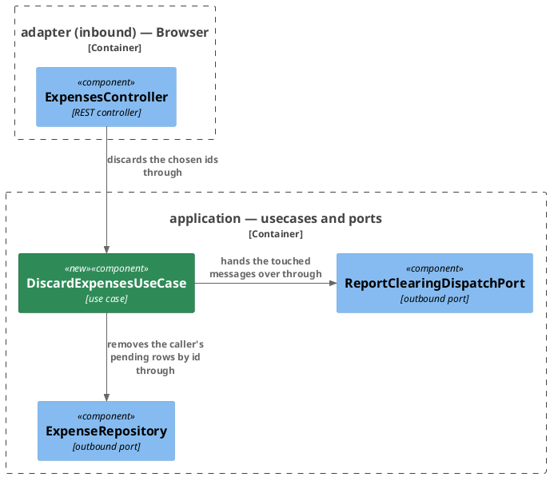

# Plan: Discard Chosen Proposals — `ledger-service`

**Format:** 2
**Affected Modules:** `ledger-service`
**Spec:** [Discard Chosen Proposals](../spec.md)

## Architecture Decisions

### Discarding by id is a use case of its own beside the acceptance



**Placement:** The discard is `DiscardExpensesUseCase` behind a `DiscardExpensesPort` of its own, served by the
existing `ExpensesController` and calling the same two outbound ports `AcceptExpensesUseCase` calls;
`ResolveProposalsUseCase`, which discards by message for a Telegram tap, is left as it is.

## Step-by-Step Implementation Map (To-Do List)

### Stabilization

#### Interface-First / Build Stabilization

The request and response types this plan names, `DiscardExpensesRequest` and `DiscardExpenses200Response`, are
the ones `shared/plan.md` records as generated; where it records others, those are the ones meant.

**Interface & Signature Sync**

- [x] ST01 · Add the domain exception and widen `ProposalIds`'s javadoc
  - writes: `ledger-service/src/main/java/bot/finance/domain/exception/InvalidExpenseDiscardException.java`,
    `ledger-service/src/main/java/bot/finance/domain/value/ProposalIds.java`
  - `InvalidExpenseDiscardException extends InvalidValueException` — a plain subclass with a message
    constructor, as `InvalidExpenseAcceptanceException` is.
  - `ProposalIds` — the javadoc names the ids an acceptance or a discard request named; nothing else changes.
- [x] ST02 · Add the application records · after: ST01
  - writes: `ledger-service/src/main/java/bot/finance/application/dto/DiscardExpensesCommand.java`,
    `ledger-service/src/main/java/bot/finance/application/dto/ExpenseDiscard.java`
  - `DiscardExpensesCommand(AuthenticatedUserId userId, ProposalIds ids)`, as `AcceptExpensesCommand` is.
  - `ExpenseDiscard(int discarded, int missing)`, as `ExpenseAcceptance` is.
- [x] ST03 · Add the ports, each operation carrying the `@throws` javadoc its neighbours carry · after: ST02
  - writes: `ledger-service/src/main/java/bot/finance/application/port/DiscardExpensesPort.java`,
    `ledger-service/src/main/java/bot/finance/application/port/ExpenseRepository.java`
  - `DiscardExpensesPort.discard(DiscardExpensesCommand command)` answering `ExpenseDiscard`, throwing
    `InvalidExpenseDiscardException` for an absent command, `EntityNotFoundException` for a caller naming no
    stored user and `PersistenceFailedException` for a failed write.
  - `ExpenseRepository.discardByIds(long userId, ProposalIds ids, Instant now)` answering
    `List<IncomingMessageId>` — removes the caller's `PENDING` entries named by id, answering the message each was
    reported on.
- [x] ST04 · Stub `DiscardExpensesUseCase` implementing `DiscardExpensesPort`, constructed from
  `UserRepository`, `ExpenseRepository`, `ReportClearingDispatchPort`, `Clock` and `LoggerFactory` as
  `AcceptExpensesUseCase` is · after: ST03
  - writes: `ledger-service/src/main/java/bot/finance/application/usecase/DiscardExpensesUseCase.java`
  ```java
  @Override
  public ExpenseDiscard discard(DiscardExpensesCommand command) {
      // refuses an absent command, resolves the caller by stored id, removes their pending rows by id at the
      // clock's instant, hands each touched message to the clearing once, logs one info line with both counts
      // and the caller's external id, and answers discarded and missing
      return null;
  }
  ```
- [x] ST05 · Add the persistence side · after: ST03
  - writes: `ledger-service/src/main/java/bot/finance/adapter/persistence/ExpenseEntityRepository.java`,
    `ledger-service/src/main/java/bot/finance/adapter/persistence/ExpenseRepositoryAdapter.java`
  - `ExpenseEntityRepository.discardByIds(Long userId, List<Long> ids)` answering `List<SpendingRowProjection>`,
    the statement `discard` runs narrowed by id as `acceptByIds` narrows `accept`:
    ```sql
    WITH changed AS (
        DELETE FROM expense
        WHERE user_id = :userId AND id IN (:ids) AND status = 'PENDING'
        RETURNING *
    )
    SELECT c.id AS id, c.user_id AS user_id, c.incoming_message_id AS incoming_message_id,
           c.status AS status, c.description AS description, c.merchant AS merchant,
           c.amount_minor_units AS amount_minor_units, c.currency_code AS currency_code,
           c.created_at AS created_at, cat.id AS category_id, cat.name AS category_name,
           grp.id AS grouping_id, grp.name AS grouping_name
    FROM changed c
    JOIN category cat ON c.category_id = cat.id
    LEFT JOIN category grp ON cat.parent_id = grp.id
    ```
  - `ExpenseRepositoryAdapter.discardByIds` — `@Transactional`, a stub returning `List.of()`, intent: run that
    statement, append a `ProposalDiscarded` fact per removed row at `now` through `LedgerEventOutbox`, answer each
    row's message, and wrap any failure in `PersistenceFailedException`.
- [x] ST06 · Add the web side · after: ST03
  - writes: `ledger-service/src/main/java/bot/finance/adapter/web/ExpensesController.java`,
    `ledger-service/src/main/java/bot/finance/adapter/web/ExpenseWebMapper.java`,
    `ledger-service/src/test/java/bot/finance/adapter/web/ExpensesControllerTest.java`,
    `ledger-service/src/test/java/bot/finance/adapter/web/WebExceptionHandlerTest.java`
  - `ExpenseWebMapper` — `toDiscardExpensesCommand(DiscardExpensesRequest, AuthenticatedUserId)` and
    `toDiscardResponse(ExpenseDiscard)` **implemented**, each one constructor over the other's fields, as
    `toAcceptExpensesCommand` and `toAcceptanceResponse` are.
  - `ExpensesController` — takes `DiscardExpensesPort` as a fourth constructor parameter; `discardExpenses`
    overridden as a stub returning `null`, intent: build the command with
    `AuthenticatedCaller.authenticatedUserId()`, call the port, answer 200 through the mapper.
  - `ExpensesControllerTest` and `WebExceptionHandlerTest` — each gains a `@MockitoBean DiscardExpensesPort`
    beside its `AcceptExpensesPort`, so the slice still boots; `ExpensesControllerTest`'s class javadoc names the
    discard path and its port beside the acceptance's.

**Configuration**

- [x] ST07 · Wire the use case and admit the path · after: ST04
  - writes: `ledger-service/src/main/java/bot/finance/adapter/config/UseCaseConfiguration.java`,
    `ledger-service/src/main/java/bot/finance/adapter/security/SecurityConfiguration.java`
  - `UseCaseConfiguration` — a `DiscardExpensesPort` bean beside `acceptExpensesPort`, with `Clock.systemUTC()`.
  - `SecurityConfiguration` — `POST /api/v1/expenses/discards` as `.authenticated()` on the web-session chain,
    beside the acceptance's matcher and ahead of `anyRequest().denyAll()`.

**Shared Test Infrastructure**

- [x] ST08 · Add a `DISCARD_EXPENSES` scenario to `TelegramTestBot`, `new TelegramScenario(1001, 1010, 2010)`, with a
  javadoc naming `DiscardExpensesSystemTest` as its owner and saying, as `ACCEPT_EXPENSES`'s does, that the
  clearing runs off the request thread and the conversation tells it from another class's traffic
  - writes: `ledger-service/src/test/java/bot/finance/common/stubs/TelegramTestBot.java`

#### Closing item

- [x] ST09 · Confirm `bot.finance.architecture.CleanArchitectureTest` passes and the pre-existing suite is green:
  `tools/agent-test/agent-test.sh --module ledger-service`. This group disables no test.
  - writes: none

### Red Phase

AC12 is held by `ClearEmptiedReportsUseCaseTest`'s case "when the one message still has a pending proposal", and
AC13 by `ResolveProposalsUseCaseTest`'s case "when the resolution and the count both answer 0".

#### TDD Unit Red Phase

- [x] RU01 · `DiscardExpensesUseCase` · test: `DiscardExpensesUseCaseTest` · covers: `discard()` · scenarios: AC01, AC03, AC09, AC10, AC11
  - `discard()`:
    - given: a stored user, a fixed clock, and the repository answering message A and message B for two posted
      ids
      when: discard() is called
      then: the answer is `discarded` 2 and `missing` 0, and the repository was called with the stored user id,
      the two ids in the order posted and the clock's instant
    - given: the repository answering nothing for two posted ids
      when: discard() is called
      then: the answer is `discarded` 0 and `missing` 2, and nothing is handed to the clearing
    - given: the repository answering message A, message A and message B
      when: discard() is called
      then: the clearing receives the stored user id, and message A and message B once each
    - given: no user row for the caller
      when: discard() is called
      then: `EntityNotFoundException` is thrown, and neither the repository nor the clearing is called
    - given: the repository throwing `PersistenceFailedException`
      when: discard() is called
      then: that exception reaches the caller, and nothing is handed to the clearing
    - given: an absent command
      when: discard() is called
      then: `InvalidExpenseDiscardException` is thrown, and no port is called

#### TDD Integration Red Phase

- [x] RI01 · `ExpenseRepositoryAdapter` · test: `ExpenseRepositoryAdapterTest` · covers: `discardByIds()` · scenarios: AC01, AC03, AC04, AC05
  - `discardByIds()`:
    - given: three `PENDING` entries of the caller's, two under message M and one under another message, a
      `RECORDED` entry of the caller's, and another person's `PENDING` entry
      when: discardByIds() is called for the caller with the ids of the two under M, the `RECORDED` entry and the
      other person's entry
      then: it answers M twice and nothing else, those two rows are gone, the caller's third entry is still
      `PENDING`, the `RECORDED` entry is still `RECORDED`, and the other person's row is still `PENDING`
    - given: two `PENDING` entries of the caller's under message M
      when: discardByIds() is called with their ids, and then again with the same ids
      then: the first call answers M twice, and the second answers nothing
    - given: an entity repository throwing `QueryTimeoutException`, in the `WithAMockedStore` class
      when: discardByIds() is called
      then: `PersistenceFailedException` is thrown carrying it as the cause
- [x] RI02 · `ExpenseRepositoryAdapter` · test: `ExpenseRepositoryAdapterEventsTest` · covers: `discardByIds()` · scenarios: AC02, AC03, AC05
  - `discardByIds()`:
    - given: two `PENDING` entries of the caller's on different messages, a third left out of the ids, and another
      person's `PENDING` entry
      when: the two and the other person's entry are discarded by id for the caller
      then: a `ProposalDiscarded` fact carries each of the two as it was, and none names the third or the other
      person's entry
    - given: two `PENDING` entries of the caller's
      when: they are discarded by id, and then again with the same ids
      then: exactly one `ProposalDiscarded` fact names each entry
- [x] RI03 · `ExpensesController` · test: `ExpensesControllerTest` · covers: `POST /api/v1/expenses/discards` · mocks: `DiscardExpensesPort` · scenarios: AC01, AC06, AC07, AC08, AC10
  - Happy Path:
    - given: the port answering `discarded` 2 and `missing` 0
      when: two ids are posted with a session and a CSRF token
      then: 200 with `discarded` 2 and `missing` 0, and the port received the session's user and the two ids in
      the order posted
  - Error Mapping:
    - given: the port throwing `PersistenceFailedException`
      when: ids are posted
      then: 503, and the body names no table or statement
    - given: no session cookie, and in another case a session cookie this service did not sign, built through
      `BrowserSessions`
      when: ids are posted
      then: 401, and the port is never called
    - given: a session and no CSRF header
      when: ids are posted
      then: 403, and the port is never called
  - Validation: `ids` — absent, `null`, empty, 101 ids, a repeated id, a `null` id, `0`, `-1` and `"abc"`, and a
    body that is not JSON, each 400 naming what it refused where a field is named, and the port never called;
    100 distinct ids accepted. A fractional id such as `1.5` is posted first and asserted as it is observed to
    bind, never assumed refused.

#### TDD System Test Red Phase

- [x] RS01 · `DiscardExpensesSystemTest` · covers: `POST /api/v1/expenses/discards` · scenarios: AC01, AC09, AC11
  - Happy Path:
    - given: a person signed in, two `PENDING` entries under one message whose report location is stored for the
      `DISCARD_EXPENSES` conversation, and a third `PENDING` entry under another message
      when: they post the ids of the two with the session cookie and a CSRF token
      then: 200 with `discarded` 2 and `missing` 0; the person's only `PENDING` row is the third and none is
      `RECORDED`; and one `editMessageReplyMarkup` is recorded for that report's chat and message id, with no
      `sendMessage`
  - Unhappy Path:
    - given: a person signed in, whose user row is then deleted
      when: they post a list of ids with the session cookie and a CSRF token
      then: 404

### Green Phase

#### TDD Unit Green Phase

- [x] GU01 · `DiscardExpensesUseCase` · test: `DiscardExpensesUseCaseTest`

#### TDD Integration Green Phase

- [x] GI01 · `ExpenseRepositoryAdapter` · test: `ExpenseRepositoryAdapterTest`
- [x] GI02 · `ExpenseRepositoryAdapter` · test: `ExpenseRepositoryAdapterEventsTest` · after: GI01
- [x] GI03 · `ExpensesController` · test: `ExpensesControllerTest` · covers: `POST /api/v1/expenses/discards` · mocks: `DiscardExpensesPort`

#### TDD System Test Green Phase

- [x] GS01 · `DiscardExpensesSystemTest` · covers: `POST /api/v1/expenses/discards`

### Post-Implementation Steps

#### Manual Request Files

- [ ] PI01 · Add `ledger-service/docs/requests/expenses/discard-expenses.http`, shaped as `accept-expenses.http` is
  - writes: `ledger-service/docs/requests/expenses/discard-expenses.http`

## Open Questions

None.
