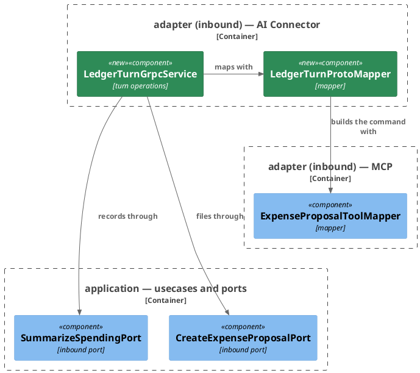
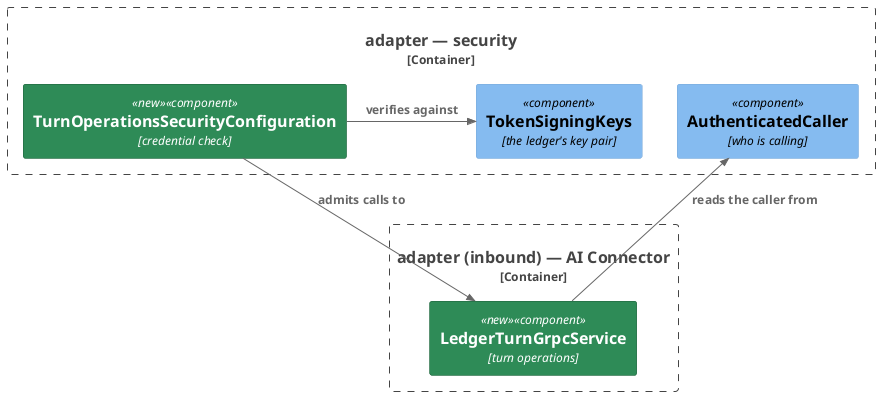
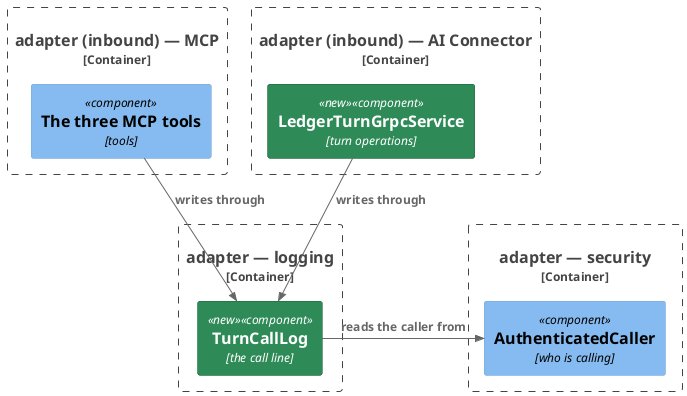
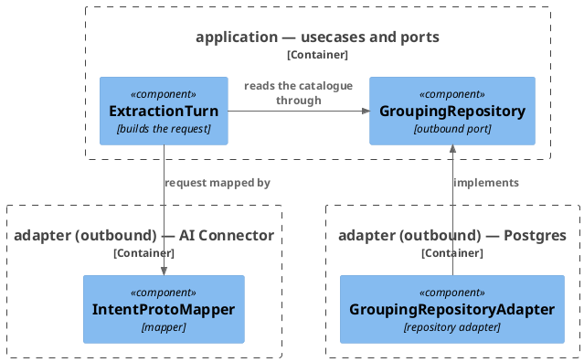

# Plan: The Ledger Takes a Turn's Writes over gRPC — `ledger-service`

**Format:** 2
**Affected Modules:** `ledger-service`
**Spec:** [The Ledger Takes a Turn's Writes over gRPC](../spec.md)

The schema both builds read is the shared plan's, landed before this one starts. What the design leaves to this
plan: the ledger's gRPC server and the class answering the two operations, the credential check in front of it,
the component writing the call line, and the one read that yields the catalogue.

## Architecture Decisions

### The turn operations front the AI connector



**Placement:** The operations join everything else fronting the AI connector and call the tools' own inbound
ports, building the expense command through the tools' mapper so the amount rule exists once.

### The security adapter checks the turn's credential



**Placement:** The check sits in the security adapter beside the tools' decoders. It applies their validators
against the ledger's own public key and also requires a message reference. It hands the caller on through the
security context `AuthenticatedCaller` already reads.

### One component writes the call line for both ways in



**Placement:** The line leaves the MCP adapter for the logging adapter, so both inbound adapters write it through
one component that `TURN_CALL_LOG_ENABLED` switches.

### The groupings sent come from the catalogue read



**Placement:** `GroupingRepository.findCatalogue` replaces the read of grouping names, and the request derives its
groupings from the catalogue it carries, so the two can never disagree.

## Step-by-Step Implementation Map (To-Do List)

### Stabilization

#### Interface-First / Build Stabilization

New-method stubs carry an intent comment starting `stub-intent:`.

**Interface & Signature Sync**

- [x] ST01 · Add `org.springframework.boot:spring-boot-starter-grpc-server` to `build.gradle`'s dependencies,
  beside the gRPC client starter. The slices that boot autoconfiguration without the turn operations —
  `McpAdapterTest`, `MetricsAdapterTest` and `CdcRecoveryEndpointTest` — set `spring.grpc.server.enabled=false`
  - writes: `ledger-service/build.gradle`, `ledger-service/src/test/java/bot/finance/common/boot/McpAdapterTest.java`,
    `ledger-service/src/test/java/bot/finance/common/boot/MetricsAdapterTest.java`,
    `ledger-service/src/test/java/bot/finance/adapter/cdc/CdcRecoveryEndpointTest.java`
- [x] ST02 · Add the record `CatalogueEntry(String grouping, List<String> categories)` to `application/dto`, with
  no checks of its own
  - writes: `ledger-service/src/main/java/bot/finance/application/dto/CatalogueEntry.java`
- [x] ST03 · Replace `GroupingRepository.findNamesWithCategories(long): List<String>` with
  `findCatalogue(long): List<CatalogueEntry>` · after: ST02
  - `GroupingRepositoryAdapter.findCatalogue()` keeps the existing names query and answers each name as an entry
    holding that name as its one category, with a `TODO` naming the categories still to be read
  - `GroupingRepositoryAdapterTest` calls `findCatalogue()` where it called `findNamesWithCategories()`, and its
    assertions read the entries' groupings
  - writes: `ledger-service/src/main/java/bot/finance/application/port/GroupingRepository.java`,
    `ledger-service/src/main/java/bot/finance/adapter/persistence/GroupingRepositoryAdapter.java`,
    `ledger-service/src/test/java/bot/finance/adapter/persistence/GroupingRepositoryAdapterTest.java`
- [x] ST04 · Replace `IntentExtractionRequest`'s `List<String> categoryGroupings` component with
  `List<CatalogueEntry> catalogue`, and add `categoryGroupings()` answering the entries' groupings in order · after: ST02
  - every existing check keeps running, over those groupings; the catalogue is kept as given, with a `TODO`
    naming the copy and the entry checks still owed
  - `IntentProtoMapper` reads `categoryGroupings()` unchanged
  - every test constructing a request — `IntentExtractionRequestTest`, `IntentProtoMapperTest`,
    `AiConnectorIntentExtractionAdapterTest` — passes each grouping it named as an entry holding one category,
    and keeps its assertion. A test passing a null list passes a null catalogue; one passing a list holding a
    null or blank name passes an entry with that grouping
  - `IntentExtractionRequestTest.whenGroupingListIsModifiedAfterConstruction_thenCategoryGroupingsIsUnchanged()`
    would fail against the uncopied catalogue, so it is disabled, naming RU01
  - writes: `ledger-service/src/main/java/bot/finance/application/dto/IntentExtractionRequest.java`,
    `ledger-service/src/test/java/bot/finance/application/dto/IntentExtractionRequestTest.java`,
    `ledger-service/src/test/java/bot/finance/adapter/aiconnector/IntentProtoMapperTest.java`,
    `ledger-service/src/test/java/bot/finance/adapter/aiconnector/AiConnectorIntentExtractionAdapterTest.java`
- [x] ST05 · `ExtractionTurn.request()` takes the catalogue in place of the grouping names.
  `HandleIncomingMessageUseCase.handle()` and `HandleWrittenMessageUseCase`'s preparation read
  `findCatalogue()`, give `catchAllAmong()` the catalogue's groupings, and pass the catalogue to `request()` ·
  after: ST03, ST04
  - `HandleIncomingMessageUseCaseTest` and `HandleWrittenMessageUseCaseTest` stub and verify `findCatalogue()`
    where they stubbed and verified `findNamesWithCategories()`, each grouping an entry holding one category,
    a thrown failure thrown the same way; their assertions stand
  - writes: `ledger-service/src/main/java/bot/finance/application/usecase/ExtractionTurn.java`,
    `ledger-service/src/main/java/bot/finance/application/usecase/HandleIncomingMessageUseCase.java`,
    `ledger-service/src/main/java/bot/finance/application/usecase/HandleWrittenMessageUseCase.java`,
    `ledger-service/src/test/java/bot/finance/application/usecase/HandleIncomingMessageUseCaseTest.java`,
    `ledger-service/src/test/java/bot/finance/application/usecase/HandleWrittenMessageUseCaseTest.java`
- [x] ST06 · Add `TurnCallLog` to `adapter/logging`, a component taking `TurnCallLogProperties`, `JsonMapper` and
  `LoggerFactory`, with its nested enum `Via { MCP, GRPC }`; add the record
  `TurnCallLogProperties(boolean enabled)` bound to `turn-call-log`, registered by a new `LoggingConfiguration` in
  the same package. The `logging` entry of the module's architecture conventions names the call line beside the
  `Logger`/`LoggerFactory` implementation
  - writes: `ledger-service/docs/conventions/architecture.md`,
    `ledger-service/src/main/java/bot/finance/adapter/logging/TurnCallLog.java`,
    `ledger-service/src/main/java/bot/finance/adapter/logging/TurnCallLogProperties.java`,
    `ledger-service/src/main/java/bot/finance/adapter/logging/LoggingConfiguration.java`
- [x] ST07 · Stub `TurnCallLog.write()` · after: ST06
  - writes: `ledger-service/src/main/java/bot/finance/adapter/logging/TurnCallLog.java`
  ```java
  public void write(String operation, Via via, boolean accepted, Object arguments) {
      // stub-intent: where enabled, logs one turn_call line naming the operation, the way it arrived, the
      // outcome, the authenticated caller and message or none, and the arguments as JSON; otherwise nothing
  }
  ```
- [x] ST08 · `CreateExpenseProposalMcpTool`, `ListCategoriesMcpTool` and `SummarizeSpendingMcpTool` take
  `TurnCallLog` in place of their `McpCallLine` logger and write through it with `Via.MCP`, the tool's name, the
  result's outcome and the same arguments; delete `McpCallLine`. Its `arguments(...)` moves to `TurnCallLog` as a
  static method; its caller and message lookups are what `TurnCallLog.write()` owes. `McpAdapterTest` imports
  `TurnCallLog` and `LoggingConfiguration` · after: ST07
  - writes: `ledger-service/src/main/java/bot/finance/adapter/mcp/CreateExpenseProposalMcpTool.java`,
    `ledger-service/src/main/java/bot/finance/adapter/mcp/ListCategoriesMcpTool.java`,
    `ledger-service/src/main/java/bot/finance/adapter/mcp/SummarizeSpendingMcpTool.java`,
    `ledger-service/src/main/java/bot/finance/adapter/mcp/McpCallLine.java`,
    `ledger-service/src/test/java/bot/finance/common/boot/McpAdapterTest.java`
- [x] ST09 · Add `LedgerTurnProtoMapper` to `adapter/aiconnector`, with stubs:
  - writes: `ledger-service/src/main/java/bot/finance/adapter/aiconnector/LedgerTurnProtoMapper.java`
  ```java
  public static CreateExpenseProposalToolRequest toToolRequest(FileExpenseProposalRequest request) {
      // stub-intent: copies the request's fields into the tools' request, an absent merchant as null
      return null;
  }

  public static FileExpenseProposalResponse toResponse(Expense stored, String grouping, String category) {
      // stub-intent: answers the stored entry with the grouping and category it was filed under, its amount as
      // a plain decimal, created_at as RFC 3339 in UTC, and merchant only where the entry has one
      return null;
  }

  public static RecordSpendingPeriodResponse toResponse(SpendingPeriod period) {
      // stub-intent: answers the period's two days written YYYY-MM-DD
      return null;
  }
  ```
- [x] ST10 · Add `LedgerTurnGrpcService` to `adapter/aiconnector`, a `@GrpcService` extending the generated
  `LedgerTurnServiceGrpc.LedgerTurnServiceImplBase`, taking `CreateExpenseProposalPort`, `SummarizeSpendingPort`,
  `TurnCallLog` and `LoggerFactory`, with stubs · after: ST06, ST09
  - writes: `ledger-service/src/main/java/bot/finance/adapter/aiconnector/LedgerTurnGrpcService.java`
  ```java
  @Override
  public void fileExpenseProposal(
          FileExpenseProposalRequest request, StreamObserver<FileExpenseProposalResponse> responseObserver) {
      // stub-intent: files a pending expense as the authenticated caller for its message, answers the stored
      // entry, maps each refusal to its status with the tool's reason, logs each refusal with its kind and
      // never the request or token, and writes the call line as create_expense_proposal
      responseObserver.onNext(FileExpenseProposalResponse.getDefaultInstance());
      responseObserver.onCompleted();
  }

  @Override
  public void recordSpendingPeriod(
          RecordSpendingPeriodRequest request, StreamObserver<RecordSpendingPeriodResponse> responseObserver) {
      // stub-intent: records the period as the authenticated caller for its message, answers its two days,
      // maps each refusal to its status with the tool's reason, logs each refusal with its kind and never the
      // request or token, and writes the call line as summarize_spending
      responseObserver.onNext(RecordSpendingPeriodResponse.getDefaultInstance());
      responseObserver.onCompleted();
  }
  ```
- [x] ST11 · Add `TurnOperationsSecurityConfiguration` to `adapter/security`, declaring the server's one
  `AuthenticationProcessInterceptor`, built from `GrpcSecurity`. `SecurityConfiguration.validator(...)` becomes
  package-private, so the check reuses the tools' validators · after: ST01
  - writes: `ledger-service/src/main/java/bot/finance/adapter/security/TurnOperationsSecurityConfiguration.java`,
    `ledger-service/src/main/java/bot/finance/adapter/security/SecurityConfiguration.java`
  ```java
  @Bean
  @GlobalServerInterceptor
  AuthenticationProcessInterceptor turnOperationsAuthenticationInterceptor(GrpcSecurity grpcSecurity)
          throws Exception {
      // stub-intent: requires the turn's credential on every LedgerTurnService call, verified against the
      // ledger's own public key with the tools' validators and a message reference required, and leaves the
      // health and reflection services open
      return grpcSecurity.authorizeRequests(requests -> requests.allRequests().permitAll()).build();
  }
  ```
  - that a permit-all interceptor builds from `GrpcSecurity` with no authentication configured — unverified

**Configuration**

- [x] ST12 · In `application.yaml`, serve gRPC on `spring.grpc.server.port: ${LEDGER_GRPC_PORT:1006}` (DN06, the
  next free port) and add `turn-call-log.enabled: ${TURN_CALL_LOG_ENABLED:false}` (DN07, off by default). In
  `application-test.yaml`, bind `spring.grpc.server.port: 0`
  - writes: `ledger-service/src/main/resources/application.yaml`,
    `ledger-service/src/test/resources/application-test.yaml`

**Shared Test Infrastructure**

- [x] ST14 · Add `TurnOperationCalls` to `common/fixtures`: a blocking `LedgerTurnServiceGrpc` stub dialing
  `localhost` on a given port, with or without `authorization: Bearer <token>` metadata, closing its channel after
  the call; and the two request builders, `fileExpense(grouping, category, description, merchant, amount,
  currencyCode)` with a null merchant left unset, and `recordPeriod(from, to)`. Listed in the module's testing
  conventions under `fixtures`
  - writes: `ledger-service/src/test/java/bot/finance/common/fixtures/TurnOperationCalls.java`,
    `ledger-service/docs/conventions/testing.md`
- [x] ST15 · Add the composed annotation `TurnOperationsAdapterTest` to `common/boot`: an explicit bean list —
  `LedgerTurnGrpcService`, `TurnOperationsSecurityConfiguration`, `TurnCallLog`, `LoggingConfiguration`,
  `TokenSigningKeys`, `AccessTokenMinter`, `Slf4jLoggerFactory` and the properties they bind — with
  autoconfiguration on, the datasource and Redis excluded, `spring.grpc.server.port=0`,
  `turn-call-log.enabled=true`, and `CreateExpenseProposalPort` and `SummarizeSpendingPort` as `@MockitoBean`s.
  A test reaches the server on `GrpcServerLifecycle.getPort()`. `TurnOperationsAdapterContextTest` boots it.
  Listed in the module's testing conventions under `boot` and under the inbound integration layer
  - writes: `ledger-service/src/test/java/bot/finance/common/boot/TurnOperationsAdapterTest.java`,
    `ledger-service/src/test/java/bot/finance/common/boot/TurnOperationsAdapterContextTest.java`,
    `ledger-service/docs/conventions/testing.md`
- [x] ST16 · `McpAdapterTest` sets `turn-call-log.enabled=true` · after: ST08
  - writes: `ledger-service/src/test/java/bot/finance/common/boot/McpAdapterTest.java`

#### Closing item

- [x] ST17 · `tools/agent-test/agent-test.sh --module ledger-service --tests "bot.finance.architecture.CleanArchitectureTest"`
  passes, and the existing suite stays green
  - writes: none

### Red Phase

#### TDD Unit Red Phase

- [x] RU01 · `IntentExtractionRequest` · test: `IntentExtractionRequestTest` · covers: `IntentExtractionRequest()`,
  `catalogue()` · scenarios: AC11
  - `IntentExtractionRequest()`:
    - given: a catalogue holding a null entry
      when: the request is constructed
      then: throws InvalidExtractionRequestException
    - given: an entry whose categories are null or empty, or hold a null or blank name
      when: the request is constructed
      then: throws InvalidExtractionRequestException
  - `catalogue()`:
    - given: a request built from a mutable catalogue, which is changed afterwards
      when: catalogue() is read
      then: it holds the entries as they were at construction, each with its categories, and refuses
      modification
    - update: `whenGroupingListIsModifiedAfterConstruction_thenCategoryGroupingsIsUnchanged()` — re-enable it; it
      changes the mutable catalogue after construction, and its assertion on `categoryGroupings()` stands
- [x] RU02 · `IntentProtoMapper` · test: `IntentProtoMapperTest` · covers: `toProtoRequest()` · scenarios: AC11
  - `toProtoRequest()`:
    - given: a request whose catalogue holds `Dining` with `Cafés` and `Restaurants`, then `Other` with `Misc`
      when: toProtoRequest() is called
      then: the generated request's catalogue holds the same two entries in that order, each with its
      categories in order, and `category_groupings` names `Dining`, `Other`
- [x] RU03 · `LedgerTurnProtoMapper` · test: `LedgerTurnProtoMapperTest` · covers: `toToolRequest()`,
  `toResponse(Expense, String, String)`, `toResponse(SpendingPeriod)` · scenarios: AC01, AC06
  - `toToolRequest()`:
    - given: a request filing `Dining`, `Cafés`, `coffee`, merchant `Bean Bar`, `4.50`, `EUR`
      when: toToolRequest() is called
      then: the tools' request carries every field unchanged
    - given: a request with no merchant set
      when: toToolRequest() is called
      then: the tools' request's merchant is null
  - `toResponse(Expense, String, String)`:
    - given: a stored entry with id 7, `coffee`, no merchant, 4.50 EUR, stored at `2026-10-13T09:15:00Z`
      when: toResponse() is called with `Dining` and `Cafés`
      then: the answer carries 7, `Dining`, `Cafés`, `coffee`, `4.50`, `EUR` and `2026-10-13T09:15:00Z`, and no
      merchant
    - given: a stored entry with merchant `Bean Bar`
      when: toResponse() is called
      then: the answer carries the merchant
    - given: a stored entry of 7200 JPY
      when: toResponse() is called
      then: the amount is written `7200`, with no exponent
  - `toResponse(SpendingPeriod)`:
    - given: the period `2026-10-12` to `2026-10-12`
      when: toResponse() is called
      then: from and to are both `2026-10-12`
- [x] RU04 · `TurnCallLog` · test: `TurnCallLogTest` · covers: `write()` · scenarios: AC13, AC16
  - `write()`:
    - given: the line enabled, and a security context holding a verified token for user 42 and message `web:17`
      when: write() is called for `create_expense_proposal`, MCP, accepted, with arguments `grouping` and
      `amount`
      then: one line `turn_call operation=create_expense_proposal via=mcp outcome=ok userId=42 message=web:17
      arguments={"grouping":…,"amount":…}` is logged
    - given: the line enabled and the same context
      when: write() is called for `summarize_spending`, GRPC, rejected
      then: the line reads `via=grpc` and `outcome=rejected`
    - given: the line enabled and no authenticated caller
      when: write() is called
      then: the line reads `userId=none message=none`
    - given: the line disabled
      when: write() is called
      then: nothing is logged

#### TDD Integration Red Phase

- [x] RI01 · `GroupingRepositoryAdapter` · test: `GroupingRepositoryAdapterTest` · covers: `findCatalogue()` ·
  scenarios: AC11
  - `findCatalogue()`:
    - given: a user whose `Transport` holds `Taxi` and `Fuel`, and whose `Dining` holds `Cafés`
      when: findCatalogue() is called
      then: `Dining` carries `Cafés`, and `Transport` carries `Fuel`, `Taxi`, in that order
    - update: `whenFindCatalogueHitsDatabaseFailure_thenThrowsPersistenceFailedExceptionWrappingIt()` — stub the
      catalogue's own read, `findCategoryEntriesForUser`, to throw where it stubbed `findNonEmptyGroupingNames`;
      its assertion stands
- [x] RI02 · `AiConnectorIntentExtractionAdapter` · test: `AiConnectorIntentExtractionAdapterTest` · covers:
  `extract()` · scenarios: AC11
  - `extract()`:
    - given: a request whose catalogue holds `Groceries` with `Milk`, then `Other` with `Misc`
      when: extract() is called
      then: the stub server receives both entries in that order, each with its category
- [x] RI03 · `TurnOperationsSecurityConfiguration` · test: `TurnOperationsSecurityConfigurationTest` · covers:
  `LedgerTurnService.FileExpenseProposal`, `LedgerTurnService.RecordSpendingPeriod` · mocks:
  `CreateExpenseProposalPort`, `SummarizeSpendingPort` · scenarios: AC08, AC09
  - Happy Path:
    - given: the port answers a stored entry, and a token the ledger minted for a person's message
      when: FileExpenseProposal is called with it
      then: the call is answered rather than refused
    - given: no credential
      when: the server's health service is asked about the server
      then: it answers serving
    - given: no credential
      when: the reflection service is asked to list the services
      then: it answers, naming `bot.finance.ledger.v1.LedgerTurnService`
  - Error Mapping:
    - given: no credential, a browser session token, a token expired past the skew, one of another issuer —
      minted by a `McpTokens.wrongIssuerToken(long)` this step adds — one of another audience, or one whose
      lifetime exceeds the ceiling
      when: either operation is called with it
      then: the call fails with UNAUTHENTICATED and neither port is called
    - given: a token that verifies but carries no message reference, or a blank one
      when: either operation is called with it
      then: the call fails with UNAUTHENTICATED and neither port is called
- [x] RI04 · `LedgerTurnGrpcService` · test: `LedgerTurnGrpcServiceTest` · covers:
  `LedgerTurnService.FileExpenseProposal`, `LedgerTurnService.RecordSpendingPeriod` · mocks:
  `CreateExpenseProposalPort`, `SummarizeSpendingPort` · scenarios: AC01, AC02, AC03, AC04, AC05, AC06, AC07,
  AC10, AC13
  - Happy Path:
    - given: the port answers a stored entry for `Dining`, `Cafés`, `coffee`, 4.50 EUR
      when: FileExpenseProposal is called for it with no merchant, under a token for user 42 and a message
      then: the port receives user 42, the message's reference, `Dining`, `Cafés`, `coffee`, no merchant and
      4.50 EUR, and the call answers the stored entry
    - given: an amount written with surrounding whitespace, ` 4.50 `
      when: FileExpenseProposal is called
      then: the port receives 4.50
    - given: a blank merchant
      when: FileExpenseProposal is called
      then: the port receives no merchant
    - given: an amount of eighteen integer digits, or `1.2345` in a currency of four decimal places
      when: FileExpenseProposal is called
      then: the port receives it
    - given: the port answers the period `2026-10-12` to `2026-10-12`
      when: RecordSpendingPeriod is called with those days
      then: the port receives the caller, the message's reference and both days, and the call answers them
    - given: the port answers a stored entry
      when: FileExpenseProposal is called under a token for user 42 and message `m`
      then: one line `turn_call operation=create_expense_proposal via=grpc outcome=ok userId=42 message=m` is
      logged, its arguments the tool's: `category`, `grouping`, `description`, `merchant`, `amount`,
      `currencyCode`
    - given: the port answers a period
      when: RecordSpendingPeriod is called
      then: one line `turn_call operation=summarize_spending via=grpc outcome=ok` is logged with `from` and `to`
    - (added) given: the port answers a stored entry with merchant `Bean Bar`
      when: FileExpenseProposal is called
      then: the call answers the merchant
  - Error Mapping:
    - given: the port throws InvalidGroupingException for `Snacks`
      when: FileExpenseProposal is called
      then: INVALID_ARGUMENT, its description repeating `Snacks`
    - given: the port throws InvalidCategoryException naming `Fuel` and `Dining`
      when: FileExpenseProposal is called
      then: INVALID_ARGUMENT, its description naming both
    - given: the port throws InvalidExpenseException for a blank description
      when: FileExpenseProposal is called
      then: INVALID_ARGUMENT, its description naming an invalid request and the field
    - given: the port throws InvalidSpendingPeriodException
      when: RecordSpendingPeriod is called
      then: INVALID_ARGUMENT, its description the exception's own
    - given: the summarizing port throws InvalidUserException
      when: RecordSpendingPeriod is called
      then: INVALID_ARGUMENT, its description naming an invalid request
    - given: either port throws EntityNotFoundException
      when: its operation is called
      then: NOT_FOUND, its description saying the user is unknown
    - given: either port throws PersistenceFailedException carrying an internal detail
      when: its operation is called
      then: UNAVAILABLE, its description the tool's — the proposal could not be stored, the summary could not
      be recorded — and never the detail
    - given: either port throws an unrecognised RuntimeException carrying an internal detail
      when: its operation is called
      then: INTERNAL, its description the tool's — the proposal could not be created, the spending could not be
      summarized — and never the detail
    - given: the port refuses the call
      when: FileExpenseProposal is called
      then: the call line reads `outcome=rejected`
  - Validation: `amount` — blank, a sign, an exponent, digit grouping, five decimal places, nineteen integer
    digits, and `12.505` in EUR, which the currency cannot record; `currency_code` — not three letters;
    `grouping` — blank. Each fails with INVALID_ARGUMENT naming an invalid request and the field, and the port is
    never called. `category` — blank: the port receives it and its refusal is mapped as above — unverified
    - (added) `amount` — whitespace only; `currency_code` — `EU`, `EURO`, `E1R`; `grouping` — empty. Each fails
      the same way
    - given: `amount` `4.50` in `XAU`, a currency no amount can be recorded in
      when: FileExpenseProposal is called
      then: INVALID_ARGUMENT naming an invalid request and `currency_code`, and the port is never called
- [x] RI05 · `CreateExpenseProposalMcpTool` · test: `CreateExpenseProposalMcpToolTest` · covers: `POST /mcp` ·
  mocks: `CreateExpenseProposalPort`, `ToolCallMeters` · scenarios: AC12, AC13
  - Happy Path:
    - given: the port answers a stored proposal
      when: create_expense_proposal is called under a token for user 42 and message `m`
      then: one line `turn_call operation=create_expense_proposal via=mcp outcome=ok userId=42 message=m` is
      logged, its arguments `category`, `grouping`, `description`, `merchant`, `amount`, `currencyCode` as sent
  - Error Mapping:
    - given: the port throws PersistenceFailedException
      when: create_expense_proposal is called
      then: the line reads `outcome=rejected`
- [x] RI06 · `ListCategoriesMcpTool` · test: `ListCategoriesMcpToolTest` · covers: `POST /mcp` · mocks:
  `ListCategoriesPort`, `ToolCallMeters` · scenarios: AC12, AC13
  - Happy Path:
    - given: the port answers the categories of `Dining`
      when: list_categories is called for `Dining`
      then: one line `turn_call operation=list_categories via=mcp outcome=ok` is logged with
      `{"grouping":"Dining"}`
- [x] RI07 · `SummarizeSpendingMcpTool` · test: `SummarizeSpendingMcpToolTest` · covers: `POST /mcp` · mocks:
  `SummarizeSpendingPort`, `ToolCallMeters` · scenarios: AC12, AC13
  - Happy Path:
    - given: the port answers the period `2026-10-12` to `2026-10-12`
      when: summarize_spending is called for those days under a token for user 42 and message `m`
      then: one line `turn_call operation=summarize_spending via=mcp outcome=ok userId=42 message=m` is logged
      with `from` and `to`
  - Error Mapping:
    - given: the port throws InvalidSpendingPeriodException
      when: summarize_spending is called
      then: the line reads `outcome=rejected`

#### TDD System Test Red Phase

- [x] RS01 · `FileExpenseProposalSystemTest` · covers: `LedgerTurnService.FileExpenseProposal` · scenarios: AC01,
  AC02, AC08, AC14
  - Happy Path:
    - given: a stored person whose `Dining` holds `Cafés`, and a token the application minted for their message
      when: FileExpenseProposal is called on the gRPC port for `Dining`, `Cafés`, `coffee`, `4.50`, `EUR`
      then: the call answers the stored entry, and one pending expense row is stored under that message
    - given: one call answered
      when: the management port's Prometheus scrape is read
      then: it shows the server's call timer for `FileExpenseProposal` with status `OK` — the meter's name
      unverified
  - Unhappy Path:
    - given: the person has no grouping `Snacks`
      when: FileExpenseProposal is called for `Snacks`
      then: the call fails with INVALID_ARGUMENT repeating `Snacks`, and no row is stored
    - given: a valid token
      when: the operation's path is posted to the HTTP port as a gRPC call would be
      then: the operation does not answer it — the status is 400 or above — and no row is stored
- [x] RS02 · `RecordSpendingPeriodSystemTest` · covers: `LedgerTurnService.RecordSpendingPeriod` · scenarios:
  AC06, AC10
  - Happy Path:
    - given: a stored person and a token the application minted for their Telegram message
      when: RecordSpendingPeriod is called for `2026-10-12` to `2026-10-12`
      then: the call answers both days, and a spending query row for that day is stored under the message
  - Unhappy Path:
    - given: a token whose subject no stored user carries
      when: RecordSpendingPeriod is called
      then: the call fails with NOT_FOUND saying the user is unknown, and no row is stored
- [x] RS03 · `ReceiveTelegramMessageSystemTest` · covers: `HandleIncomingMessagePort.handle()` · scenarios: AC11
  - Happy Path:
    - given: a first message from a new person, whose default catalogue is created by the turn
      when: the message reaches the AI connector
      then: the request's catalogue lists every grouping that holds a category, in the order
      `category_groupings` names them, each with exactly the category names stored under it

### Green Phase

#### TDD Unit Green Phase

- [x] GU01 · `IntentExtractionRequest` · test: `IntentExtractionRequestTest`
- [x] GU02 · `IntentProtoMapper` · test: `IntentProtoMapperTest` · after: GU01
- [x] GU03 · `LedgerTurnProtoMapper` · test: `LedgerTurnProtoMapperTest`
- [x] GU04 · `TurnCallLog` · test: `TurnCallLogTest`

#### TDD Integration Green Phase

- [x] GI01 · `GroupingRepositoryAdapter` · test: `GroupingRepositoryAdapterTest`
- [x] GI02 · `AiConnectorIntentExtractionAdapter` · test: `AiConnectorIntentExtractionAdapterTest` · after: GU01,
  GU02
- [x] GI03 · `TurnOperationsSecurityConfiguration` · test: `TurnOperationsSecurityConfigurationTest` · covers:
  `LedgerTurnService.FileExpenseProposal`, `LedgerTurnService.RecordSpendingPeriod` · mocks:
  `CreateExpenseProposalPort`, `SummarizeSpendingPort`
- [x] GI04 · `LedgerTurnGrpcService` · test: `LedgerTurnGrpcServiceTest` · covers:
  `LedgerTurnService.FileExpenseProposal`, `LedgerTurnService.RecordSpendingPeriod` · mocks:
  `CreateExpenseProposalPort`, `SummarizeSpendingPort` · after: GI03, GU03, GU04
- [x] GI05 · `CreateExpenseProposalMcpTool` · test: `CreateExpenseProposalMcpToolTest` · covers: `POST /mcp` ·
  mocks: `CreateExpenseProposalPort`, `ToolCallMeters` · after: GU04
- [x] GI06 · `ListCategoriesMcpTool` · test: `ListCategoriesMcpToolTest` · covers: `POST /mcp` · mocks:
  `ListCategoriesPort`, `ToolCallMeters` · after: GU04
- [x] GI07 · `SummarizeSpendingMcpTool` · test: `SummarizeSpendingMcpToolTest` · covers: `POST /mcp` · mocks:
  `SummarizeSpendingPort`, `ToolCallMeters` · after: GU04

#### TDD System Test Green Phase

- [x] GS01 · `FileExpenseProposalSystemTest` · covers: `LedgerTurnService.FileExpenseProposal`
- [x] GS02 · `RecordSpendingPeriodSystemTest` · covers: `LedgerTurnService.RecordSpendingPeriod`
- [x] GS03 · `ReceiveTelegramMessageSystemTest` · covers: `HandleIncomingMessagePort.handle()`

AC12 is held by the existing tests of the three MCP tools and their system tests, which keep their assertions
through this change. AC15 is the evaluation runner's, in its own plan.

### Post-Implementation Steps

#### ADR Placeholders

- [x] PI01 · Place ADR: the ledger serves a turn's writes as gRPC operations on a port of their own, beside its
  MCP tools, behind the tools' own credential

## Open Questions

- **OQ01:** An ADR could record that the ledger serves a turn's writes as gRPC operations on a port of their own,
  beside its MCP tools, behind the tools' own credential. Without one, the fact lives in the ledger's contract
  page for the operations and in this task's design. Place the ADR?
  - A: yes
