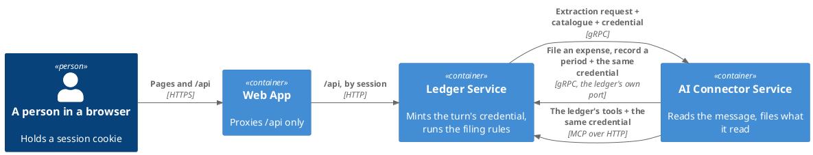

# Turn Operations

What the ledger offers a connector that files a turn's results itself.



## The Catalogue on the Extraction Request

| Field                    | Holds                                                                                  |
|--------------------------|----------------------------------------------------------------------------------------|
| `catalogue`              | one entry per grouping holding at least one category, groupings in alphabetical order |
| `catalogue[].grouping`   | the grouping's name                                                                    |
| `catalogue[].categories` | the names of the categories under it, in alphabetical order, at least one             |

Every existing request field keeps its meaning. `category_groupings` stays, and names exactly the groupings
`catalogue` names, in the same order. Both come from one read of the person's categories.

## The Operations

`LedgerTurnService`, in its own file `proto/ledger_turn.proto` under the package `bot.finance.ledger.v1` (DN05),
served by the ledger on `LEDGER_GRPC_PORT` (DN06) and called by the connector. Both operations act as the
credential's subject, for the message the credential names. Each runs the
same rules as its tool, and a filed expense publishes the same proposal-created fact on the change stream. Neither
is idempotent: two calls store two rows, as the tools do.

| Operation              | Request                                                                                | Answer                                                                                      |
|------------------------|----------------------------------------------------------------------------------------|---------------------------------------------------------------------------------------------|
| `FileExpenseProposal`  | `grouping`, `category`, `description`, `merchant` (optional), `amount`, `currency_code` | `id`, `grouping`, `category`, `description`, `merchant`, `amount`, `currency_code`, `created_at` |
| `RecordSpendingPeriod` | `from`, `to`                                                                           | `from`, `to`                                                                                |

| Field           | Bound                                                                                                            |
|-----------------|------------------------------------------------------------------------------------------------------------------|
| `amount`        | the currency's main unit, as the message wrote it — `7200` for 7200 HUF                                          |
| `amount`        | surrounding whitespace dropped, then 1–18 digits, optionally a dot and 1–4 digits; no sign, exponent or grouping |
| `currency_code` | ISO 4217, three letters                                                                                          |
| `merchant`      | an optional field; absent and blank are both no merchant, and an answer with no merchant leaves it absent        |
| `from`, `to`    | `YYYY-MM-DD`; `to` not before `from`                                                                             |
| `created_at`    | the instant the entry was stored, in UTC, as RFC 3339 — `2026-10-13T09:15:00Z`                                   |

Every other bound is the [expense](../../ledger-service/docs/domain/expense.md)'s and the
[spending period](../../ledger-service/docs/domain/spending-period.md)'s, unchanged.

| Status             | When                                                                                       | Description says                              |
|--------------------|--------------------------------------------------------------------------------------------|-----------------------------------------------|
| `INVALID_ARGUMENT` | a field is missing, malformed, or breaks a bound                                           | the request is invalid, naming the field      |
| `INVALID_ARGUMENT` | the grouping is not one of the person's                                                    | the grouping, repeated                        |
| `INVALID_ARGUMENT` | the grouping holds no category of that name                                                | the category and the grouping                 |
| `INVALID_ARGUMENT` | a day is not written `YYYY-MM-DD`                                                          | the day at fault and the value                |
| `INVALID_ARGUMENT` | the period's last day is before its first                                                  | the period ends before it starts              |
| `INVALID_ARGUMENT` | the subject is not a stored user's id at all                                               | the request is invalid                        |
| `UNAUTHENTICATED`  | no credential; expired past the skew; wrong issuer, audience or lifetime; no message reference | nothing                                   |
| `NOT_FOUND`        | the subject names no stored user                                                           | the caller is unknown                         |
| `UNAVAILABLE`      | the store cannot be reached                                                                | that it could not be stored, nothing internal |
| `INTERNAL`         | anything else                                                                              | that the call could not be completed          |

Every reason is the one the matching tool gives for the same input. `INVALID_ARGUMENT` is about this one call: the
caller may go on with the next. Every other status, or no answer, is about the turn. Each refusal is logged with
its kind, and with neither the request nor the token.

## Who May Call

- The credential is the one the ledger mints per turn and the tools already take. It is checked exactly as the
  tools check it: signature against the ledger's own key, `MCP_JWT_CLOCK_SKEW`, issuer, audience and the
  `MCP_JWT_TTL` lifetime ceiling. The check never depends on another setting, and needs no key-set fetch.
- It travels as call metadata, `authorization: Bearer <token>`, and is verified before the request is read. The
  person and the message it names travel with the call to the operation and to the call line.
- The server's health and reflection services answer without a credential.
- `LEDGER_GRPC_PORT` defaults to `1006`. It is reached on the services' own network and published to no host. The
  web app proxies `/api` only, so no browser route leads to it. A test run binds it to a free port.
- `MCP_ENABLED` does not switch these operations off.
- Each call is timed by the server's call metrics, by method and status.

## The Call Line

One line per call made for a turn, whichever way the call arrived. It carries the person and the arguments, so it
is written only where `TURN_CALL_LOG_ENABLED` is on (DN07). It is off by default, and the evaluation stack turns
it on.

```
turn_call operation=<operation> via=<mcp|grpc> outcome=<ok|rejected> userId=<id|none> message=<id|none> arguments=<json>
```

| Part        | Holds                                                                                              |
|-------------|----------------------------------------------------------------------------------------------------|
| `operation` | `create_expense_proposal`, `list_categories` or `summarize_spending`, whichever way it arrived     |
| `via`       | `mcp` for a tool call, `grpc` for a turn operation                                                 |
| `outcome`   | `ok`, or `rejected` for any refusal                                                                |
| `arguments` | the arguments as the tool names them: `grouping`, `category`, `description`, `merchant`, `amount`, `currencyCode`, `from`, `to` |

`FileExpenseProposal` logs as `create_expense_proposal` and `RecordSpendingPeriod` as `summarize_spending`, so a
case's expected calls hold in either mode. The evaluation runner reads this line in place of `mcp_call`, and its
expectations stay keyed by operation.
