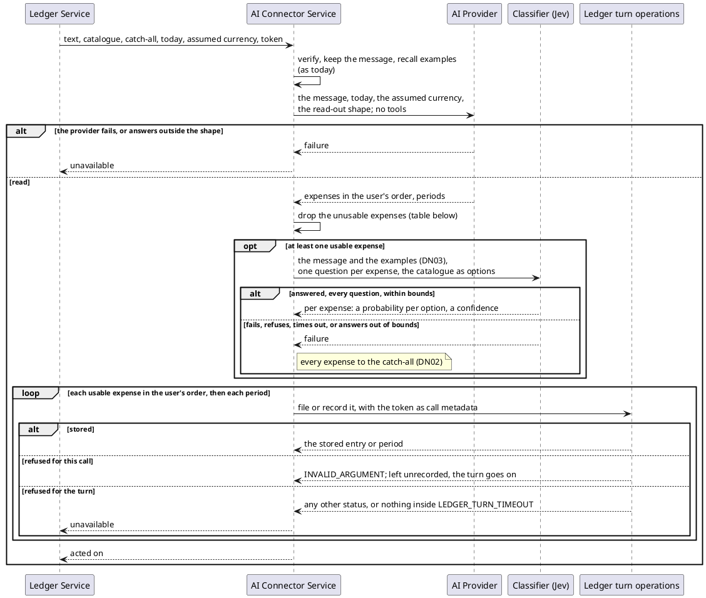

# The Classifier Turn

`EXTRACTION_MODE` is read once at startup. Unset or `tools`, every turn is today's. `classifier`, every turn is the
one below. Everything before the provider call — the token, keeping the message, recalling examples — is today's
turn, unchanged. Recall still runs, since it stores the message's vector for later turns, but the model is given
no examples: they name categories, and this model names none.

## The Exchange

A failure that ends the turn while filing expenses also loses the periods not yet recorded. Totals cover recorded
spending only, so the order changes no figure.

Each ledger call runs inside the ledger's own extraction call, so it ends at `LEDGER_TURN_TIMEOUT` or at that
call's deadline, whichever comes first. Once the ledger stops waiting, the filings left are cancelled, and the
turn ends unavailable. The tool-calling turn runs on past that point; this one does not.

Before either mode runs, the request's catalogue must hold an entry for the catch-all grouping and no entry
without a category. Otherwise the call is refused as an invalid argument (AC17).

## Choosing a Category

| The classifier's answer for one expense            | Filed under                                                             |
|----------------------------------------------------|-------------------------------------------------------------------------|
| confidence at or above `CLASSIFIER_MIN_CONFIDENCE` | the most probable option's grouping and category                        |
| confidence below it                                | the catch-all grouping, in its most probable category there (DN01)      |
| no answer: the call failed (DN02)                  | the catch-all grouping, in its first category as the catalogue lists it |

An option is mapped back to its grouping and category through the catalogue it was built from, never by reading
the option's text: a category name may itself hold a `/`.

## An Expense the Read-Out Cannot File

| The read-out                                       | What happens                                  |
|----------------------------------------------------|-----------------------------------------------|
| no currency, and the request assumes one           | filed in the assumed currency                 |
| no currency, and the request assumes none          | left unrecorded; never sent to the classifier |
| a currency that is not ISO 4217                    | left unrecorded; never sent to the classifier |
| an amount that is not a positive decimal           | left unrecorded; never sent to the classifier |
| a blank description                                | left unrecorded; never sent to the classifier |

Each unrecorded expense is logged with its reason and without the message text.
