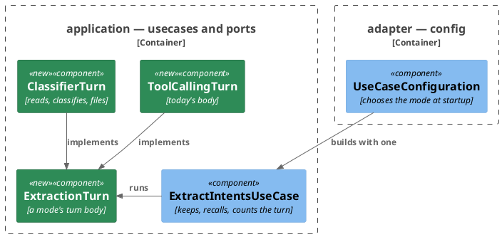
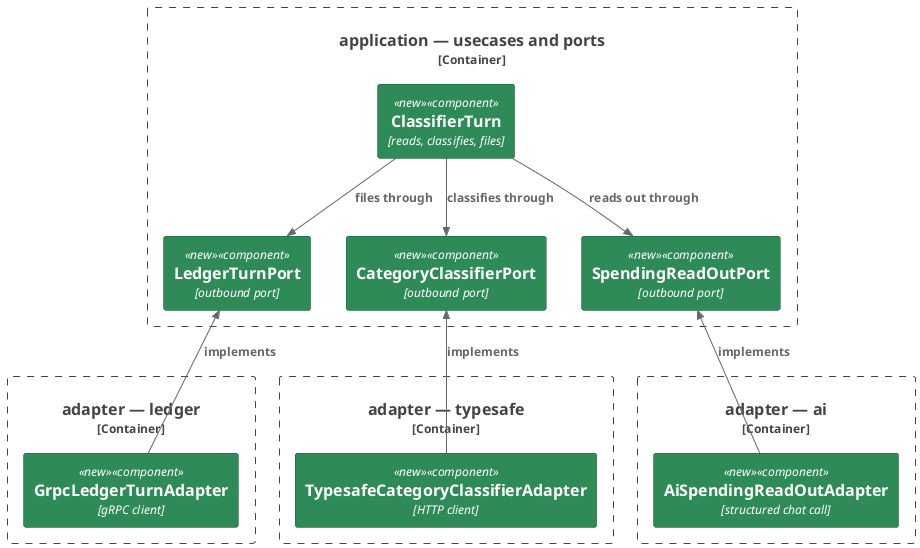
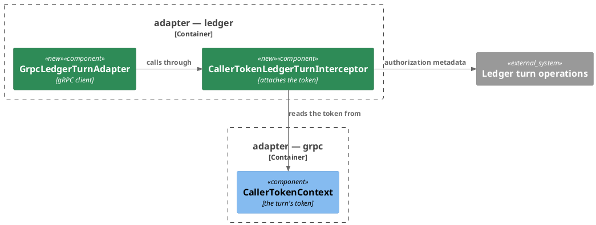
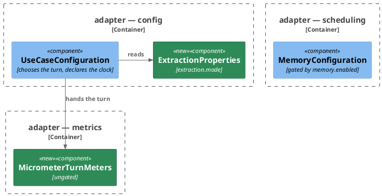

# Plan: The Connector Files a Message's Spending with a Classifier — `ai-connector-service`

**Format:** 2
**Affected Modules:** `ai-connector-service`
**Spec:** [The Connector Files a Message's Spending with a Classifier](spec.md)

Both schemas the turn speaks are already in `proto/` and already generate into this build, so nothing crosses
modules and no shared plan exists. What the design leaves to this plan: where the mode is chosen, the classes
running the classifier turn, the three outbound adapters it calls, the meters, and the startup checks. The wire
paths, fields, settings and meters are the design's, in [The two calls](the-two-calls.md).

## Architecture Decisions

### The use case keeps the turn's front and hands its body to the configured mode



**Placement:** `ExtractionTurn` sits in `application/usecase` beside the use case, and `adapter/config` builds the
use case with the mode's implementation, so keeping the message and recalling examples stay in one place for both
modes.

### The classifier turn reaches three systems through three ports



**Placement:** The classifier gets a subpackage of its own, `adapter/typesafe`, as each external system does. The
turn operations join `adapter/ledger`, which already fronts the ledger. The read-out stays in `adapter/ai` with the
provider.

### The caller token rides the ledger channel through an interceptor of its own



**Placement:** The token is attached by a `ClientInterceptor` on the channel, as `CallerTokenMcpRequestCustomizer`
does for the MCP client, so the adapter maps requests and statuses only.

### The mode, the clock and the turn meters register whatever the memory says



**Placement:** `extraction.*` binds in `adapter/config`, which reads it to choose the turn; the `Clock` moves there
from the memory-gated `MemoryConfiguration`, and `MicrometerTurnMeters` is the one ungated metrics bean, since a
turn runs with the memory off.

## Step-by-Step Implementation Map (To-Do List)

### Stabilization

#### Interface-First / Build Stabilization

New-method stubs carry an intent comment starting `stub-intent:`.

**Interface & Signature Sync**

- [x] ST01 · Add `org.springframework.boot:spring-boot-starter-grpc-client` to `build.gradle`'s dependencies,
  beside the gRPC server starter
  - writes: `ai-connector-service/build.gradle`
- [x] ST02 · Add the domain values `CatalogueEntry(String grouping, List<String> categories)` and
  `CategoryChoice(String grouping, String category)` to `domain/value`, and the enum
  `ExtractionMode { TOOLS, CLASSIFIER }` with `tagValue()` answering `tools` or `classifier`. `CatalogueEntry`'s
  compact constructor copies its list, and each of the two carries a `TODO` naming the checks still owed
  - writes: `ai-connector-service/src/main/java/bot/finance/ai/domain/value/CatalogueEntry.java`,
    `ai-connector-service/src/main/java/bot/finance/ai/domain/value/CategoryChoice.java`,
    `ai-connector-service/src/main/java/bot/finance/ai/domain/value/ExtractionMode.java`
- [x] ST03 · Add the domain value `ExpenseToFile(String description, Optional<String> merchant, String amount,
  CurrencyCode currency)` to `domain/value`, with a `TODO` naming the checks still owed
  - writes: `ai-connector-service/src/main/java/bot/finance/ai/domain/value/ExpenseToFile.java`
- [x] ST04 · Add the domain exceptions `ClassificationFailedException` and `LedgerCallRefusedException` to
  `domain/exception`, each with a message constructor and a message-and-cause constructor
  - writes: `ai-connector-service/src/main/java/bot/finance/ai/domain/exception/ClassificationFailedException.java`,
    `ai-connector-service/src/main/java/bot/finance/ai/domain/exception/LedgerCallRefusedException.java`
- [x] ST05 · Add a component `List<CatalogueEntry> catalogue` to `ExtractIntentsCommand`, after
  `messageIdentity`. The record copies it and refuses a null list, with a `TODO` naming the catch-all check still
  owed. `ExtractIntentsRequestReader.toCommand()` passes each request `catalogue` entry as a `CatalogueEntry`,
  with a `TODO` naming its own checks still owed · after: ST02
  - every test constructing a command — `ExtractIntentsCommandTest`, `ExtractIntentsUseCaseTest` — passes a
    catalogue holding one entry per grouping it names, each entry holding one category named after its grouping,
    and keeps its assertion. A test passing a null or blank grouping list passes an empty catalogue
  - writes: `ai-connector-service/src/main/java/bot/finance/ai/application/dto/ExtractIntentsCommand.java`,
    `ai-connector-service/src/main/java/bot/finance/ai/adapter/grpc/ExtractIntentsRequestReader.java`,
    `ai-connector-service/src/test/java/bot/finance/ai/application/dto/ExtractIntentsCommandTest.java`,
    `ai-connector-service/src/test/java/bot/finance/ai/application/usecase/ExtractIntentsUseCaseTest.java`
- [x] ST06 · Add a component `Optional<String> merchant` to `ExampleExpense`, after `description`, with a `TODO`
  naming the null check still owed. `RecordedExpenseEntity.toExampleExpense()` passes `Optional.empty()`, with a `TODO` naming the
  stored merchant still to be passed · after: ST05
  - every test constructing an example expense — `ExampleExpenseTest`, `MessageExampleTest`,
    `RecallExamplesUseCaseTest`, `ExtractIntentsUseCaseTest`, `ExampleSectionRendererTest`,
    `AiExpenseRecordingAdapterTest` — passes `Optional.empty()` for it, and keeps its assertion
  - writes: `ai-connector-service/src/main/java/bot/finance/ai/domain/value/ExampleExpense.java`,
    `ai-connector-service/src/main/java/bot/finance/ai/adapter/persistence/RecordedExpenseEntity.java`,
    `ai-connector-service/src/test/java/bot/finance/ai/domain/value/ExampleExpenseTest.java`,
    `ai-connector-service/src/test/java/bot/finance/ai/domain/value/MessageExampleTest.java`,
    `ai-connector-service/src/test/java/bot/finance/ai/application/usecase/RecallExamplesUseCaseTest.java`,
    `ai-connector-service/src/test/java/bot/finance/ai/application/usecase/ExtractIntentsUseCaseTest.java`,
    `ai-connector-service/src/test/java/bot/finance/ai/adapter/ai/ExampleSectionRendererTest.java`,
    `ai-connector-service/src/test/java/bot/finance/ai/adapter/ai/AiExpenseRecordingAdapterTest.java`
- [x] ST07 · Add the outbound-port results to `application/dto`, with no checks of their own:
  `SpendingReadOut(List<ReadOutExpense> expenses, List<ReadOutPeriod> periods)`,
  `ReadOutExpense(String description, String merchant, String amount, String currency)`,
  `ReadOutPeriod(LocalDate from, LocalDate to)` and
  `ExpenseClassification(Integer position, CategoryChoice choice, Double confidence,
  Map<CategoryChoice, Double> probabilities)` · after: ST02
  - writes: `ai-connector-service/src/main/java/bot/finance/ai/application/dto/SpendingReadOut.java`,
    `ai-connector-service/src/main/java/bot/finance/ai/application/dto/ReadOutExpense.java`,
    `ai-connector-service/src/main/java/bot/finance/ai/application/dto/ReadOutPeriod.java`,
    `ai-connector-service/src/main/java/bot/finance/ai/application/dto/ExpenseClassification.java`
- [x] ST08 · Add the outbound ports to `application/port` · after: ST03, ST04, ST07
  - writes: `ai-connector-service/src/main/java/bot/finance/ai/application/port/SpendingReadOutPort.java`,
    `ai-connector-service/src/main/java/bot/finance/ai/application/port/CategoryClassifierPort.java`,
    `ai-connector-service/src/main/java/bot/finance/ai/application/port/LedgerTurnPort.java`,
    `ai-connector-service/src/main/java/bot/finance/ai/application/port/TurnMeters.java`
  ```java
  public interface SpendingReadOutPort {
      /** @throws ExpenseRecordingFailedException if the provider fails or answers outside the read-out shape */
      SpendingReadOut readOut(String text, LocalDate currentDate, Optional<CurrencyCode> assumedCurrency);
  }

  public interface CategoryClassifierPort {
      /** @throws ClassificationFailedException if the classifier fails, times out or names an unknown option */
      List<ExpenseClassification> classify(
              String text, List<MessageExample> examples, List<ExpenseToFile> expenses, List<CatalogueEntry> catalogue);
  }

  public interface LedgerTurnPort {
      /**
       * @throws LedgerCallRefusedException if the ledger refuses this one call
       * @throws ExpenseRecordingFailedException if the ledger answers any other failure, or not in time
       */
      void fileExpense(CategoryChoice category, ExpenseToFile expense);

      /** Throws as {@link #fileExpense}. */
      void recordPeriod(LocalDate from, LocalDate to);
  }

  public interface TurnMeters {
      void recordTurn(ExtractionMode mode, boolean actedOn);

      void recordClassifierCall(Duration duration, boolean answered);

      void recordConfidence(double confidence);

      void countLowConfidence();
  }
  ```
- [x] ST09 · Add the interface `ExtractionTurn` to `application/usecase`, with `ExtractionMode mode()` and
  `void run(ExtractIntentsCommand command, Optional<List<MessageExample>> examples)`. Add `ToolCallingTurn`
  implementing it: it takes `ExpenseRecordingPort`, answers `TOOLS`, and makes the call to
  `ExpenseRecordingPort.record()` that `ExtractIntentsUseCase` makes today, with the same arguments.
  `ExtractIntentsUseCase` takes `ExtractionTurn` and `TurnMeters` in place of `ExpenseRecordingPort`, and calls
  `run()` where it called `record()`, with a `TODO` naming the turn meter still owed. `UseCaseConfiguration`
  builds the use case with a `ToolCallingTurn` · after: ST08
  - premise: the use case reaches `ExpenseRecordingPort` through a `ToolCallingTurn` built around the same mock ·
    `ExtractIntentsUseCaseTest` builds the use case with `new ToolCallingTurn(expenseRecordingPort)` and a mocked
    `TurnMeters`, and every verification on `expenseRecordingPort` stands
  - writes: `ai-connector-service/src/main/java/bot/finance/ai/application/usecase/ExtractionTurn.java`,
    `ai-connector-service/src/main/java/bot/finance/ai/application/usecase/ToolCallingTurn.java`,
    `ai-connector-service/src/main/java/bot/finance/ai/application/usecase/ExtractIntentsUseCase.java`,
    `ai-connector-service/src/main/java/bot/finance/ai/adapter/config/UseCaseConfiguration.java`,
    `ai-connector-service/src/test/java/bot/finance/ai/application/usecase/ExtractIntentsUseCaseTest.java`
- [x] ST10 · Add `ClassifierTurn` to `application/usecase`, implementing `ExtractionTurn`, taking
  `SpendingReadOutPort`, `CategoryClassifierPort`, `LedgerTurnPort`, `TurnMeters`, `Clock`, the minimum confidence
  as a `double` and `LoggerFactory`, with stubs · after: ST09
  - writes: `ai-connector-service/src/main/java/bot/finance/ai/application/usecase/ClassifierTurn.java`
  ```java
  @Override
  public ExtractionMode mode() {
      return ExtractionMode.CLASSIFIER;
  }

  @Override
  public void run(ExtractIntentsCommand command, Optional<List<MessageExample>> examples) {
      // stub-intent: reads the message out, drops and logs each unusable expense, asks the classifier once about
      // the usable ones with the message and the examples, chooses each one's category, then files each expense
      // in the user's order and records each period, going on past a refused call and stopping on any other
      // failure
  }
  ```
- [x] ST11 · Add `MicrometerTurnMeters` to `adapter/metrics`, a `@Component` registered whatever
  `memory.enabled` says, implementing `TurnMeters` with empty methods. `MeterName` gains `TURNS`
  (`ai_turns_total`), `CLASSIFIER_SECONDS` (`ai_classifier_seconds`), `CLASSIFIER_CONFIDENCE`
  (`ai_classifier_confidence`) and `CLASSIFIER_LOW_CONFIDENCE` (`ai_classifier_low_confidence_total`). The module's
  architecture conventions name it as the one bean of `adapter/metrics` that `memory.enabled` does not gate · after:
  ST08
  - `adapter/metrics/package-info.java` names `MicrometerTurnMeters` and the `TurnMeters` port among the
    package's classes
  - writes: `ai-connector-service/src/main/java/bot/finance/ai/adapter/metrics/MicrometerTurnMeters.java`,
    `ai-connector-service/src/main/java/bot/finance/ai/adapter/metrics/package-info.java`,
    `ai-connector-service/src/main/java/bot/finance/ai/adapter/metrics/MeterName.java`,
    `ai-connector-service/docs/conventions/architecture.md`
- [x] ST12 · Add `AiSpendingReadOutAdapter` to `adapter/ai`, a `@Component` implementing `SpendingReadOutPort`,
  taking a second chat client `spendingReadOutChatClient` by qualifier and `LoggerFactory`, its `readOut()`
  stubbed to answer an empty read-out with a `stub-intent:` comment. `ChatClientConfiguration` declares that bean
  from the injected builder with the system prompt `prompts/read-out-spending.st`, and marks the existing
  `chatClient` `@Primary`. `ExpenseRecordingProperties` gains `Resource readOutSystemPrompt` and
  `Resource readOutMessageTemplate`, bound to `ai.expense.read-out-system-prompt` and
  `ai.expense.read-out-message-template`; both prompt files hold the design's instructions: the request's day, the
  assumed currency, today's period rules, and no grouping, category or tool · after: ST08
  - writes: `ai-connector-service/src/main/java/bot/finance/ai/adapter/ai/AiSpendingReadOutAdapter.java`,
    `ai-connector-service/src/main/java/bot/finance/ai/adapter/ai/ChatClientConfiguration.java`,
    `ai-connector-service/src/main/java/bot/finance/ai/adapter/ai/ExpenseRecordingProperties.java`,
    `ai-connector-service/src/main/resources/prompts/read-out-spending.st`,
    `ai-connector-service/src/main/resources/prompts/read-out-message.st`,
    `ai-connector-service/src/main/resources/application.yaml`
- [x] ST13 · Add the subpackage `adapter/typesafe` with its `package-info.java`, and in it
  `TypesafeCategoryClassifierAdapter`, a `@Component` implementing `CategoryClassifierPort` and registered only
  with `extraction.mode=classifier`, its `classify()` stubbed to answer an empty list with a `stub-intent:` comment;
  `TypesafeClassifierProperties(String apiKey, URI baseUrl, String model, Duration timeout, double minConfidence)`
  bound to `classifier`; and `TypesafeClassifierConfiguration`, registered only in that mode, enabling the
  properties and declaring a `RestClient` bean on the base URL with the API key as a bearer credential and the
  timeout as its read and connect timeout. The module's architecture conventions list the subpackage beside
  `adapter/ai` · after: ST08
  - writes: `ai-connector-service/src/main/java/bot/finance/ai/adapter/typesafe/package-info.java`,
    `ai-connector-service/src/main/java/bot/finance/ai/adapter/typesafe/TypesafeCategoryClassifierAdapter.java`,
    `ai-connector-service/src/main/java/bot/finance/ai/adapter/typesafe/TypesafeClassifierProperties.java`,
    `ai-connector-service/src/main/java/bot/finance/ai/adapter/typesafe/TypesafeClassifierConfiguration.java`,
    `ai-connector-service/docs/conventions/architecture.md`
- [x] ST14 · Add `SystemOneRequestMapper` to `adapter/typesafe`, a stateless mapper with stubs · after: ST13
  - writes: `ai-connector-service/src/main/java/bot/finance/ai/adapter/typesafe/SystemOneRequestMapper.java`
  ```java
  static Map<String, Object> toRequest(
          String model,
          String text,
          List<MessageExample> examples,
          List<ExpenseToFile> expenses,
          List<CatalogueEntry> catalogue) {
      // stub-intent: builds the classifier's body: the model, the state holding the message text and each
      // example's decided expenses without amounts, currencies or earlier text, and one choice question per
      // expense keyed by its position, offering one option per catalogue pair keyed "<grouping> / <category>"
      return Map.of();
  }

  static List<ExpenseClassification> fromAnswer(JsonNode answer, List<CatalogueEntry> catalogue) {
      // stub-intent: reads each question's choice, confidence and probabilities back, mapping each option key to
      // its pair through the catalogue the request was built from; an option no pair holds is a failure
      return List.of();
  }
  ```
- [x] ST15 · Add `GrpcLedgerTurnAdapter` to `adapter/ledger`, a `@Component` implementing `LedgerTurnPort` and
  registered only with `extraction.mode=classifier`, taking the generated
  `LedgerTurnServiceGrpc.LedgerTurnServiceBlockingStub` and `LedgerTurnProperties`, with both methods stubbed to
  return with a `stub-intent:` comment. Add `LedgerTurnProperties(String target, Duration timeout)` bound to
  `ledger.turn`, and `LedgerTurnConfiguration`, registered only in that mode, enabling the properties and
  declaring the channel from `GrpcChannelFactory.createChannel("ledger-turn")` — the named channel whose target
  `spring.grpc.client.channel.ledger-turn.target` reads `${ledger.turn.target}` — and the blocking stub on it,
  intercepted by `CallerTokenLedgerTurnInterceptor`. The module's architecture conventions say `adapter/ledger`
  also fronts the ledger's turn operations · after: ST01, ST08
  - writes: `ai-connector-service/src/main/java/bot/finance/ai/adapter/ledger/GrpcLedgerTurnAdapter.java`,
    `ai-connector-service/src/main/java/bot/finance/ai/adapter/ledger/LedgerTurnProperties.java`,
    `ai-connector-service/src/main/java/bot/finance/ai/adapter/ledger/LedgerTurnConfiguration.java`,
    `ai-connector-service/src/main/resources/application.yaml`,
    `ai-connector-service/docs/conventions/architecture.md`
- [x] ST16 · Add `ExtractionProperties(String mode)` to `adapter/config`, bound to `extraction`, enabled there.
  `UseCaseConfiguration` declares the `ExtractionTurn` bean twice: a `ToolCallingTurn` with
  `extraction.mode=tools` or the property missing, and a `ClassifierTurn` with `extraction.mode=classifier`,
  built with the `Clock` bean and `TypesafeClassifierProperties.minConfidence()`. The `Clock` bean moves from
  `MemoryConfiguration`, which registers only with the memory on, to `UseCaseConfiguration`, unconditionally. The
  module's architecture conventions say `extraction.*` binds in `adapter/config`, which reads it to choose the
  turn and declares the clock · after: ST10, ST13
  - writes: `ai-connector-service/src/main/java/bot/finance/ai/adapter/config/ExtractionProperties.java`,
    `ai-connector-service/src/main/java/bot/finance/ai/adapter/config/UseCaseConfiguration.java`,
    `ai-connector-service/src/main/java/bot/finance/ai/adapter/scheduling/MemoryConfiguration.java`,
    `ai-connector-service/src/test/java/bot/finance/ai/common/boot/PersistenceAdapterTest.java`,
    `ai-connector-service/src/test/java/bot/finance/ai/adapter/persistence/JdbcChangeAttemptStoreAdapterTest.java`,
    `ai-connector-service/src/test/java/bot/finance/ai/adapter/persistence/JdbcMessageMemoryAdapterTest.java`,
    `ai-connector-service/src/test/java/bot/finance/ai/adapter/persistence/JdbcRecordedExpenseStoreAdapterTest.java`,
    `ai-connector-service/docs/conventions/architecture.md`
- [x] ST18 · `CleanArchitectureTest.coreTypesCarryNoExternalSystemName` gains `Typesafe`, `TypeSafe`, `SystemOne`
  and `Jev`
  - writes: `ai-connector-service/src/test/java/bot/finance/ai/architecture/CleanArchitectureTest.java`,
    `ai-connector-service/docs/conventions/architecture.md`
- [x] ST28 · Add `CallerTokenLedgerTurnInterceptor` to `adapter/ledger`, a gRPC `ClientInterceptor`, with a stub.
  The module's testing conventions list it beside `CallerTokenMcpRequestCustomizer` as a unit target · after: ST15
  - writes: `ai-connector-service/src/main/java/bot/finance/ai/adapter/ledger/CallerTokenLedgerTurnInterceptor.java`,
    `ai-connector-service/docs/conventions/testing.md`
  ```java
  @Override
  public <ReqT, RespT> ClientCall<ReqT, RespT> interceptCall(
          MethodDescriptor<ReqT, RespT> method, CallOptions callOptions, Channel next) {
      // stub-intent: attaches the turn's caller token as `authorization: Bearer <token>` metadata, read from
      // CallerTokenContext; a call made with no token held is failed before it is sent
      return next.newCall(method, callOptions);
  }
  ```

**Configuration**

- [x] ST19 · In `application.yaml`: `extraction.mode: ${EXTRACTION_MODE:tools}`; `classifier.api-key:
  ${TYPESAFE_API_KEY:}`, `classifier.base-url: ${TYPESAFE_BASE_URL:https://api.typesafe.ai}`,
  `classifier.model: ${CLASSIFIER_MODEL:}`, `classifier.timeout: ${CLASSIFIER_TIMEOUT:3s}`,
  `classifier.min-confidence: ${CLASSIFIER_MIN_CONFIDENCE:0.5}`; `ledger.turn.target: ${LEDGER_TURN_TARGET:}`,
  `ledger.turn.timeout: ${LEDGER_TURN_TIMEOUT:5s}`. Compose sets `LEDGER_TURN_TARGET` to
  `static://ledger-service:1006` for the connector. Each setting joins the module's configuration table with its
  default, as [The two calls](the-two-calls.md) lists them
  - writes: `ai-connector-service/src/main/resources/application.yaml`, `infrastructure/docker-compose.yaml`,
    `ai-connector-service/docs/configuration.md`

**Shared Test Infrastructure**

- [x] ST20 · `RequestFixtures` gives every request a catalogue: one entry per grouping it names, each holding one
  category named after its grouping, and adds `requestWithCatalogue(String text, List<GroupingCategories>
  catalogue, String catchAllGrouping)`, which sets the groupings from the catalogue's · after: ST05
  - writes: `ai-connector-service/src/test/java/bot/finance/ai/common/fixtures/RequestFixtures.java`
- [x] ST21 · `ChatCompletionFixtures` gains `readOut(String json)`: a whole chat-completion body whose message
  content is the given read-out JSON, with no `tool_calls`
  - writes: `ai-connector-service/src/test/java/bot/finance/ai/common/fixtures/ChatCompletionFixtures.java`
- [x] ST22 · Add `ClassifierStubs` to `common/stubs`: one static method per outcome of `POST /v1/systemone` on
  `WireMockSupport.SERVER` — answered with a given body, answered with a status, answered slower than a given
  delay, answered with an unparseable body. Add `SystemOneFixtures` to `common/fixtures`, building an answer body
  from per-question choice, confidence and probabilities. `WireMockUrlConfiguration` and `AbstractSystemTest`
  point `classifier.base-url` at the stub server. Both listed in the module's testing conventions
  - writes: `ai-connector-service/src/test/java/bot/finance/ai/common/stubs/ClassifierStubs.java`,
    `ai-connector-service/src/test/java/bot/finance/ai/common/fixtures/SystemOneFixtures.java`,
    `ai-connector-service/src/test/java/bot/finance/ai/common/boot/WireMockUrlConfiguration.java`,
    `ai-connector-service/src/test/java/bot/finance/ai/common/boot/AbstractSystemTest.java`,
    `ai-connector-service/docs/conventions/testing.md`
- [x] ST23 · Add `LedgerTurnServer` to `common/containers`: a JVM-wide gRPC server on a random real port serving
  a fake `LedgerTurnService`, which records each request with its `authorization` metadata and answers the outcome
  scripted for it — stored, refused with a given status, or never answering. Add `LedgerTurnStubs` to
  `common/stubs`: scripting one outcome per call in order, reading the recorded calls back, and resetting. A
  `LedgerTurnServerTest` completes one call through it. Both listed in the module's testing conventions
  - writes: `ai-connector-service/src/test/java/bot/finance/ai/common/containers/LedgerTurnServer.java`,
    `ai-connector-service/src/test/java/bot/finance/ai/common/stubs/LedgerTurnStubs.java`,
    `ai-connector-service/src/test/java/bot/finance/ai/common/containers/LedgerTurnServerTest.java`,
    `ai-connector-service/docs/conventions/testing.md`
- [x] ST24 · Add the composed annotations `ClassifierAdapterTest` — booting `TypesafeCategoryClassifierAdapter`
  and `TypesafeClassifierConfiguration` with `extraction.mode=classifier`, a key, a model and `classifier.timeout=1s`,
  over `WireMockUrlConfiguration` — and `LedgerTurnAdapterTest` — booting `GrpcLedgerTurnAdapter` and
  `LedgerTurnConfiguration` with Spring gRPC's client autoconfiguration, `extraction.mode=classifier`,
  `ledger.turn.target` at `LedgerTurnServer`'s port and `ledger.turn.timeout=1s`. `ClassifierAdapterTestBootTest`
  and `LedgerTurnAdapterTestBootTest` boot them. Listed in the module's testing conventions under `boot` and the
  outbound integration layer · after: ST22, ST23
  - writes: `ai-connector-service/src/test/java/bot/finance/ai/common/boot/ClassifierAdapterTest.java`,
    `ai-connector-service/src/test/java/bot/finance/ai/common/boot/ClassifierAdapterTestBootTest.java`,
    `ai-connector-service/src/test/java/bot/finance/ai/common/boot/LedgerTurnAdapterTest.java`,
    `ai-connector-service/src/test/java/bot/finance/ai/common/boot/LedgerTurnAdapterTestBootTest.java`,
    `ai-connector-service/docs/conventions/testing.md`
- [x] ST25 · Add `AbstractClassifierSystemTest` to `common/boot`, extending `AbstractSystemTest` with
  `extraction.mode=classifier`, a key, a model, `ledger.turn.target` at `LedgerTurnServer`'s port, and
  `LedgerTurnStubs` reset before and after each test. `AbstractClassifierSystemTestBootTest` boots it. Listed in
  the module's testing conventions · after: ST22, ST23
  - writes: `ai-connector-service/src/test/java/bot/finance/ai/common/boot/AbstractClassifierSystemTest.java`,
    `ai-connector-service/src/test/java/bot/finance/ai/common/boot/AbstractClassifierSystemTestBootTest.java`,
    `ai-connector-service/docs/conventions/testing.md`
- [x] ST26 · `AiAdapterTest` boots `AiSpendingReadOutAdapter`; `MetricsAdapterTest` imports
  `MicrometerTurnMeters`
  - writes: `ai-connector-service/src/test/java/bot/finance/ai/common/boot/AiAdapterTest.java`,
    `ai-connector-service/src/test/java/bot/finance/ai/common/boot/MetricsAdapterTest.java`

#### Closing item

- [x] ST27 · `tools/agent-test/agent-test.sh --module ai-connector-service --tests "bot.finance.ai.architecture.CleanArchitectureTest"`
  passes, and the existing suite stays green
  - writes: none

### Red Phase

#### TDD Unit Red Phase

- [ ] RU01 · `CatalogueEntry` · test: `CatalogueEntryTest` · covers: `CatalogueEntry()` · scenarios: AC17
  - `CatalogueEntry()`:
    - given: a null or blank grouping
      when: the entry is constructed
      then: throws InvalidValueException
    - given: a null or empty category list, or one holding a null or blank name, or a name twice
      when: the entry is constructed
      then: throws InvalidValueException
- [ ] RU02 · `ExtractIntentsCommand` · test: `ExtractIntentsCommandTest` · covers: `ExtractIntentsCommand()` ·
  scenarios: AC17
  - `ExtractIntentsCommand()`:
    - given: a catalogue with no entry for the catch-all grouping
      when: the command is constructed
      then: throws InvalidValueException
    - given: a catalogue holding a null entry
      when: the command is constructed
      then: throws InvalidValueException
    - given: a catalogue naming one grouping twice, or naming groupings other than the command's groupings or in
      another order
      when: the command is constructed
      then: throws InvalidValueException
- [ ] RU03 · `ExpenseToFile` · test: `ExpenseToFileTest` · covers: `ExpenseToFile()` · scenarios: AC14
  - `ExpenseToFile()`:
    - given: a null or blank description, a null merchant `Optional`, a null amount or a null currency
      when: the expense is constructed
      then: throws InvalidValueException
    - given: an amount that is not a positive decimal — `0`, `-4`, `1e3`, `abc`
      when: the expense is constructed
      then: throws InvalidValueException
    - given: a merchant present but blank
      when: the expense is constructed
      then: its merchant reads absent
- [ ] RU04 · `ExampleExpense` · test: `ExampleExpenseTest` · covers: `ExampleExpense()` · scenarios: AC11
  - `ExampleExpense()`:
    - given: a null merchant `Optional`
      when: the example expense is constructed
      then: throws InvalidValueException
- [ ] RU05 · `RecordedExpenseEntity` · test: `RecordedExpenseEntityTest` · covers: `toExampleExpense()` · scenarios:
  AC11
  - `toExampleExpense()`:
    - given: a row with a merchant
      when: it is turned into an example expense
      then: the example carries that merchant
- [ ] RU06 · `ExtractIntentsUseCase` · test: `ExtractIntentsUseCaseTest` · covers: `extractIntents()` · scenarios:
  AC12, AC13
  - `extractIntents()`:
    - given: the turn returns
      when: the turn ends
      then: the turn is counted under the turn's mode as acted on
    - given: the turn throws ExpenseRecordingFailedException
      when: the turn ends
      then: the turn is counted under its mode as unavailable, and the same exception propagates
- [ ] RU08 · `ClassifierTurn` · test: `ClassifierTurnTest` · covers: `run()`, `mode()` · scenarios: AC01, AC02,
  AC03, AC04, AC05, AC06, AC07, AC08, AC09, AC10, AC11, AC13, AC14, AC15
  - `run()`:
    - given: the read-out holds `coffee`, `4.50`, `EUR`, and the classifier answers `Dining / Cafés` at the minimum
      confidence exactly
      when: the turn runs
      then: one expense is filed under `Dining`, `Cafés`, with `coffee`, `4.50` and `EUR`
    - given: the read-out holds a taxi then a lunch
      when: the turn runs
      then: the classifier is asked once about both, in that order, and the taxi is filed before the lunch
    - given: the read-out holds "4000 HUF for the thing", a catch-all `Miscellaneous` listing `Gifts` then
      `Uncategorized Expenses`, and the classifier answers below the minimum confidence with `Uncategorized
      Expenses` more probable than `Gifts`
      when: the turn runs
      then: the expense is filed under `Miscellaneous` in `Uncategorized Expenses`, and one low confidence is
      counted
    - given: the read-out holds an expense with no merchant
      when: the turn runs
      then: it is filed with no merchant
    - given: the classifier answers several expenses
      when: the turn runs
      then: each expense's confidence is recorded, and the classifier call is recorded as answered with its
      duration on the clock
    - given: a turn dated `2026-10-13`, and the read-out holds the period `2026-10-12` to `2026-10-12` and no
      expense
      when: the turn runs
      then: that period is recorded and the classifier is never called
    - given: the read-out holds neither an expense nor a period
      when: the turn runs
      then: neither the classifier nor the ledger is called
    - given: an expense with no currency, and a command carrying an assumed currency
      when: the turn runs
      then: the expense is filed in the assumed currency
    - given: an expense with no currency and no assumed currency, beside a usable one
      when: the turn runs
      then: only the usable one reaches the classifier and the ledger, and the other is logged with its reason
    - given: an expense with a blank description, one with an amount that is not a positive decimal, and one with
      a currency that is not ISO 4217, beside a usable one
      when: the turn runs
      then: only the usable one reaches the classifier and the ledger, and each other one is logged with its
      reason and without the message text
    - given: the read-out port throws ExpenseRecordingFailedException
      when: the turn runs
      then: the same exception propagates and neither the classifier nor the ledger is called
    - given: a catch-all `Miscellaneous` listing `Gifts` then `Uncategorized Expenses`, and the classifier throws
      ClassificationFailedException
      when: the turn runs
      then: every usable expense is filed under `Miscellaneous` in `Gifts`, the call is recorded as failed, and
      one WARN names the person and the message and no text
    - given: the classifier answers no classification for one expense, a missing or repeated position, a null
      confidence, a confidence outside `0..1`, or no probability for one catalogue pair
      when: the turn runs
      then: every usable expense is filed as for a classifier failure, the call is recorded as failed, and one
      WARN is logged
    - given: the command carries no message identity, and the classifier fails
      when: the turn runs
      then: one WARN is logged, naming neither person nor message
    - given: the ledger refuses the first of two expenses
      when: the turn files them
      then: the second is filed, the first is logged, and the turn returns
    - given: the ledger refuses a period
      when: the turn records it
      then: the turn returns and the refusal is logged
    - given: the ledger throws ExpenseRecordingFailedException on the first of two expenses, with a period read
      when: the turn files them
      then: the same exception propagates, and neither the second expense nor the period is tried
    - given: recalled examples
      when: the turn runs
      then: the classifier receives the message text and those examples
  - `mode()`:
    - given: a classifier turn
      when: its mode is read
      then: it is the classifier mode
- [ ] RU09 · `SystemOneRequestMapper` · test: `SystemOneRequestMapperTest` · covers: `toRequest()`, `fromAnswer()` ·
  scenarios: AC01, AC02, AC10, AC11
  - `toRequest()`:
    - given: a catalogue holding `Dining` with `Cafés` and `Restaurants`, and `Transportation` with `Taxis/Uber`
      when: the body is built for one expense
      then: the question offers exactly the three pairs, keyed `<grouping> / <category>`, each valued with its
      grouping
    - given: two expenses
      when: the body is built
      then: it holds one choice question per expense, keyed by its position, each naming its description and
      merchant
    - given: examples whose expenses carry a description, a merchant, a grouping, a category, an outcome, an
      amount and a currency, under an earlier message's text
      when: the body is built
      then: the state carries the message text and each example expense's description, merchant, grouping,
      category and outcome, and never an amount, a currency or the earlier text
  - `fromAnswer()`:
    - given: an answer choosing `Transportation / Taxis/Uber` with probabilities for every option
      when: it is read back
      then: the choice maps to `Transportation`, `Taxis/Uber`, and each probability to its pair
    - given: an answer naming an option no catalogue pair holds
      when: it is read back
      then: throws ClassificationFailedException
- [ ] RU10 · `ExtractionProperties` · test: `ExtractionPropertiesTest` · covers: `ExtractionProperties()` ·
  scenarios: AC16
  - `ExtractionProperties()`:
    - given: a mode that is neither `tools` nor `classifier` — `rules`, empty, `CLASSIFIER`
      when: the properties are bound
      then: throws IllegalArgumentException naming `EXTRACTION_MODE`
    - given: a null mode
      when: the properties are bound
      then: the mode is the tool-calling mode
- [ ] RU11 · `TypesafeClassifierProperties` · test: `TypesafeClassifierPropertiesTest` · covers:
  `TypesafeClassifierProperties()` · scenarios: AC16
  - `TypesafeClassifierProperties()`:
    - given: a null or blank key
      when: the properties are bound
      then: throws IllegalArgumentException naming `TYPESAFE_API_KEY`
    - given: a null or blank model
      when: the properties are bound
      then: throws IllegalArgumentException naming `CLASSIFIER_MODEL`
    - given: a minimum confidence below 0 or above 1
      when: the properties are bound
      then: throws IllegalArgumentException naming `CLASSIFIER_MIN_CONFIDENCE`
    - given: a minimum confidence of exactly 0 or exactly 1
      when: the properties are bound
      then: they bind
    - given: a timeout of zero or less
      when: the properties are bound
      then: throws IllegalArgumentException naming `CLASSIFIER_TIMEOUT`
- [ ] RU12 · `LedgerTurnProperties` · test: `LedgerTurnPropertiesTest` · covers: `LedgerTurnProperties()` ·
  scenarios: AC16
  - `LedgerTurnProperties()`:
    - given: a null or blank target
      when: the properties are bound
      then: throws IllegalArgumentException naming `LEDGER_TURN_TARGET`
    - given: a timeout of zero or less
      when: the properties are bound
      then: throws IllegalArgumentException naming `LEDGER_TURN_TIMEOUT`
- [ ] RU13 · `CategoryChoice` · test: `CategoryChoiceTest` · covers: `CategoryChoice()` · scenarios: AC01
  - `CategoryChoice()`:
    - given: a null or blank grouping, or a null or blank category
      when: the choice is constructed
      then: throws InvalidValueException
- [ ] RU14 · `CallerTokenLedgerTurnInterceptor` · test: `CallerTokenLedgerTurnInterceptorTest` · covers:
  `interceptCall()` · scenarios: AC01
  - `interceptCall()`:
    - given: the turn holds a caller token
      when: a call is started through the interceptor
      then: its headers carry `authorization: Bearer <token>`
    - given: the turn holds no caller token
      when: a call is started through the interceptor
      then: the call fails before it is sent, and the next channel never sees it

#### TDD Integration Red Phase

- [ ] RI01 · `IntentExtractionGrpcService` · test: `IntentExtractionGrpcServiceTest` · covers:
  `IntentExtractionService.ExtractIntents` · mocks: `ExtractIntentsPort` · scenarios: AC17
  - Happy Path:
    - given: a request carrying a catalogue of two groupings
      when: the call is made
      then: the port receives a command carrying both entries in order, with their categories
  - Validation: `catalogue` — no entry for the catch-all grouping; an entry with no category; an entry with a
    blank grouping or a blank category name; a grouping named twice; a category named twice in one entry;
    groupings differing from `category_groupings` or in another order; each `INVALID_ARGUMENT`, the port never
    called
- [ ] RI02 · `AiSpendingReadOutAdapter` · test: `AiSpendingReadOutAdapterTest` · covers: `readOut()` · scenarios:
  AC01, AC04, AC09
  - `readOut()`:
    - given: the provider answers one expense with a merchant, one with a null merchant, and the period
      `2026-10-12` to `2026-10-12`
      when: the message is read out
      then: the read-out holds both expenses, the second with no merchant, and that period, and the request
      carried a JSON-schema response format, no tools, and names no grouping or category
    - given: the day `2026-10-13` and the assumed currency `EUR`
      when: the message is read out
      then: the request's instructions state that day and that currency
    - given: the provider answers 500, or does not answer
      when: the message is read out
      then: throws ExpenseRecordingFailedException
    - given: the provider answers content outside the read-out shape, or a period day that is not `YYYY-MM-DD`
      when: the message is read out
      then: throws ExpenseRecordingFailedException
- [ ] RI03 · `TypesafeCategoryClassifierAdapter` · test: `TypesafeCategoryClassifierAdapterTest` · covers:
  `classify()` · scenarios: AC01, AC02, AC10
  - `classify()`:
    - given: the classifier answers both questions
      when: two expenses are classified
      then: one request reached `POST /v1/systemone` carrying the model and the key, and each expense's choice,
      confidence and probabilities come back in position order
    - given: the classifier answers 4xx or 5xx
      when: an expense is classified
      then: throws ClassificationFailedException
    - given: the classifier answers later than the timeout
      when: an expense is classified
      then: throws ClassificationFailedException
    - given: the classifier answers an unparseable body
      when: an expense is classified
      then: throws ClassificationFailedException
- [ ] RI04 · `GrpcLedgerTurnAdapter` · test: `GrpcLedgerTurnAdapterTest` · covers: `fileExpense()`,
  `recordPeriod()` · scenarios: AC01, AC07, AC08, AC15
  - `fileExpense()`:
    - given: the ledger stores the expense, and the turn holds a caller token
      when: an expense with a merchant is filed
      then: the ledger received its grouping, category, description, merchant, amount and currency, and
      `authorization: Bearer <token>`
    - given: an expense with no merchant
      when: it is filed
      then: the ledger received no merchant
    - given: the ledger answers `INVALID_ARGUMENT`
      when: an expense is filed
      then: throws LedgerCallRefusedException
    - given: the ledger answers `NOT_FOUND`, `UNAVAILABLE` or `PERMISSION_DENIED`
      when: an expense is filed
      then: throws ExpenseRecordingFailedException
    - given: the ledger does not answer inside the timeout
      when: an expense is filed
      then: throws ExpenseRecordingFailedException
    - given: the inbound call's deadline is nearer than the timeout
      when: an expense is filed and the ledger does not answer
      then: throws ExpenseRecordingFailedException once that deadline passes
  - `recordPeriod()`:
    - given: the ledger stores the period
      when: a period is recorded
      then: the ledger received both days written `YYYY-MM-DD`
    - given: the ledger answers `INVALID_ARGUMENT`
      when: a period is recorded
      then: throws LedgerCallRefusedException
- [ ] RI05 · `MicrometerTurnMeters` · test: `MicrometerTurnMetersTest` · covers: `recordTurn()`,
  `recordClassifierCall()`, `recordConfidence()`, `countLowConfidence()` · scenarios: AC03, AC13
  - `recordTurn()`:
    - given: a classifier turn acted on, and a tool-calling turn unavailable
      when: both are recorded
      then: `ai_turns_total` rises by one under `mode="classifier",outcome="acted_on"` and under
      `mode="tools",outcome="unavailable"`
  - `recordClassifierCall()`:
    - given: an answered call and a failed call
      when: both are recorded
      then: `ai_classifier_seconds` counts one under each outcome
  - `recordConfidence()`:
    - given: a confidence of 0.8
      when: it is recorded
      then: `ai_classifier_confidence` counts one more sample
  - `countLowConfidence()`:
    - given: a low confidence
      when: it is counted
      then: `ai_classifier_low_confidence_total` rises by one
- [ ] RI06 · `JdbcMessageMemoryAdapter` · test: `JdbcMessageMemoryAdapterTest` · covers: `findExamples()` ·
  scenarios: AC11
  - `findExamples()`:
    - given: a neighbour message with one decided expense carrying a merchant and one carrying none
      when: examples are found
      then: the first example expense carries that merchant and the second carries none

#### TDD System Test Red Phase

- [ ] RS01 · `ClassifierTurnSystemTest` · covers: `IntentExtractionService.ExtractIntents` · scenarios: AC01, AC08,
  AC13
  - Happy Path:
    - given: the provider reads out "coffee 4.50 EUR", the classifier answers `Dining / Cafés` confidently, and the
      ledger stores the expense
      when: the call is made with a caller token and the classifier mode on
      then: the call answers acted on, the ledger received one filing under `Dining`, `Cafés` carrying the token,
      the provider request carried no tools, and `ai_turns_total` rose under `mode="classifier",outcome="acted_on"`
  - Unhappy Path:
    - given: two expenses read, and the ledger answers the first `UNAVAILABLE`
      when: the call is made
      then: the call fails `UNAVAILABLE`, and the ledger received no second filing
- [ ] RS02 · `ExtractionModeStartupSystemTest` · covers: `AiConnectorServiceApplication.main()` · scenarios: AC16
  - Unhappy Path:
    - given: `EXTRACTION_MODE` at `rules`
      when: the application starts
      then: it fails to start, naming `EXTRACTION_MODE`
    - given: `EXTRACTION_MODE` at `classifier` and no `LEDGER_TURN_TARGET`
      when: the application starts
      then: it fails to start, naming `LEDGER_TURN_TARGET`
- [ ] RS03 · `ExtractIntentsSystemTest` · covers: `IntentExtractionService.ExtractIntents` · scenarios: AC12, AC13
  - Happy Path:
    - given: the mode unset, and the provider answering a tool-calling turn
      when: the call is made
      then: the classifier received no request, and `ai_turns_total` rose under
      `mode="tools",outcome="acted_on"`

### Green Phase

#### TDD Unit Green Phase

- [ ] GU01 · `CatalogueEntry` · test: `CatalogueEntryTest`
- [ ] GU02 · `ExtractIntentsCommand` · test: `ExtractIntentsCommandTest` · after: GU01
- [ ] GU03 · `ExpenseToFile` · test: `ExpenseToFileTest`
- [ ] GU04 · `ExampleExpense` · test: `ExampleExpenseTest`
- [ ] GU05 · `RecordedExpenseEntity` · test: `RecordedExpenseEntityTest` · after: GU04
- [ ] GU06 · `ExtractIntentsUseCase` · test: `ExtractIntentsUseCaseTest` · after: GU02, GU04
- [ ] GU08 · `ClassifierTurn` · test: `ClassifierTurnTest` · after: GU01, GU02, GU03, GU04, GU13
- [ ] GU09 · `SystemOneRequestMapper` · test: `SystemOneRequestMapperTest` · after: GU01, GU03, GU04, GU13
- [ ] GU10 · `ExtractionProperties` · test: `ExtractionPropertiesTest`
- [ ] GU11 · `TypesafeClassifierProperties` · test: `TypesafeClassifierPropertiesTest`
- [ ] GU12 · `LedgerTurnProperties` · test: `LedgerTurnPropertiesTest`
- [ ] GU13 · `CategoryChoice` · test: `CategoryChoiceTest`
- [ ] GU14 · `CallerTokenLedgerTurnInterceptor` · test: `CallerTokenLedgerTurnInterceptorTest`

#### TDD Integration Green Phase

- [ ] GI01 · `IntentExtractionGrpcService` · test: `IntentExtractionGrpcServiceTest` · after: GU01, GU02
- [ ] GI02 · `AiSpendingReadOutAdapter` · test: `AiSpendingReadOutAdapterTest`
- [ ] GI03 · `TypesafeCategoryClassifierAdapter` · test: `TypesafeCategoryClassifierAdapterTest` · after: GU09,
  GU11
- [ ] GI04 · `GrpcLedgerTurnAdapter` · test: `GrpcLedgerTurnAdapterTest` · after: GU03, GU12, GU13, GU14
- [ ] GI05 · `MicrometerTurnMeters` · test: `MicrometerTurnMetersTest`
- [ ] GI06 · `JdbcMessageMemoryAdapter` · test: `JdbcMessageMemoryAdapterTest` · after: GU05

#### TDD System Test Green Phase

- [ ] GS01 · `ClassifierTurnSystemTest` · covers: `IntentExtractionService.ExtractIntents`
- [ ] GS02 · `ExtractionModeStartupSystemTest` · covers: `AiConnectorServiceApplication.main()`
- [ ] GS03 · `ExtractIntentsSystemTest` · covers: `IntentExtractionService.ExtractIntents`

AC12 is also held by the existing tool-calling tests — `AiExpenseRecordingAdapterTest` and the system tests
driving `ExtractIntents` — which keep their assertions through this change.

### Post-Implementation Steps

#### ADR Placeholders

- [ ] PI01 · Place ADR: in the classifier mode, the connector reads a message with the model, picks each category
  with a classifier, and files through the ledger's turn operations; ADR 0008 stays in force for the tool-calling
  mode

## Open Questions

- **OQ01:** The design names `POST /v1/systemone` and the fields `model`, `state`, `questions`, `instructions`,
  `criteria`, `choice`, `confidence` and `probabilities`. The credential header, a question's key field and the
  answer's envelope are not in the tree, and docs.typesafe.ai is not on the fetch allow list. Allow fetching it
  for RI03, or supply a sample request and answer?
  - A: Allow docs.typesafe.ai — `WebFetch(domain:docs.typesafe.ai)` is on the allow list; RU09, RI03, ST14 and
    ST22 follow the shape documented there.

- **OQ02:** An ADR records the classifier mode beside ADR 0008 (spec DN06, a new record sits beside it). Place it
  as PI01?
  - A: yes — the spec's DN06, decided by the user on 2026-10-13
