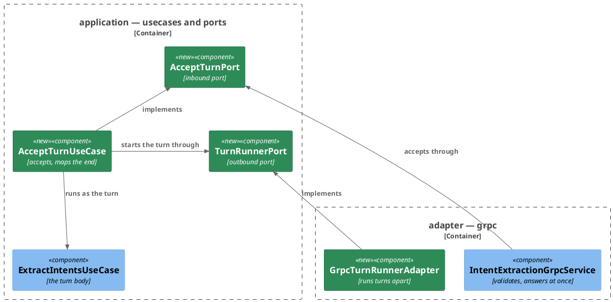
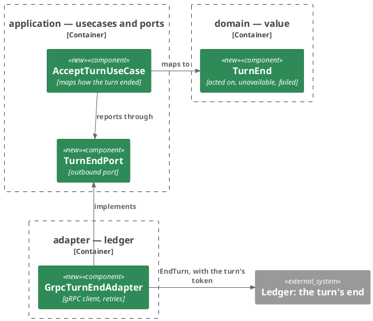
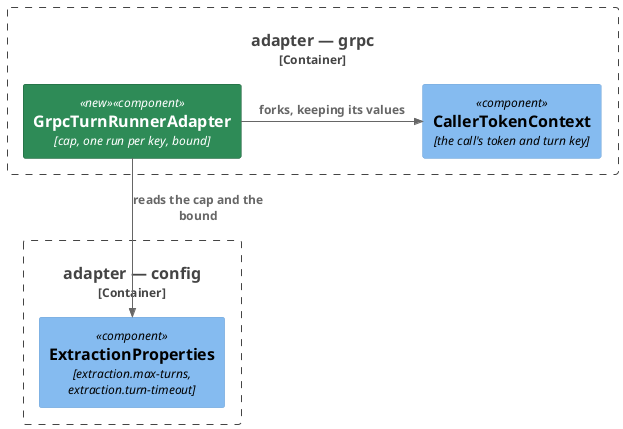
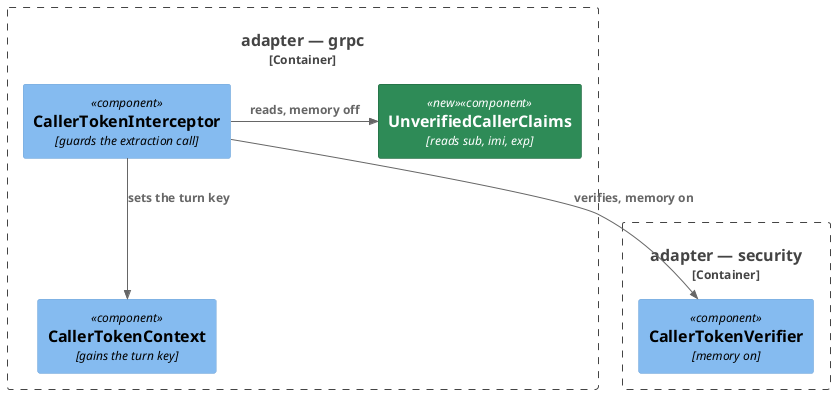
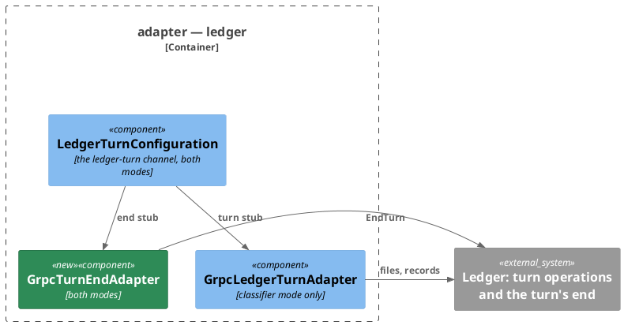

# Plan: The Ledger Stops Waiting for a Turn — `ai-connector-service`

**Format:** 2
**Affected Modules:** `ai-connector-service`
**Spec:** [The Ledger Stops Waiting for a Turn](../spec.md)

The turn's end and the reworded hand-over answer are already in `proto/` when this plan starts, and their generated
types are in this build. What the design leaves to this plan: where the acceptance is decided, what runs the turn
apart from the call that accepted it, where the turn key is read, the adapter telling the ledger how a turn ended,
and the two new settings. The wire, the outcomes and the timing are the design's, in
[The turn in two halves](../the-turn-in-two-halves.md).

## Architecture Decisions

### The service accepts through a use case of its own, and a runner owns the run



**Placement:** `AcceptTurnUseCase` in `application/usecase` decides the acceptance from what the runner answers and
maps how the turn ended. `ExtractIntentsUseCase` stays the turn body unchanged: keeping the message, recalling,
running the mode and counting the turn. The service maps `BUSY` to `RESOURCE_EXHAUSTED` and `ACCEPTED` to the empty
answer.

### The turn's end leaves through a port of its own



**Placement:** The three ends are a core enum in `domain/value`, so the use case maps a turn's outcome without
naming the wire. `GrpcTurnEndAdapter` joins `adapter/ledger`, which already fronts the turn operations, and owns the
mapping to the generated `TurnEnd`, the per-attempt bound and the retries.

### The runner sits in the gRPC adapter, where the call's context lives



**Placement:** `GrpcTurnRunnerAdapter` runs each turn on a thread of its own inside a fork of the accepting call's
gRPC context, which keeps the token for every ledger call and drops that call's cancellation and deadline. The cap
and the bound bind under `extraction.*` in `adapter/config`, beside the mode.

### The turn key rides the call's context in either memory setting



**Placement:** The interceptor sets `CallerTokenContext.TURN_KEY` on every guarded call: the verified identity where
the verifier is present, otherwise the claims `UnverifiedCallerClaims` reads (DN11, the claims read unverified only
to keep one run per turn). `MESSAGE_IDENTITY` keeps meaning "verified", so a turn with the memory off still neither
registers nor recalls.

### The ledger-turn channel serves both modes



**Placement:** `LedgerTurnConfiguration` and `LedgerTurnProperties` register whatever the mode, so `LEDGER_TURN_TARGET`
is required in both (DF09, compose already sets it). Both stubs share the one channel and its
`CallerTokenLedgerTurnInterceptor`. `GrpcLedgerTurnAdapter` stays registered only in the classifier mode.

## Step-by-Step Implementation Map (To-Do List)

### Stabilization

#### Interface-First / Build Stabilization

New-method stubs carry an intent comment starting `stub-intent:`.

**Interface & Signature Sync**

- [x] ST01 · Add the enum `TurnEnd { ACTED_ON, UNAVAILABLE, FAILED }` to `domain/value`. Add to `application/dto` the
  enums `TurnAcceptance { ACCEPTED, BUSY }` and `TurnStart { STARTED, ALREADY_RUNNING, BUSY }`, and the inbound
  command `AcceptTurnCommand(ExtractIntentsCommand turn, MessageIdentity turnKey)`, with a `TODO` naming its null
  checks still owed
  - writes: `ai-connector-service/src/main/java/bot/finance/ai/domain/value/TurnEnd.java`,
    `ai-connector-service/src/main/java/bot/finance/ai/application/dto/TurnAcceptance.java`,
    `ai-connector-service/src/main/java/bot/finance/ai/application/dto/TurnStart.java`,
    `ai-connector-service/src/main/java/bot/finance/ai/application/dto/AcceptTurnCommand.java`
- [x] ST02 · Add the inbound port `AcceptTurnPort` and the outbound ports `TurnRunnerPort` and `TurnEndPort` to
  `application/port` · after: ST01
  - writes: `ai-connector-service/src/main/java/bot/finance/ai/application/port/AcceptTurnPort.java`,
    `ai-connector-service/src/main/java/bot/finance/ai/application/port/TurnRunnerPort.java`,
    `ai-connector-service/src/main/java/bot/finance/ai/application/port/TurnEndPort.java`
  ```java
  public interface AcceptTurnPort {
      TurnAcceptance accept(AcceptTurnCommand command);
  }

  public interface TurnRunnerPort {
      /**
       * Runs {@code turn} apart from the caller unless a turn under {@code turnKey} is already running or the cap is
       * reached, then hands {@code end} what the turn returned, or {@link TurnEnd#UNAVAILABLE} when it outlived the
       * run's bound.
       */
      TurnStart start(MessageIdentity turnKey, Supplier<TurnEnd> turn, Consumer<TurnEnd> end);
  }

  public interface TurnEndPort {
      void report(TurnEnd end);
  }
  ```
- [x] ST03 · Add `AcceptTurnUseCase` to `application/usecase`, implementing `AcceptTurnPort`, taking
  `ExtractIntentsPort`, `TurnRunnerPort` and `TurnEndPort`, with a stub. `UseCaseConfiguration` declares the
  `AcceptTurnPort` bean from the `ExtractIntentsPort` bean and the two outbound ports · after: ST02
  - writes: `ai-connector-service/src/main/java/bot/finance/ai/application/usecase/AcceptTurnUseCase.java`,
    `ai-connector-service/src/main/java/bot/finance/ai/adapter/config/UseCaseConfiguration.java`
  ```java
  @Override
  public TurnAcceptance accept(AcceptTurnCommand command) {
      // stub-intent: hands the runner the command's turn key, a turn running the command's turn through
      // ExtractIntentsPort and mapping how it ended, and an end reported through TurnEndPort; answers BUSY when the
      // runner is full, ACCEPTED when it started the turn or one under that key is already running
      return null;
  }
  ```
- [x] ST04 · `CallerTokenContext` gains the package-private key `TURN_KEY` (a `MessageIdentity`) and the accessor
  `public static Optional<MessageIdentity> turnKey()`. Add to `adapter/grpc` the record
  `UnverifiedCallerClaims(MessageIdentity identity, Optional<Instant> expiry)` with a stub
  - writes: `ai-connector-service/src/main/java/bot/finance/ai/adapter/grpc/CallerTokenContext.java`,
    `ai-connector-service/src/main/java/bot/finance/ai/adapter/grpc/UnverifiedCallerClaims.java`
  ```java
  public static UnverifiedCallerClaims read(String authorization) {
      // stub-intent: parses a Bearer JWT without verifying its signature or its times, and reads the person from
      // sub, the message from imi and the expiry from exp when present; a value that is no Bearer JWT, or whose
      // sub or imi do not yield a MessageIdentity, throws CallerNotIdentifiedException
      return null;
  }
  ```
- [x] ST05 · `ExtractionProperties` gains `int maxTurns` and `Duration turnTimeout`, bound to `extraction.max-turns`
  and `extraction.turn-timeout`, with a `TODO` naming their checks still owed. The mode check stands
  - every call site constructing the properties — `ExtractionPropertiesTest` — passes a max of `4` and a timeout of
    `90s`, and keeps its assertion
  - writes: `ai-connector-service/src/main/java/bot/finance/ai/adapter/config/ExtractionProperties.java`,
    `ai-connector-service/src/test/java/bot/finance/ai/adapter/config/ExtractionPropertiesTest.java`
- [x] ST06 · Add `GrpcTurnRunnerAdapter` to `adapter/grpc`, a `@Component` implementing `TurnRunnerPort`, taking
  `ExtractionProperties`, with stubs. `adapter/grpc/package-info.java` names the runner of accepted turns among the
  package's classes. The module's architecture conventions say `adapter/grpc` also runs accepted turns, and that
  `extraction.*` is read there for the cap and the bound · after: ST02, ST05
  - writes: `ai-connector-service/src/main/java/bot/finance/ai/adapter/grpc/GrpcTurnRunnerAdapter.java`,
    `ai-connector-service/src/main/java/bot/finance/ai/adapter/grpc/package-info.java`,
    `ai-connector-service/docs/conventions/architecture.md`
  ```java
  @Override
  public TurnStart start(MessageIdentity turnKey, Supplier<TurnEnd> turn, Consumer<TurnEnd> end) {
      // stub-intent: answers BUSY once the runner is closed; answers ALREADY_RUNNING while a turn under the key is in
      // flight, whatever the cap; then BUSY when the cap of turns in flight is reached; otherwise runs the turn on a
      // thread of its own in a fork of the current gRPC context, interrupting it at the turn timeout; once its thread
      // returns, hands end the turn's answer, or UNAVAILABLE past the bound, and only then frees the key and the slot
      return null;
  }

  @PreDestroy
  public void close() {
      // stub-intent: stops taking turns and waits for the turns in flight, up to the turn timeout
  }
  ```
- [x] ST07 · Add `GrpcTurnEndAdapter` to `adapter/ledger`, a `@Component` implementing `TurnEndPort`, registered
  whatever the mode, taking the generated `LedgerTurnEndServiceGrpc.LedgerTurnEndServiceBlockingStub`,
  `LedgerTurnProperties`, the `Clock` bean `UseCaseConfiguration` declares and `LoggerFactory`, its `report()`
  stubbed to return with a `stub-intent:` comment: maps the end onto the generated `TurnEnd` and sends it, each
  attempt bounded by the timeout, again after a 500 ms pause only while the ledger answers unavailable or not in
  time and the clock is before the token's expiry read through `UnverifiedCallerClaims`; any other status,
  unauthenticated included, and a token with no expiry are tried once; giving up is logged at `ERROR` with the turn
  key when held. `LedgerTurnConfiguration` loses its mode condition; the configuration
  declares the `ledger-turn` channel once and both blocking stubs on it, each intercepted by
  `CallerTokenLedgerTurnInterceptor`. `GrpcLedgerTurnAdapter` keeps its condition. The module's architecture
  conventions say `ledger.turn.*` binds in `adapter/ledger` whatever the mode, and that `adapter/ledger` also tells
  the ledger how a turn ended · after: ST02, ST04
  - writes: `ai-connector-service/src/main/java/bot/finance/ai/adapter/ledger/GrpcTurnEndAdapter.java`,
    `ai-connector-service/src/main/java/bot/finance/ai/adapter/ledger/LedgerTurnConfiguration.java`,
    `ai-connector-service/docs/conventions/architecture.md`
- [x] ST15 · `IntentExtractionGrpcService` takes `AcceptTurnPort` in place of `ExtractIntentsPort`, hands it an
  `AcceptTurnCommand` of the command it reads and the turn key `CallerTokenContext` holds, answers empty on
  ACCEPTED, and fails `RESOURCE_EXHAUSTED` on BUSY. A test this fails is disabled, naming the step that reworks its
  class · after: ST03, ST04
  - writes: `ai-connector-service/src/main/java/bot/finance/ai/adapter/grpc/IntentExtractionGrpcService.java`,
    `ai-connector-service/src/test/java/bot/finance/ai/adapter/grpc/IntentExtractionGrpcServiceTest.java`,
    `ai-connector-service/src/test/java/bot/finance/ai/adapter/grpc/CallerTokenInterceptorTest.java`,
    `ai-connector-service/src/test/java/bot/finance/ai/system/`
- [x] ST16 · `GrpcStatusConfiguration` drops its `ExpenseRecordingFailedException` to `UNAVAILABLE` mapping; its
  handler returns `null` for every throwable · after: ST15
  - writes: `ai-connector-service/src/main/java/bot/finance/ai/adapter/grpc/GrpcStatusConfiguration.java`

**Configuration**

- [x] ST08 · In `application.yaml`: `extraction.max-turns: ${EXTRACTION_MAX_TURNS:4}` and
  `extraction.turn-timeout: ${EXTRACTION_TURN_TIMEOUT:90s}`. The module's configuration table gains both rows: how
  many turns run at once, beyond which a hand-over is refused as busy, not positive stops startup; how long one
  accepted turn may run before it ends unavailable, kept below the ledger's `MCP_JWT_TTL`, not positive stops
  startup. `LEDGER_TURN_TARGET` becomes required in both modes, and `LEDGER_TURN_TIMEOUT` bounds each attempt to
  tell the ledger how a turn ended too, both checked in either mode. The `EXTRACTION_MODE` row no longer says the
  rows below it go unread in the tools mode; it names the classifier rows that do. The table is re-padded
  - writes: `ai-connector-service/src/main/resources/application.yaml`, `ai-connector-service/docs/configuration.md`

**Shared Test Infrastructure**

- [x] ST09 · Every full-application boot gets a `ledger.turn.target`, now required in both modes:
  `AbstractSystemTest` points it at `LedgerTurnServer`'s target and resets `LedgerTurnStubs` before and after each
  test; `AbstractClassifierSystemTest` keeps only its mode, key and model; `@GrpcAdapterTest` sets it to
  `static://localhost:1`; `ExtractionModeStartupSystemTest`'s
  `whenExtractionModeIsRules_thenApplicationFailsToStartNamingExtractionMode()` passes
  `--ledger.turn.target=static://localhost:1`
  - writes: `ai-connector-service/src/test/java/bot/finance/ai/common/boot/AbstractSystemTest.java`,
    `ai-connector-service/src/test/java/bot/finance/ai/common/boot/AbstractClassifierSystemTest.java`,
    `ai-connector-service/src/test/java/bot/finance/ai/common/boot/GrpcAdapterTest.java`,
    `ai-connector-service/src/test/java/bot/finance/ai/system/ExtractionModeStartupSystemTest.java`,
    `ai-connector-service/docs/conventions/testing.md`
- [x] ST10 · `LedgerTurnServer` also serves a fake `LedgerTurnEndService`: it records each `EndTurn` request with its
  `authorization` metadata on a list of its own, and answers the outcome scripted on a script of its own — taken,
  refused with a given status, or never answering — taken once that script is spent. `reset()` clears both scripts
  and both lists, and `recordedCalls()` keeps holding only the turn operations' calls. `LedgerTurnStubs` gains
  `scriptEndTaken()`, `scriptEndRefused(Status)`, `scriptEndNeverAnswering()`, `recordedEnds()`, and
  `awaitEnds(int count)`, which waits with Awaitility until that many ends are recorded and returns them.
  `LedgerTurnServerTest` completes one `EndTurn` exchange. Both described anew in the module's testing conventions
  - writes: `ai-connector-service/src/test/java/bot/finance/ai/common/containers/LedgerTurnServer.java`,
    `ai-connector-service/src/test/java/bot/finance/ai/common/stubs/LedgerTurnStubs.java`,
    `ai-connector-service/src/test/java/bot/finance/ai/common/containers/LedgerTurnServerTest.java`,
    `ai-connector-service/docs/conventions/testing.md`
- [x] ST11 · `CallerTokens` gains `bearerExpiringIn(long userId, String incomingMessageId, Duration lifetime)` and
  `bearerNoExpiry(long userId, String incomingMessageId)`. `CallerTokenTestSupport` gains
  `withTurn(String token, MessageIdentity turnKey, Runnable body)`, putting both in scope. `WireMockStubs` gains
  `stubChatCompletionDelayed(String body, Duration delay)`
  - writes: `ai-connector-service/src/test/java/bot/finance/ai/common/fixtures/CallerTokens.java`,
    `ai-connector-service/src/test/java/bot/finance/ai/adapter/grpc/CallerTokenTestSupport.java`,
    `ai-connector-service/src/test/java/bot/finance/ai/common/stubs/WireMockStubs.java`
- [x] ST12 · `@LedgerTurnAdapterTest` also boots `GrpcTurnEndAdapter`; its javadoc and the module's testing
  conventions say it boots the ledger turn adapters
  - writes: `ai-connector-service/src/test/java/bot/finance/ai/common/boot/LedgerTurnAdapterTest.java`,
    `ai-connector-service/docs/conventions/testing.md`
- [x] ST13 · The module's testing conventions list `GrpcTurnRunnerAdapter` and `UnverifiedCallerClaims` among the
  adapter-layer unit targets
  - writes: `ai-connector-service/docs/conventions/testing.md`

#### Closing item

- [x] ST14 · `tools/agent-test/agent-test.sh --module ai-connector-service --tests "bot.finance.ai.architecture.CleanArchitectureTest"`
  passes, and the existing suite stays green
  - writes: none

### Red Phase

#### TDD Unit Red Phase

- [x] RU01 · `AcceptTurnCommand` · test: `AcceptTurnCommandTest` · covers: `AcceptTurnCommand()` · scenarios: AC05
  - `AcceptTurnCommand()`:
    - given: a null turn, or a null turn key
      when: the command is constructed
      then: throws InvalidValueException
- [x] RU02 · `AcceptTurnUseCase` · test: `AcceptTurnUseCaseTest` · covers: `accept()` · scenarios: AC05, AC06, AC07,
  AC08, AC25, AC26
  - `accept()`:
    - given: the runner starts the turn
      when: a turn is accepted
      then: answers ACCEPTED, and the runner received the command's turn key
    - given: the runner answers that a turn under that key is already running
      when: a turn is accepted
      then: answers ACCEPTED, and the turn body is never called
    - given: the runner answers busy
      when: a turn is accepted
      then: answers BUSY, and the turn body is never called
    - given: the turn body returns
      when: the turn handed to the runner runs
      then: it yields ACTED_ON, and the turn body received the command's turn
    - given: the turn body throws ExpenseRecordingFailedException
      when: the turn handed to the runner runs
      then: it yields UNAVAILABLE
    - given: the turn body throws an IllegalStateException
      when: the turn handed to the runner runs
      then: it yields FAILED
    - given: the runner hands an end to the end it was given
      when: that end is called with UNAVAILABLE
      then: the end port reports UNAVAILABLE
    - given: a null command
      when: a turn is accepted
      then: throws InvalidValueException, and the runner is never called
- [x] RU03 · `UnverifiedCallerClaims` · test: `UnverifiedCallerClaimsTest` · covers: `read()` · scenarios: AC03, AC26
  - `read()`:
    - given: a token signed by a key no published set holds, naming person `42`, message `m-1` and an expiry
      when: it is read
      then: the identity is `42`, `m-1`, and the expiry is the token's
    - given: an expired token
      when: it is read
      then: the identity and its past expiry are read
    - given: a token with no expiry
      when: it is read
      then: the identity is read, and the expiry is absent
    - given: a value with no Bearer scheme, a Bearer value that is no JWT, a token with no sub, a non-numeric sub,
      no imi, or a blank imi
      when: it is read
      then: throws CallerNotIdentifiedException
- [x] RU04 · `ExtractionProperties` · test: `ExtractionPropertiesTest` · covers: `ExtractionProperties()` · scenarios:
  AC20, AC25
  - `ExtractionProperties()`:
    - given: a max of turns of zero or less
      when: the properties are bound
      then: throws IllegalArgumentException naming `EXTRACTION_MAX_TURNS`
    - given: a null turn timeout, or one of zero or less
      when: the properties are bound
      then: throws IllegalArgumentException naming `EXTRACTION_TURN_TIMEOUT`
- [x] RU05 · `GrpcTurnRunnerAdapter` · test: `GrpcTurnRunnerAdapterTest` · covers: `start()`, `close()` · scenarios:
  AC05, AC20, AC25, AC26
  - The step agent observes what `Context.current().fork()` keeps and drops — its values, `isCancelled()` and
    `getDeadline()` once the parent is cancelled or past its deadline — before writing the context scenarios, and
    what an interrupt does to the run thread's blocking call
  - `start()`:
    - given: no turn running under the key and a free slot
      when: a turn is started
      then: answers STARTED, the turn runs on a thread other than the caller's, and its answer is handed to the end
    - given: the caller's context holds a caller token and is cancelled once start returns
      when: a turn is started
      then: the turn runs to its end and reads that token while it runs
    - given: the caller's context carries a deadline that passes while the turn runs
      when: a turn is started
      then: the turn runs to its end, and its answer is handed to the end
    - given: a turn running under a key
      when: a second turn is started under the same key
      then: answers ALREADY_RUNNING, and the second turn never runs
    - given: a turn under a key whose end has not yet returned
      when: a second turn is started under the same key
      then: answers ALREADY_RUNNING
    - given: a turn under a key that ended and whose end returned
      when: a turn is started under that key again
      then: answers STARTED, and the turn runs
    - given: as many turns running as the max allows
      when: one more is started
      then: answers BUSY, and that turn never runs
    - given: as many turns running as the max allows, one of them under a key
      when: a turn is started under that same key
      then: answers ALREADY_RUNNING, not BUSY, and the second turn never runs
    - given: as many turns running as the max allows, and one of them ends
      when: one more is started
      then: answers STARTED
    - given: a turn still running at the turn timeout
      when: the timeout passes
      then: the turn's thread is interrupted, and once it returns the end receives UNAVAILABLE, not the turn's
      answer, on a thread whose interrupt status is clear, and the end reads the caller token
    - given: a closed runner
      when: a turn is started
      then: answers BUSY, and that turn never runs
  - `close()`:
    - given: a turn running inside the turn timeout
      when: the runner is closed
      then: it returns once that turn ended and its end returned
    - given: a turn running past the turn timeout
      when: the runner is closed
      then: it returns once the interrupted turn returned and its end received UNAVAILABLE
- [x] RU06 · `ClassifierTurn` · test: `ClassifierTurnTest` · covers: `run()` · scenarios: AC20
  - `run()`:
    - given: two expenses read, and the turn's thread interrupted once the first is filed
      when: the turn runs
      then: only the first expense is filed, and the turn throws ExpenseRecordingFailedException

#### TDD Integration Red Phase

- [x] RI01 · `IntentExtractionGrpcService` · test: `IntentExtractionGrpcServiceTest` · covers:
  `IntentExtractionService.ExtractIntents` · mocks: `AcceptTurnPort` · scenarios: AC05, AC25
  - Happy Path:
    - given: the mocked port answers ACCEPTED, and the memory off
      when: the call is made with a token naming person `42` and message `m-1`
      then: the call answers empty, and the port received a command whose turn key is `42`, `m-1`
  - Error Mapping:
    - given: the mocked port answers BUSY
      when: the call is made
      then: the call fails `RESOURCE_EXHAUSTED`
  - update: premise — the service hands `AcceptTurnPort.accept()` an `AcceptTurnCommand` whose `turn()` is the
    command it handed `ExtractIntentsPort` · the `@MockitoBean` is an `AcceptTurnPort` answering ACCEPTED; a test
    capturing the command captures the `AcceptTurnCommand` and reads `turn()`; a test stubbing the port to throw
    stubs `accept()`; a test verifying the port was never called verifies `accept()`
  - update: premise — with the memory off, a guarded call whose token names no readable person and message is
    refused · `authenticatedStub()` sends `CallerTokens.bearer(42L, "incoming-message-42")` in place of the literal
    opaque token; the assertions stand, and
    `whenValidRequestMadeUnderOpaqueTokenWithMemoryDisabled_thenCommandCarriesNoIdentityAndPortCalled()` is renamed,
    with its display name, for a request under a caller token with the memory off
  - update: `whenPortThrowsExpenseRecordingFailedException_thenFailsWithUnavailable()` — delete
- [x] RI02 · `CallerTokenInterceptor` · test: `CallerTokenInterceptorTest` · covers:
  `IntentExtractionService.ExtractIntents` · mocks: `AcceptTurnPort` · scenarios: AC03, AC26
  - Happy Path:
    - given: the memory off, and a token signed by a key no published set holds, naming person `42` and message
      `m-1`
      when: the call is made
      then: the port is called with a turn key of `42`, `m-1` in its context, and no message identity
    - given: the verifier identifies the caller as person `7`, message `m-7`
      when: the call is made
      then: the port is called with the turn key `7`, `m-7` in its context
  - Error Mapping:
    - given: the memory off, and a token that is no JWT
      when: the call is made
      then: the call fails `UNAUTHENTICATED`, and the port is never called
  - update: premise — the service calls `AcceptTurnPort` where it called `ExtractIntentsPort` · the `@MockitoBean`
    is an `AcceptTurnPort`; a `doAnswer` capturing the context answers from `accept()` with ACCEPTED; a
    verification on `extractIntents()` is made on `accept()`
  - update: `whenStubCarriesAuthorizationHeader_thenPortSeesCallerTokenInContext()` — sends a token from
    `CallerTokens.bearer(...)` in place of `Bearer abc`, and asserts that token in the context
  - update: `whenMemoryDisabledAndTokenWouldNotVerify_thenPortCalledAndMessageIdentityAbsent()` — sends
    `CallerTokens.bearerSignedByUnpublishedKey(...)` in place of `Bearer not-a-valid-jwt`; the identity stays absent
- [x] RI03 · `GrpcTurnEndAdapter` · test: `GrpcTurnEndAdapterTest` · covers: `report()` · scenarios: AC06, AC07, AC08,
  AC21
  - `report()`:
    - given: the ledger takes the end, and the turn holds a token and the turn key `42`, `m-1`
      when: ACTED_ON, UNAVAILABLE or FAILED is reported
      then: the ledger received one `EndTurn` carrying the matching wire value and `authorization` with that token
    - given: the ledger answers `UNAVAILABLE` twice, then takes the end
      when: an end is reported
      then: the ledger received three `EndTurn`, and nothing is logged at `ERROR`
    - given: the ledger does not answer inside the timeout once, then takes the end
      when: an end is reported
      then: the ledger received two `EndTurn`
    - given: the ledger answers `UNAUTHENTICATED`
      when: an end is reported
      then: the ledger received one `EndTurn`, and one `ERROR` names person `42` and message `m-1`
    - given: the ledger answers `INVALID_ARGUMENT`
      when: an end is reported
      then: the ledger received one `EndTurn`, and one `ERROR` is logged
    - given: the ledger answers `UNAVAILABLE` every time, and the token expires two seconds from now
      when: an end is reported
      then: it returns once the token expired, no `EndTurn` was started after the expiry, and one `ERROR` names
      person `42` and message `m-1`
    - given: the ledger answers `UNAVAILABLE`, and the token has already expired
      when: an end is reported
      then: the ledger received one `EndTurn`, and one `ERROR` is logged
    - given: the ledger answers `UNAVAILABLE` every time, and the token carries no expiry
      when: an end is reported
      then: the ledger received one `EndTurn`, and one `ERROR` is logged
    - given: the turn holds no token
      when: an end is reported
      then: the ledger received nothing, and one `ERROR` is logged

AC03's other connector-side refusals are held by the existing tests: a missing header and a refused verification in
`CallerTokenInterceptorTest`, and the request's validation matrix in `IntentExtractionGrpcServiceTest`. AC18's
connector side, an unreadable key set answered as unavailable, is held by `CallerTokenInterceptorTest` and
`CallerTokenVerifierTest`.

#### TDD System Test Red Phase

- [x] RS01 · `ExtractIntentsSystemTest` · covers: `IntentExtractionService.ExtractIntents` · scenarios: AC05, AC06, AC07
  - Happy Path:
    - given: the provider answers "nothing to record" after one second
      when: the call is made with a caller token
      then: the call answers empty before the provider answered, and one end `TURN_END_ACTED_ON` reaches the ledger
      carrying that token
  - update: premise — with the memory off, a guarded call whose token names no readable person and message is
    refused · `CALLER_TOKEN` is `CallerTokens.bearer(...)` in place of `Bearer opaque-caller-token`; an assertion
    comparing a forwarded header with it stands
  - update: premise — the call answers before the turn runs · a test asserting what the turn did — tool calls,
    provider requests, a meter — first awaits the one end `LedgerTurnStubs.awaitEnds(1)` returns, then asserts as
    it does
  - update: `whenProviderRespondsServerError_thenFailsWithUnavailable()` — the call answers empty, and the one
    awaited end is `TURN_END_UNAVAILABLE` carrying the token; renamed for that outcome
- [x] RS02 · `ClassifierTurnSystemTest` · covers: `IntentExtractionService.ExtractIntents` · scenarios: AC06, AC07
  - update: premise — with the memory off, a guarded call whose token names no readable person and message is
    refused · `CALLER_TOKEN` is `CallerTokens.bearer(...)` in place of `Bearer opaque-caller-token`; the
    `authorization` assertion on the filing stands
  - update: `whenClassifierAnswersConfidently_thenFilingReachesLedgerUnderTokenAndTurnCounts()` — awaits the one
    end before asserting the filing, the provider request and the meter, and asserts that end is
    `TURN_END_ACTED_ON` carrying the token
  - update: `whenLedgerAnswersFirstFilingUnavailable_thenCallFailsUnavailableAndNoSecondFiling()` — the call
    answers empty, the one awaited end is `TURN_END_UNAVAILABLE`, and the ledger received one filing; renamed for
    that outcome
- [x] RS03 · `TurnRunSystemTest` · covers: `IntentExtractionService.ExtractIntents` · scenarios: AC05, AC20, AC26
  - The class runs with `extraction.max-turns=1` and `extraction.turn-timeout=3s`, and awaits each turn's end before
    it ends
  - Happy Path:
    - given: the provider answers "nothing to record" after one second
      when: the same token is handed over twice while the first turn runs
      then: both calls answer empty, the provider received one request, and one end reaches the ledger
    - given: the provider answers "nothing to record" after one second
      when: the call is made with a deadline of 500 ms
      then: the call answers empty before its deadline, and the end `TURN_END_ACTED_ON` reaches the ledger after it
  - Unhappy Path:
    - given: the provider answers a tool call after six seconds
      when: the call is made
      then: the end `TURN_END_UNAVAILABLE` reaches the ledger carrying the call's token, and no tool call reaches the
      ledger's MCP endpoint
- [x] RS04 · `ExtractionModeStartupSystemTest` · covers: `AiConnectorServiceApplication.main()` · scenarios: AC06,
  AC20, AC25
  - Unhappy Path:
    - given: `EXTRACTION_MAX_TURNS` at `0`, with a target set
      when: the application starts
      then: it fails to start, naming `EXTRACTION_MAX_TURNS`
    - given: `EXTRACTION_TURN_TIMEOUT` at `0s`, with a target set
      when: the application starts
      then: it fails to start, naming `EXTRACTION_TURN_TIMEOUT`
- [x] RS05 · `RegisterMessageSystemTest` · covers: `IntentExtractionService.ExtractIntents`
  - update: `whenTokenedRequestRegistersNewMessage_thenStoredUnderTokenIdentity()` — awaits the one end before
    asserting the tool call and the stored row
  - update: `whenSameMessageRegisteredTwice_thenStoredOnlyOnce()` — awaits the first turn's end, then repeats the
    second hand-over with Awaitility until its own end is recorded, since one sent while the first key is still
    held is accepted and starts nothing, before asserting the row count
- [x] RS06 · `RecallExamplesSystemTest` · covers: `IntentExtractionService.ExtractIntents`
  - update: premise — the call answers before the turn runs · each test awaits the one end before asserting the
    stored vector, the embedding attempts and the provider's prompt
- [x] RS07 · `MetersSystemTest` · covers: `IntentExtractionService.ExtractIntents`
  - update: `whenTurnRunsAndPrometheusIsScraped_thenCarriesRpcChatToolEmbeddingAndPendingSamples()` — awaits the
    one end before the scrape
  - update: `whenProviderRefusesChatCall_thenRpcFailsAndChatSampleCarriesErrorTag()` — the call answers empty, the
    one awaited end is `TURN_END_UNAVAILABLE`, then the scrape asserts as it does; renamed for that outcome
- [x] RS08 · `ChangeStreamUnavailableSystemTest` · covers: `IntentExtractionService.ExtractIntents`
  - update: `whenTurnRunsWithRedisUnreachable_thenAnswersEmptyAndOneRowHoldsText()` — awaits the one end before
    asserting the row

No spec scenario's `Then:` is a measurement, and the module's testing conventions say performance is not measured.

### Green Phase

#### TDD Unit Green Phase

- [x] GU01 · `AcceptTurnCommand` · test: `AcceptTurnCommandTest`
- [x] GU02 · `AcceptTurnUseCase` · test: `AcceptTurnUseCaseTest` · after: GU01
- [x] GU03 · `UnverifiedCallerClaims` · test: `UnverifiedCallerClaimsTest`
- [x] GU04 · `ExtractionProperties` · test: `ExtractionPropertiesTest`
- [x] GU05 · `GrpcTurnRunnerAdapter` · test: `GrpcTurnRunnerAdapterTest` · after: GU04
- [x] GU06 · `ClassifierTurn` · test: `ClassifierTurnTest`

#### TDD Integration Green Phase

- [x] GI01 · `IntentExtractionGrpcService` · test: `IntentExtractionGrpcServiceTest` · covers:
  `IntentExtractionService.ExtractIntents` · mocks: `AcceptTurnPort` · after: GU01, GI02
- [x] GI02 · `CallerTokenInterceptor` · test: `CallerTokenInterceptorTest` · covers:
  `IntentExtractionService.ExtractIntents` · mocks: `AcceptTurnPort` · after: GU03
- [x] GI03 · `GrpcTurnEndAdapter` · test: `GrpcTurnEndAdapterTest` · after: GU03

#### TDD System Test Green Phase

- [ ] GS01 · `ExtractIntentsSystemTest` · covers: `IntentExtractionService.ExtractIntents`
- [ ] GS02 · `ClassifierTurnSystemTest` · covers: `IntentExtractionService.ExtractIntents`
- [ ] GS03 · `TurnRunSystemTest` · covers: `IntentExtractionService.ExtractIntents`
- [ ] GS04 · `ExtractionModeStartupSystemTest` · covers: `AiConnectorServiceApplication.main()`
- [ ] GS05 · `RegisterMessageSystemTest` · covers: `IntentExtractionService.ExtractIntents`
- [ ] GS06 · `RecallExamplesSystemTest` · covers: `IntentExtractionService.ExtractIntents`
- [ ] GS07 · `MetersSystemTest` · covers: `IntentExtractionService.ExtractIntents`
- [ ] GS08 · `ChangeStreamUnavailableSystemTest` · covers: `IntentExtractionService.ExtractIntents`

### Post-Implementation Steps

#### ADR Placeholders

- [ ] PI01 · Place ADR: with the memory off, the connector still reads a caller token's person, message and expiry
  without verifying it, only to keep one run per turn and to bound the retries of the turn's end; it supersedes ADR
  0017's single switch for token reading

## Open Questions

- **OQ01:** No file in the repository gives a default for `EXTRACTION_MAX_TURNS`; DN01 sets a cap without a value.
  ST05 and ST08 use `4` as a placeholder. Keep `4`, or which value?
  - A: 4

- **OQ02:** An ADR could record "the connector accepts a turn at once and reports its end to the ledger through an
  operation the ledger serves". If none is written, the connector's use-case page and its out-contract for the
  turn's end hold the fact. Place it as a repo-root ADR, since the ledger's side depends on it?
  - A: Yes, one repo-root ADR — placed once, by the ledger plan's PI02

- **OQ03:** DN11 amends ADR 0017's single memory switch for token reading: with the memory off the connector now
  reads a caller token's person, message and expiry unverified, only to keep one run per turn and bound the end's
  retries. Place an ADR recording that, superseding 0017's switch for token reading? If none is written, the
  connector's configuration page and its in-contract for the extraction call hold it.
  - A: Yes
