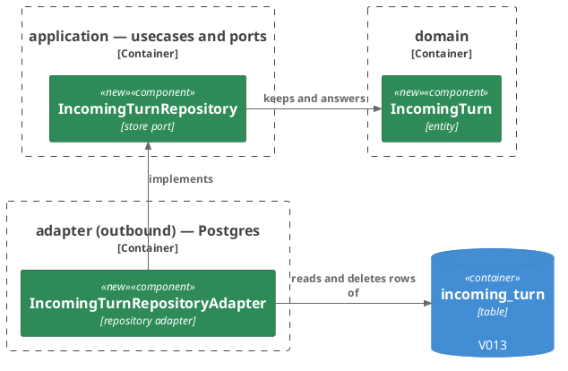
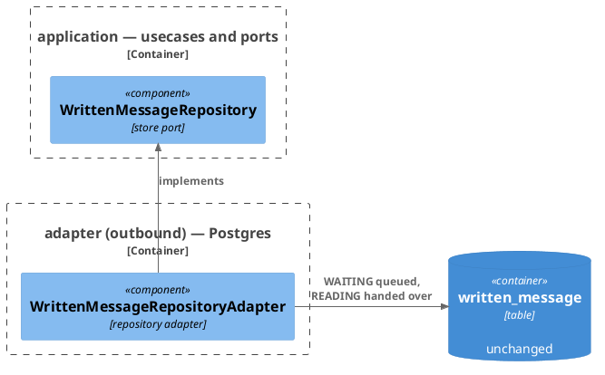
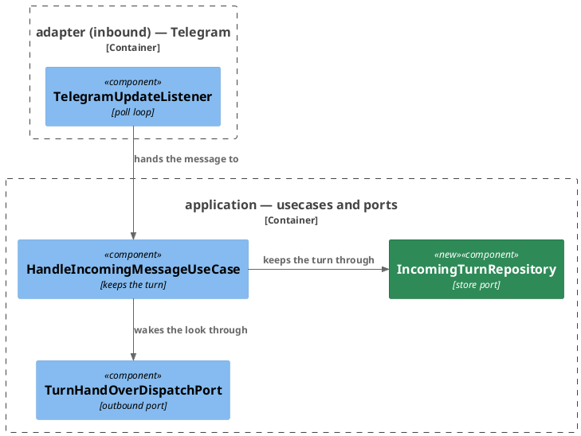
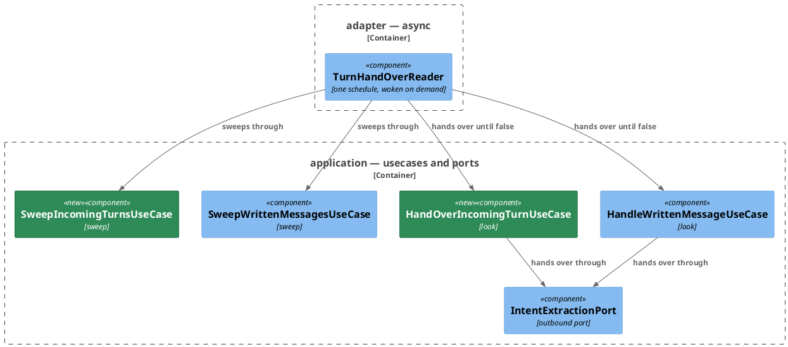
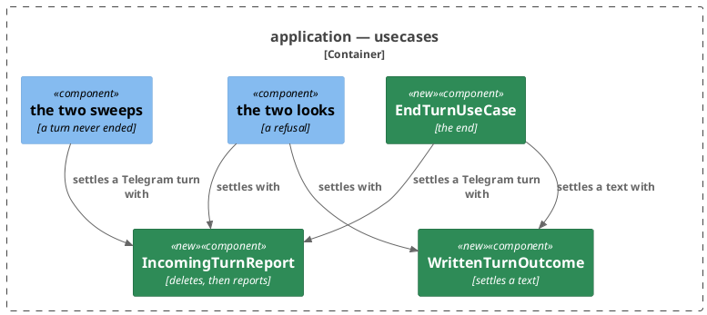
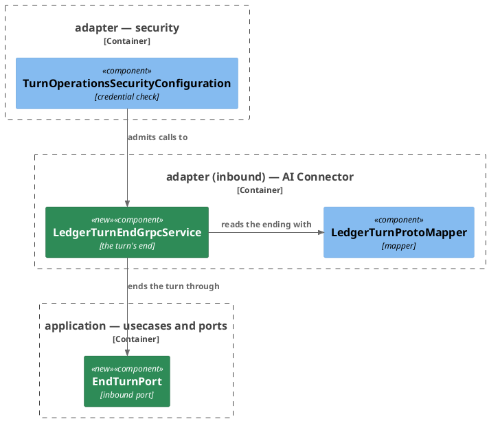
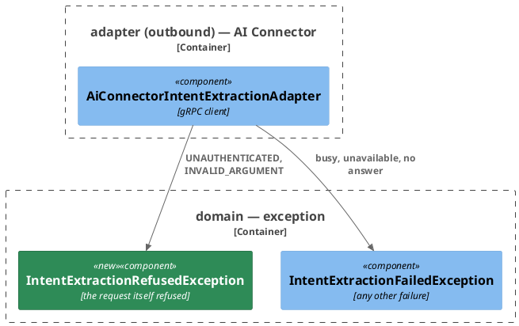
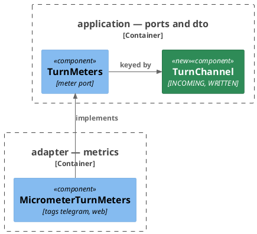

# Plan: The Ledger Stops Waiting for a Turn — `ledger-service`

**Format:** 2
**Affected Modules:** `ledger-service`
**Spec:** [The Ledger Stops Waiting for a Turn](../spec.md)

The turn's end and the reworded hand-over answer are the shared plan's, landed before this one starts, so their
generated types exist. What the design leaves to this plan: where a Telegram turn is kept, how a text shows it is
queued, the two looks and the two sweeps on the reader's one schedule, the settling the end, a refusal and a
sweep share, the service answering the end, and the two meters. The flow and what is kept are the design's, in
[The turn in two halves](../the-turn-in-two-halves.md) and [A turn awaiting its end](../a-turn-awaiting-its-end.md).

## Architecture Decisions

### A Telegram turn is kept in a store of its own



**Placement:** `IncomingTurn` is an `Entity` in `domain/model`, kept through the store port `IncomingTurnRepository`
by `IncomingTurnRepositoryAdapter` in `adapter/persistence`. The adapter checks the text's width (ADR 0004, DF20,
4096 UTF-16 units), and its delete's row count is the settle-once guard (DN07, the delete is the guard).

### A text queues in its own row



**Placement:** `WrittenMessageRepository` drops the claim and the stamp for a find of the oldest waiting text, an
attempt touching it while `WAITING`, and a `WAITING` to `READING` move on acceptance, and its settle takes either
(DN10, `WAITING` is queued). No migration touches `written_message`.

### Taking a message in only keeps its turn and wakes the look



**Placement:** `HandleIncomingMessageUseCase.handle` resolves the person, keeps the turn and wakes the look. It no
longer reaches the connector or the delivery, so the poll loop never waits on a turn.

### Two looks and two sweeps run on the reader's one schedule



**Placement:** `WrittenMessageReader` becomes `TurnHandOverReader`, and its dispatch port `TurnHandOverDispatchPort`.
A pass runs both sweeps, then each look until it answers false (DF17, one at a time, woken by a Telegram message as
by a filing). Each look answers false where the hand-over stops. Its settings keep their names.

### The end, a refusal and the sweep settle through one helper per channel



**Placement:** `IncomingTurnReport` and `WrittenTurnOutcome` are package-private helpers in `application/usecase`,
beside `ExtractionTurn`. The outcome rules are today's. Only the call whose delete or settle moved the turn reports
or counts. A text the sweep settles keeps today's sweep, which counts it nowhere under a turn's outcome (AC24).

### The end is a service of its own fronting the AI connector



**Placement:** `LedgerTurnEndGrpcService` joins the turn operations in `adapter/aiconnector`, reads the caller off
`AuthenticatedCaller`, and writes no turn call line (DF08, the runner's ledger-call count stays true). The check
guards `bot.finance.ledger.v1.LedgerTurnEndService/*` by name, since its fallback permits all. The core enum is
`TurnEnding`, not `TurnEnd`: the generated enum carries that name, and the mapper would need a fully qualified name
for one of them, which the code style refuses.

### The adapter classifies a refused hand-over



**Placement:** The adapter maps the statuses, so the looks settle a refusal at once and leave every other failure
queued (DN06, only a refusal of the request itself settles at once) without naming a gRPC status.

### Swept turns and the queue's age are meters by channel



**Placement:** `TurnMeters` gains `countSwept` (DN08, a counter of its own) and `recordOldestQueued` (DN12, a
gauge), keyed by `TurnChannel` in `application/dto`. `MicrometerTurnMeters` renders them as
`ledger_turns_swept_total` and `ledger_turn_queue_oldest_seconds`, tagged `channel` `telegram` or `web`, so the core
names no external system.

## Step-by-Step Implementation Map (To-Do List)

### Stabilization

#### Database

- [x] ST01 · Add migration `V013__keep_incoming_turns.sql`:
  - writes: `ledger-service/src/main/resources/db/migration/V013__keep_incoming_turns.sql`
  ```sql
  CREATE TABLE incoming_turn (
      id                  BIGSERIAL     PRIMARY KEY,
      user_id             BIGINT        NOT NULL REFERENCES app_user (id) ON DELETE CASCADE,
      incoming_message_id TEXT          NOT NULL,
      text                VARCHAR(4096) NOT NULL,
      conversation_id     TEXT          NOT NULL,
      inbound_message_id  TEXT          NOT NULL,
      kept_at             TIMESTAMPTZ   NOT NULL,
      last_attempt_at     TIMESTAMPTZ,
      handed_over_at      TIMESTAMPTZ,
      CONSTRAINT ck_incoming_turn_text CHECK (text ~ '\S')
  );

  CREATE UNIQUE INDEX ux_incoming_turn_incoming_message ON incoming_turn (incoming_message_id);

  CREATE INDEX idx_incoming_turn_queued ON incoming_turn (id) WHERE handed_over_at IS NULL;
  ```

#### Interface-First / Build Stabilization

New-method stubs carry an intent comment starting `stub-intent:`.

**Interface & Signature Sync**

- [x] ST02 · Add to `domain/exception` `InvalidIncomingTurnException` and `InvalidTurnEndException`, each extending
  `InvalidValueException`, and `IntentExtractionRefusedException`, shaped as `IntentExtractionFailedException`.
  `IntentExtractionPort.extract()` documents the refused one: `@throws IntentExtractionRefusedException if the
  connector refuses the request itself`, and the failed one becomes `when the hand-over is not accepted`
  - writes: `ledger-service/src/main/java/bot/finance/domain/exception/InvalidIncomingTurnException.java`,
    `ledger-service/src/main/java/bot/finance/domain/exception/InvalidTurnEndException.java`,
    `ledger-service/src/main/java/bot/finance/domain/exception/IntentExtractionRefusedException.java`,
    `ledger-service/src/main/java/bot/finance/application/port/IntentExtractionPort.java`
- [x] ST03 · Add the entity `IncomingTurn` to `domain/model`, extending `Entity`, holding the user id, the
  `IncomingMessageId`, the text, the conversation id, the inbound message id, the kept-at instant, and the last
  attempt and hand-over instants, each answered as an `Optional<Instant>`. `newTurn(long userId, String
  conversationId, String inboundMessageId, String text, Instant keptAt)` derives the reference with
  `IncomingMessageId.of(conversationId, inboundMessageId)` and holds no attempt and no hand-over;
  `stored(long id, long userId, String conversationId, String inboundMessageId, String text, Instant keptAt,
  Optional<Instant> lastAttemptAt, Optional<Instant> handedOverAt)` rebuilds one. The private constructor carries a
  `TODO` naming the checks still owed · after: ST02
  - writes: `ledger-service/src/main/java/bot/finance/domain/model/IncomingTurn.java`
  ```java
  public LocalDate keptOn(ZoneId zone) {
      // stub-intent: the day the turn was kept, read in the zone given
      return null;
  }
  ```
- [x] ST04 · Stub `IncomingMessageId.writtenMessageId()`
  - writes: `ledger-service/src/main/java/bot/finance/domain/value/IncomingMessageId.java`
  ```java
  public Optional<Long> writtenMessageId() {
      // stub-intent: the written message's id when the value names one as ofWrittenMessage writes it, `web:`
      // followed by a positive id; empty for any other value
      return Optional.empty();
  }
  ```
- [x] ST05 · Add to `application/dto` the enums `TurnEnding { ACTED_ON, UNAVAILABLE, FAILED }` and
  `TurnChannel { INCOMING, WRITTEN }`, and the record `EndTurnCommand(AuthenticatedUserId userId, IncomingMessageId
  reference, TurnEnding ending)`, whose compact constructor carries a `TODO` naming the checks still owed · after: ST02
  - writes: `ledger-service/src/main/java/bot/finance/application/dto/TurnEnding.java`,
    `ledger-service/src/main/java/bot/finance/application/dto/TurnChannel.java`,
    `ledger-service/src/main/java/bot/finance/application/dto/EndTurnCommand.java`
- [x] ST06 · `WrittenMessageView` gains the component `Instant filedAt`, last. `WrittenMessageEntity.toView()` passes
  `createdAt`. Every test constructing a view passes an instant for it and keeps its assertion
  - writes: `ledger-service/src/main/java/bot/finance/application/dto/WrittenMessageView.java`,
    `ledger-service/src/main/java/bot/finance/adapter/persistence/WrittenMessageEntity.java`,
    `ledger-service/src/test/java/bot/finance/adapter/web/WrittenMessageWebMapperTest.java`,
    `ledger-service/src/test/java/bot/finance/adapter/web/MessagesControllerTest.java`,
    `ledger-service/src/test/java/bot/finance/application/usecase/SweepWrittenMessagesUseCaseTest.java`,
    `ledger-service/src/test/java/bot/finance/application/usecase/ReadWrittenMessageUseCaseTest.java`,
    `ledger-service/src/test/java/bot/finance/application/usecase/HandleWrittenMessageUseCaseTest.java`,
    `ledger-service/src/test/java/bot/finance/application/usecase/BrowseWrittenMessagesUseCaseTest.java`,
    `ledger-service/src/test/java/bot/finance/application/usecase/FileWrittenMessageUseCaseTest.java`
- [x] ST07 · Add the store port `IncomingTurnRepository` to `application/port` · after: ST03
  - writes: `ledger-service/src/main/java/bot/finance/application/port/IncomingTurnRepository.java`
  ```java
  public interface IncomingTurnRepository {

      /**
       * Keeps the turn, queued, answering false when a turn is already kept under its message.
       *
       * @throws InvalidIncomingTurnException if the text is longer than the column
       * @throws EntityNotFoundException if the user id names no stored user
       * @throws PersistenceFailedException if the write fails
       */
      boolean keep(IncomingTurn turn);

      /** @throws PersistenceFailedException if the read fails */
      Optional<IncomingTurn> findOldestQueuedKeptSince(Instant keptSince);

      /** @throws PersistenceFailedException if the write fails */
      void recordAttempt(long turnId, Instant now);

      /**
       * Stamps the turn handed over, answering whether it was still kept and queued.
       *
       * @throws PersistenceFailedException if the write fails
       */
      boolean markHandedOver(long turnId, Instant now);

      /** @throws PersistenceFailedException if the read fails */
      Optional<IncomingTurn> findFor(long userId, IncomingMessageId reference);

      /**
       * Deletes the turn, answering whether this call removed it.
       *
       * @throws PersistenceFailedException if the write fails
       */
      boolean delete(long turnId);

      /** @throws PersistenceFailedException if the read fails */
      List<IncomingTurn> findHandedOverBefore(Instant cutoff);

      /** @throws PersistenceFailedException if the read fails */
      List<IncomingTurn> findQueuedForSweep(Instant keptBefore, Instant attemptBefore);

      /** @throws PersistenceFailedException if the read fails */
      Optional<Instant> oldestQueuedKeptAt();
  }
  ```
- [x] ST08 · `TurnMeters` gains `void countSwept(TurnChannel channel)` and `void recordOldestQueued(TurnChannel
  channel, Duration age)`, and its javadoc names both. `MicrometerTurnMeters` implements both with empty bodies, and
  `MeterName` gains `TURNS_SWEPT` (`ledger_turns_swept_total`) and `TURN_QUEUE_OLDEST` (`ledger_turn_queue_oldest_seconds`)
  · after: ST05
  - writes: `ledger-service/src/main/java/bot/finance/application/port/TurnMeters.java`,
    `ledger-service/src/main/java/bot/finance/adapter/metrics/MicrometerTurnMeters.java`,
    `ledger-service/src/main/java/bot/finance/adapter/metrics/MeterName.java`
- [x] ST09 · Add the inbound ports `HandOverIncomingTurnPort`, `SweepIncomingTurnsPort` and `EndTurnPort` to
  `application/port`. Rename `WrittenMessageReadingDispatchPort` to `TurnHandOverDispatchPort`, its callers with it.
  `HandleWrittenMessagePort.handleNext()`'s javadoc reads as `HandOverIncomingTurnPort.handOverNext()`'s · after: ST05
  - writes: `ledger-service/src/main/java/bot/finance/application/port/HandOverIncomingTurnPort.java`,
    `ledger-service/src/main/java/bot/finance/application/port/SweepIncomingTurnsPort.java`,
    `ledger-service/src/main/java/bot/finance/application/port/EndTurnPort.java`,
    `ledger-service/src/main/java/bot/finance/application/port/HandleWrittenMessagePort.java`,
    `ledger-service/src/main/java/bot/finance/application/port/WrittenMessageReadingDispatchPort.java`,
    `ledger-service/src/main/java/bot/finance/application/port/TurnHandOverDispatchPort.java`,
    `ledger-service/src/main/java/bot/finance/application/usecase/FileWrittenMessageUseCase.java`,
    `ledger-service/src/main/java/bot/finance/adapter/async/WrittenMessageReader.java`,
    `ledger-service/src/main/java/bot/finance/adapter/config/UseCaseConfiguration.java`,
    `ledger-service/src/test/java/bot/finance/application/usecase/FileWrittenMessageUseCaseTest.java`
  ```java
  public interface HandOverIncomingTurnPort {

      /**
       * Hands the oldest queued turn over, answering whether the look goes on: false when nothing is queued, or
       * when the hand-over cannot be made now and the turn stays queued.
       *
       * @throws PersistenceFailedException if recording the attempt, stamping the hand-over, or settling a refused
       *     hand-over fails
       */
      boolean handOverNext();
  }

  public interface SweepIncomingTurnsPort {

      /**
       * Settles every turn whose end never arrived and every turn queued past its wait, answering how many it
       * settled.
       *
       * @throws PersistenceFailedException if a read or a delete fails
       */
      int sweep();
  }

  public interface EndTurnPort {

      /**
       * @throws InvalidTurnEndException if the command is absent
       * @throws PersistenceFailedException if the turn cannot be read or settled
       */
      void end(EndTurnCommand command);
  }

  public interface TurnHandOverDispatchPort {

      /** Asks the hand-over to look for work now. Never throws. */
      void dispatch();
  }
  ```
- [x] ST10 · `HandleIncomingMessageUseCase` takes `InitializeUserPort`, `IncomingTurnRepository`,
  `TurnHandOverDispatchPort`, `Clock` and `LoggerFactory`, and nothing else. `handle()` keeps its absent-command
  check and becomes a stub. `UseCaseConfiguration` builds it with the new collaborators. Every test in
  `HandleIncomingMessageUseCaseTest` is disabled, its lines commented out, naming RU07. These system tests are
  disabled where they stand:
  `ReceiveTelegramMessageSystemTest` both tests naming RS01, `HandleIncomingMessageFailureSystemTest` naming RS02,
  `SummarizeSpendingReplySystemTest` naming RS07,
  `PipelineMetersSystemTest.whenPrometheusIsScrapedAfterAConfirmedTurn_thenItCarriesTurnToolCallAndResolutionCounts()`
  naming RS08, and `TelegramPollFailureRecoverySystemTest` naming RS09 · after: ST07, ST09
  - writes: `ledger-service/src/main/java/bot/finance/application/usecase/HandleIncomingMessageUseCase.java`,
    `ledger-service/src/main/java/bot/finance/adapter/config/UseCaseConfiguration.java`,
    `ledger-service/src/test/java/bot/finance/application/usecase/HandleIncomingMessageUseCaseTest.java`,
    `ledger-service/src/test/java/bot/finance/system/ReceiveTelegramMessageSystemTest.java`,
    `ledger-service/src/test/java/bot/finance/system/HandleIncomingMessageFailureSystemTest.java`,
    `ledger-service/src/test/java/bot/finance/system/SummarizeSpendingReplySystemTest.java`,
    `ledger-service/src/test/java/bot/finance/system/PipelineMetersSystemTest.java`,
    `ledger-service/src/test/java/bot/finance/system/TelegramPollFailureRecoverySystemTest.java`
  ```java
  @Override
  public void handle(HandleIncomingMessageCommand command) {
      if (command == null) {
          throw new InvalidIncomingMessageException("incoming message is absent");
      }
      // stub-intent: resolves the person, keeps the message's turn queued at the clock's instant, and wakes the
      // hand-over; a turn already kept under the message is logged once at info and nothing else happens; a
      // store failure propagates
  }
  ```
- [x] ST11 · `HandleWrittenMessageUseCase` takes `WrittenMessageRepository`, `GroupingRepository`,
  `UserPreferenceRepository`, `IntentExtractionPort`, `ExpenseRepository`, `SpendingQueryRepository`, `TurnMeters`,
  `Clock`, the longest queue wait as a `Duration`, and `LoggerFactory`. `handleNext()` becomes a stub.
  `UseCaseConfiguration` passes `Duration.ofMinutes(10)` with a `TODO` naming the wait setting. Every test in
  `HandleWrittenMessageUseCaseTest` is disabled, its lines commented out, naming RU09. These system tests are
  disabled where they stand: `WrittenMessageReadingSystemTest` both tests naming RS05, and
  `FileWrittenMessageSystemTest.whenAPersonFilesTwoExpensesInOneText_thenItIsReadToDoneWithTwoPendingEntries()`
  naming RS06 · after: ST09
  - writes: `ledger-service/src/main/java/bot/finance/application/usecase/HandleWrittenMessageUseCase.java`,
    `ledger-service/src/main/java/bot/finance/adapter/config/UseCaseConfiguration.java`,
    `ledger-service/src/test/java/bot/finance/application/usecase/HandleWrittenMessageUseCaseTest.java`,
    `ledger-service/src/test/java/bot/finance/system/WrittenMessageReadingSystemTest.java`,
    `ledger-service/src/test/java/bot/finance/system/FileWrittenMessageSystemTest.java`
  ```java
  @Override
  public boolean handleNext() {
      // stub-intent: takes the oldest text waiting since within the wait, prepares it — catalogue, catch-all,
      // default currency —, records the attempt and hands it over for the day it was filed. Accepted: moves it to
      // READING and answers true. Refused: settles it as failed and answers true. No catch-all: settles it FAILED
      // and answers true. Nothing waiting, a store failure while preparing, or any other hand-over failure:
      // answers false, leaving it waiting
      return false;
  }
  ```
- [x] ST12 · `ExtractionTurn` takes `SpendingQueryRepository` and `Logger` and keeps `catchAllAmong()` and
  `discardPeriods()`. `request()` takes the day as a last `LocalDate day` parameter and passes it as the request's
  current date, in place of reading the clock. `readDefaultCurrency()` and `extractionFailed()` go · after: ST10,
  ST11
  - writes: `ledger-service/src/main/java/bot/finance/application/usecase/ExtractionTurn.java`,
    `ledger-service/src/main/java/bot/finance/application/usecase/HandleIncomingMessageUseCase.java`,
    `ledger-service/src/main/java/bot/finance/application/usecase/HandleWrittenMessageUseCase.java`
- [x] ST13 · In `WrittenMessageRepository`, replace `claimOldestWaiting(Instant)` and `stampHandOver(long, Instant)`
  with the methods below, and reword `settle()`'s javadoc to answer whether the text was still `WAITING` or
  `READING`. `WrittenMessageRepositoryAdapter` stubs each new method and drops the two old ones;
  `WrittenMessageEntityRepository` drops `claimOldestWaiting` and `stampHandOver`. The tests calling the dropped
  methods cannot compile, so each is disabled, its lines commented out:
  `WrittenMessageRepositoryAdapterTest`'s two `ClaimOldestWaiting` tests, its two `StampHandOver` tests and
  `whenClaimOldestWaitingHitsDatabaseFailure_thenPersistenceFailedExceptionCarriesIt()` naming RI03, and
  `WrittenMessageRepositoryAdapterConcurrencyTest.whenTwoThreadsClaimTogether_thenExactlyOneGetsTheMessage()` naming
  RI04 · after: ST06, ST11
  - writes: `ledger-service/src/main/java/bot/finance/application/port/WrittenMessageRepository.java`,
    `ledger-service/src/main/java/bot/finance/adapter/persistence/WrittenMessageRepositoryAdapter.java`,
    `ledger-service/src/main/java/bot/finance/adapter/persistence/WrittenMessageEntityRepository.java`,
    `ledger-service/src/test/java/bot/finance/adapter/persistence/WrittenMessageRepositoryAdapterTest.java`,
    `ledger-service/src/test/java/bot/finance/adapter/persistence/WrittenMessageRepositoryAdapterConcurrencyTest.java`
  ```java
  /** @throws PersistenceFailedException if the read fails */
  Optional<WrittenMessageView> findOldestWaitingFiledSince(Instant filedSince);

  /**
   * Touches the text's last move while it is WAITING, as the instant of its latest hand-over attempt.
   *
   * @throws PersistenceFailedException if the write fails
   */
  void recordAttempt(long messageId, Instant now);

  /**
   * Moves the text from WAITING to READING, answering whether it was still WAITING.
   *
   * @throws PersistenceFailedException if the write fails
   */
  boolean markHandedOver(long messageId, Instant now);

  /** @throws PersistenceFailedException if the read fails */
  List<WrittenMessageView> findWaitingForSweep(Instant filedBefore, Instant attemptBefore);

  /** @throws PersistenceFailedException if the read fails */
  Optional<Instant> oldestWaitingFiledAt();
  ```
  ```java
  @Override
  public Optional<WrittenMessageView> findOldestWaitingFiledSince(Instant filedSince) {
      // stub-intent: the WAITING text with the lowest id filed at or after the instant
      return Optional.empty();
  }

  @Override
  public void recordAttempt(long messageId, Instant now) {
      // stub-intent: moves updated_at to the instant while the text is WAITING; any other text is untouched
  }

  @Override
  public boolean markHandedOver(long messageId, Instant now) {
      // stub-intent: moves a WAITING text to READING with updated_at at the instant, answering whether it moved
      return false;
  }

  @Override
  public List<WrittenMessageView> findWaitingForSweep(Instant filedBefore, Instant attemptBefore) {
      // stub-intent: every WAITING text filed before the first instant whose updated_at is before the second
      return List.of();
  }

  @Override
  public Optional<Instant> oldestWaitingFiledAt() {
      // stub-intent: the earliest created_at among WAITING texts
      return Optional.empty();
  }
  ```
- [x] ST14 · Add the package-private helpers `IncomingTurnReport` and `WrittenTurnOutcome` to `application/usecase`,
  beside `ExtractionTurn`, with stubs. `IncomingTurnReport` takes `IncomingTurnRepository`, `ExpenseRepository`,
  `SpendingQueryRepository`, `MessageDeliveryPort`, `ProposalReportRepository`, `TurnMeters` and the caller's
  `Logger`; `WrittenTurnOutcome` takes `WrittenMessageRepository`, `ExpenseRepository`, `SpendingQueryRepository`,
  `TurnMeters`, `Clock` and the caller's `Logger`. Each discards the periods through `SpendingQueryRepository`
  itself · after: ST03, ST05, ST07, ST08, ST13
  - writes: `ledger-service/src/main/java/bot/finance/application/usecase/IncomingTurnReport.java`,
    `ledger-service/src/main/java/bot/finance/application/usecase/WrittenTurnOutcome.java`
  ```java
  boolean settle(IncomingTurn turn, TurnEnding ending) {
      // stub-intent: for an end or a refused hand-over. Reads the proposals and spending summaries under the
      // turn's message, then deletes the turn; only when that delete removed it: logs at error an ending other
      // than acted on, naming the message and the outcome, delivers the report the ending and what was read earn,
      // stores its location, counts the turn under its outcome and discards the periods a delivered report
      // carried, logging a failed discard at warn; a report that cannot be delivered counts the turn unreported.
      // Answers whether this call settled it
      return false;
  }

  boolean settleSwept(IncomingTurn turn) {
      // stub-intent: for the sweep. Settles the turn as settle does for a failed ending, writing no error line
      return false;
  }
  ```
  ```java
  boolean settle(WrittenMessageView message, TurnEnding ending) {
      // stub-intent: for an end or a refused hand-over. Reads the days and periods under the text's message and
      // settles it with the outcome the ending and those earn, unless it is already DONE; only when this call
      // settled it: logs at error an ending other than acted on, naming the message and the outcome, discards its
      // periods, logging a failed discard at warn, and counts the turn under its outcome. Answers whether this
      // call settled it
      return false;
  }
  ```
- [x] ST15 · Add `HandOverIncomingTurnUseCase` to `application/usecase`, implementing `HandOverIncomingTurnPort`,
  taking `IncomingTurnRepository`, `GroupingRepository`, `UserPreferenceRepository`, `IntentExtractionPort`,
  `ExpenseRepository`, `SpendingQueryRepository`, `MessageDeliveryPort`, `ProposalReportRepository`, `TurnMeters`,
  `Clock`, the longest queue wait as a `Duration` and `LoggerFactory`, with a stub · after: ST09, ST14
  - writes: `ledger-service/src/main/java/bot/finance/application/usecase/HandOverIncomingTurnUseCase.java`
  ```java
  @Override
  public boolean handOverNext() {
      // stub-intent: takes the oldest turn queued since within the wait, prepares it — catalogue, catch-all,
      // default currency —, records the attempt and hands it over for the day it was kept. Accepted: stamps it
      // handed over and answers true. Refused: settles it as failed and answers true. No catch-all: deletes it,
      // counting it unreported, and answers true. Nothing queued, a store failure while preparing, or any other
      // hand-over failure: answers false, leaving it queued
      return false;
  }
  ```
- [x] ST16 · Add `EndTurnUseCase` to `application/usecase`, implementing `EndTurnPort`, taking
  `IncomingTurnRepository`, `WrittenMessageRepository`, `ExpenseRepository`, `SpendingQueryRepository`,
  `MessageDeliveryPort`, `ProposalReportRepository`, `TurnMeters`, `Clock` and `LoggerFactory`, with a stub · after:
  ST09, ST14
  - writes: `ledger-service/src/main/java/bot/finance/application/usecase/EndTurnUseCase.java`
  ```java
  @Override
  public void end(EndTurnCommand command) {
      // stub-intent: a reference naming a written message settles that text of the caller's, found by its id;
      // any other settles the Telegram turn kept under the caller and the reference; either settled with the
      // command's ending, and nothing happens when none is found; a store failure propagates
  }
  ```
- [x] ST17 · Add `SweepIncomingTurnsUseCase` to `application/usecase`, implementing `SweepIncomingTurnsPort`, taking
  `IncomingTurnRepository`, `ExpenseRepository`, `SpendingQueryRepository`, `MessageDeliveryPort`,
  `ProposalReportRepository`, `TurnMeters`, `Clock`, the turn's longest life and the longest queue wait as
  `Duration`s, and `LoggerFactory`, with a stub. `SweepWrittenMessagesUseCase` takes `TurnMeters` after
  `ExpenseRepository` and the longest queue wait after the longest life, keeps its logic, and carries a `TODO`
  naming the queued texts, the swept counter and the gauge still owed. `SweepWrittenMessagesPort.sweep()`'s javadoc
  reads: settles every text left reading past the turn's longest life and every text waiting past its wait,
  answering how many it settled. `UseCaseConfiguration` passes `Duration.ofMinutes(10)` for the wait, with a `TODO`
  naming the wait setting, and `SweepWrittenMessagesUseCaseTest` passes a mocked `TurnMeters` and a wait; the
  test's assertions stand · after: ST09, ST13, ST14
  - writes: `ledger-service/src/main/java/bot/finance/application/usecase/SweepIncomingTurnsUseCase.java`,
    `ledger-service/src/main/java/bot/finance/application/usecase/SweepWrittenMessagesUseCase.java`,
    `ledger-service/src/main/java/bot/finance/application/port/SweepWrittenMessagesPort.java`,
    `ledger-service/src/main/java/bot/finance/adapter/config/UseCaseConfiguration.java`,
    `ledger-service/src/test/java/bot/finance/application/usecase/SweepWrittenMessagesUseCaseTest.java`
  ```java
  @Override
  public int sweep() {
      // stub-intent: records the age of the oldest queued turn, zero when none; then settles as failed every
      // turn handed over before the longest life and every turn queued past the wait whose latest attempt is
      // older than the longest life, logging one warning naming the message and the person and counting it swept
      // for each turn this call settled; answers how many it settled
      return 0;
  }
  ```
- [x] ST18 · Add to `adapter/persistence` the record `IncomingTurnEntity`, mapped to `incoming_turn`, with
  `toDomain()` and a static `fromDomain(IncomingTurn)`; `IncomingTurnEntityRepository`, a `CrudRepository` over it;
  and `IncomingTurnRepositoryAdapter`, a `@Component` implementing `IncomingTurnRepository` with every method stubbed
  to its minimum and an intent each, as the port's javadoc says it answers. `ColumnLimits` gains
  `TURN_TEXT = 4096` · after: ST03, ST07
  - writes: `ledger-service/src/main/java/bot/finance/adapter/persistence/IncomingTurnEntity.java`,
    `ledger-service/src/main/java/bot/finance/adapter/persistence/IncomingTurnEntityRepository.java`,
    `ledger-service/src/main/java/bot/finance/adapter/persistence/IncomingTurnRepositoryAdapter.java`,
    `ledger-service/src/main/java/bot/finance/adapter/persistence/ColumnLimits.java`
  ```java
  @Override
  public boolean keep(IncomingTurn turn) {
      // stub-intent: refuses a text over 4096 UTF-16 units, stores the turn, answers false on the unique index of
      // the message reference, refuses an unknown user as not found, and wraps any other failure
      return false;
  }

  @Override
  public boolean delete(long turnId) {
      // stub-intent: deletes the row, answering whether one was removed
      return false;
  }
  ```
- [x] ST19 · Stub `LedgerTurnProtoMapper.toEnding()`, and add `LedgerTurnEndGrpcService` to `adapter/aiconnector`, a
  `@GrpcService` extending the generated `LedgerTurnEndServiceGrpc.LedgerTurnEndServiceImplBase`, taking `EndTurnPort`
  and `LoggerFactory`, with a stub · after: ST05, ST09
  - writes: `ledger-service/src/main/java/bot/finance/adapter/aiconnector/LedgerTurnProtoMapper.java`,
    `ledger-service/src/main/java/bot/finance/adapter/aiconnector/LedgerTurnEndGrpcService.java`
  ```java
  public static TurnEnding toEnding(TurnEnd end) {
      // stub-intent: TURN_END_ACTED_ON and TURN_END_UNAVAILABLE map to their own ending; TURN_END_FAILED,
      // TURN_END_UNSPECIFIED and any value this build does not know map to FAILED
      return null;
  }
  ```
  ```java
  @Override
  public void endTurn(EndTurnRequest request, StreamObserver<EndTurnResponse> responseObserver) {
      // stub-intent: ends the authenticated caller's turn for the message its credential names, with the ending
      // the request carries; answers empty once taken, maps a store failure to UNAVAILABLE and anything else to
      // INTERNAL naming nothing internal, and writes no turn call line
      responseObserver.onNext(EndTurnResponse.getDefaultInstance());
      responseObserver.onCompleted();
  }
  ```
- [x] ST20 · `WrittenMessageReaderProperties` gains the component `Duration maxQueueWait`, last, with a `TODO`
  naming its check still owed. Rename `WrittenMessageReader` to `TurnHandOverReader` and `WrittenMessageReaderTest`
  to `TurnHandOverReaderTest`. The reader implements `TurnHandOverDispatchPort` and also takes
  `HandOverIncomingTurnPort` and `SweepIncomingTurnsPort`; its pass keeps its logic, with a `TODO` naming the
  Telegram sweep and look still owed. The executor bean and its configuration keep their names. The test builds the
  reader with both new ports mocked and the properties with a wait; its assertions stand · after: ST09
  - writes: `ledger-service/src/main/java/bot/finance/adapter/async/WrittenMessageReaderProperties.java`,
    `ledger-service/src/main/java/bot/finance/adapter/async/WrittenMessageReader.java`,
    `ledger-service/src/main/java/bot/finance/adapter/async/TurnHandOverReader.java`,
    `ledger-service/src/test/java/bot/finance/adapter/async/WrittenMessageReaderTest.java`,
    `ledger-service/src/test/java/bot/finance/adapter/async/TurnHandOverReaderTest.java`
- [x] ST21 · `UseCaseConfiguration` declares `HandOverIncomingTurnPort`, `EndTurnPort` and `SweepIncomingTurnsPort`,
  and passes `WrittenMessageReaderProperties.maxQueueWait()` to both looks and both sweeps, replacing ST11's
  and ST17's placeholders. The turn's longest life, today's token lifetime plus its clock skew plus the sweep margin, is
  computed once for both sweeps · after: ST10, ST11, ST15, ST16, ST17, ST20
  - writes: `ledger-service/src/main/java/bot/finance/adapter/config/UseCaseConfiguration.java`

**Configuration**

- [x] ST22 · In `application.yaml`, `spring.grpc.client.channel.ai-connector.default.deadline:
  ${AI_CONNECTOR_HANDOVER_DEADLINE:10s}` replaces the 60-second deadline, and
  `written-message.reader.max-queue-wait: ${TURN_QUEUE_MAX_WAIT:10m}` joins the reader's settings. `docs/configuration.md` gains a row for each, and the rows of
  `WRITTEN_MESSAGE_READER_POLL_INTERVAL` and `WRITTEN_MESSAGE_SWEEP_MARGIN` say they cover a Telegram turn as well as
  a filed text; the table is re-padded to its widest cells
  - writes: `ledger-service/src/main/resources/application.yaml`, `ledger-service/docs/configuration.md`

**Shared Test Infrastructure**

- [x] ST23 · `GrpcStubServer` answers `ExtractIntents` at once: the scripted failure, or an empty answer once any
  delay `delayExtractionAnswerBy(Duration)` scripted has passed. Only after an empty answer, on a thread of its own,
  it posts the armed MCP callbacks and then calls `LedgerTurnEndService.EndTurn` on the `localhost` port
  `endTurnsOn(int)` named, with the `authorization` it received and the end `endTurnWith(TurnEnd)` scripted,
  `TURN_END_ACTED_ON` by default. `withholdTurnEnd()` skips that call, and so does a port never named.
  `endTurnStatuses()` reads back the status each end call was answered with. `reset()` clears all of it, and
  `armMcpCallbacks`' javadoc says the callbacks run after the answer. `AbstractSystemTest` names the application's
  `GrpcServerLifecycle.getPort()` before each test. In `GrpcStubServerCallbackTest`'s existing test, the
  `mcpCallbackResponses()` and authorization assertions move inside the await, since the callbacks now run after
  the answer. `GrpcStubServerCallbackTest` gains a test driving one call
  through to an end that a throwaway `LedgerTurnEndService` receives with the forwarded credential. The module's
  testing conventions describe the stub server as ending each turn it accepts
  - writes: `ledger-service/src/test/java/bot/finance/common/containers/GrpcStubServer.java`,
    `ledger-service/src/test/java/bot/finance/common/containers/GrpcStubServerCallbackTest.java`,
    `ledger-service/src/test/java/bot/finance/common/boot/AbstractSystemTest.java`,
    `ledger-service/docs/conventions/testing.md`
- [x] ST24 · `TurnOperationCalls` gains `endTurn(int port, String token, TurnEnd end)`: a blocking
  `LedgerTurnEndServiceGrpc` call to `localhost`, with no credential where the token is null, answering the response
  or throwing the `StatusRuntimeException`. `TurnOperationsAdapterTest` imports `LedgerTurnEndGrpcService` and mocks
  `EndTurnPort` beside the two ports it mocks. The module's testing conventions say both · after: ST19
  - writes: `ledger-service/src/test/java/bot/finance/common/fixtures/TurnOperationCalls.java`,
    `ledger-service/src/test/java/bot/finance/common/boot/TurnOperationsAdapterTest.java`,
    `ledger-service/docs/conventions/testing.md`
- [x] ST25 · Add `IncomingTurnRowUtils` to `common/rows`: storing a turn row with every column given and answering
  its id, reading a user's turn rows back, and reading one by id as an `Optional`. `WrittenMessageRowUtils` gains an
  overload storing a text with its `created_at` and `updated_at` apart. `TelegramTestBot` gains the scenarios
  `END_TURN` `(1101, 1011, 2011)`, `SWEEP_INCOMING_TURN` `(1201, 1012, 2012)` and `HANDLE_MESSAGE_REFUSED`
  `(1301, 1013, 2013)`. The module's testing conventions list `IncomingTurnRowUtils` under `rows` · after: ST18
  - writes: `ledger-service/src/test/java/bot/finance/common/rows/IncomingTurnRowUtils.java`,
    `ledger-service/src/test/java/bot/finance/common/rows/WrittenMessageRowUtils.java`,
    `ledger-service/src/test/java/bot/finance/common/stubs/TelegramTestBot.java`,
    `ledger-service/docs/conventions/testing.md`
- [x] ST26 · `AiConnectorAdapterTest` sets `spring.grpc.client.channel.ai-connector.default.deadline=1s`
  - writes: `ledger-service/src/test/java/bot/finance/common/boot/AiConnectorAdapterTest.java`

#### Closing item

- [x] ST27 · `tools/agent-test/agent-test.sh --module ledger-service --tests "bot.finance.architecture.CleanArchitectureTest"`
  passes, and the existing suite stays green
  - writes: none

### Red Phase

#### TDD Unit Red Phase

- [x] RU01 · `IncomingTurn` · test: `IncomingTurnTest` · covers: `newTurn()`, `stored()`, `keptOn()` · scenarios:
  AC01, AC31
  - `newTurn()`:
    - given: user 7, conversation `777`, inbound message `1`, a text, kept at an instant
      when: the turn is built
      then: its reference is `777:1`, it carries every field given, no id, no attempt and no hand-over
    - given: a user id of zero or less, a null or blank conversation or inbound message id, a null or blank text,
      or a null kept-at instant
      when: the turn is built
      then: throws InvalidIncomingTurnException
  - `stored()`:
    - given: an id, a last attempt and a hand-over instant
      when: the turn is rebuilt
      then: it answers that id and both instants
    - given: an id of zero or less, or a null last-attempt or hand-over `Optional`
      when: the turn is rebuilt
      then: throws InvalidIncomingTurnException
  - `keptOn()`:
    - given: a turn kept at `2026-08-04T23:59:59Z`
      when: its day is read in UTC, and in `+02:00`
      then: it is `2026-08-04` in UTC and `2026-08-05` in `+02:00`
- [x] RU02 · `IncomingMessageId` · test: `IncomingMessageIdTest` · covers: `writtenMessageId()` · scenarios: AC10
  - `writtenMessageId()`:
    - given: the id `ofWrittenMessage(42)` writes
      when: its written message id is read
      then: it is 42
    - given: `777:1`, `web:`, `web:abc`, `web:0`, `web:-1` or `web:99999999999999999999`
      when: its written message id is read
      then: it is empty
- [x] RU03 · `EndTurnCommand` · test: `EndTurnCommandTest` · covers: `EndTurnCommand()` · scenarios: AC09
  - `EndTurnCommand()`:
    - given: a null user id, a null reference or a null ending
      when: the command is constructed
      then: throws InvalidTurnEndException
- [x] RU04 · `LedgerTurnProtoMapper` · test: `LedgerTurnProtoMapperTest` · covers: `toEnding()` · scenarios: AC09
  - `toEnding()`:
    - given: `TURN_END_ACTED_ON`, `TURN_END_UNAVAILABLE` or `TURN_END_FAILED`
      when: it is mapped
      then: the ending is `ACTED_ON`, `UNAVAILABLE` or `FAILED` respectively
    - given: `TURN_END_UNSPECIFIED`, or a value this build does not know
      when: it is mapped
      then: the ending is `FAILED`
- [x] RU05 · `IncomingTurnReport` · test: `IncomingTurnReportTest` · covers: `settle()`, `settleSwept()` · scenarios:
  AC09, AC12, AC14, AC15, AC33
  - `settle()`:
    - given: an acted-on ending and two proposals under the turn's message
      when: the turn is settled
      then: the turn is deleted, then a `RECORDED` report carrying both proposals, the turn's conversation and
      inbound message ids and its reference is delivered, the turn is counted `RECORDED`, and it answers true
    - given: an acted-on ending and nothing under the message
      when: the turn is settled
      then: the report is `NOTHING_IDENTIFIED`
    - given: an acted-on ending and one period under the message
      when: the turn is settled
      then: the report is `ANSWERED` with one summary carrying the period's totals, and the periods under the
      message are discarded after the delivery
    - given: an acted-on ending, a proposal and a period
      when: the turn is settled
      then: the report is `RECORDED` and carries both
    - given: two distinct periods, one holding nothing
      when: the turn is settled
      then: the report carries one summary per period, the empty one with no totals
    - given: an unavailable or failed ending with a proposal, or with only a period
      when: the turn is settled
      then: the report is `PARTIAL`, and one error line names the message and the outcome, without the text
    - given: an unavailable or failed ending and nothing under the message
      when: the turn is settled
      then: the report is `FAILED`, and one error line names the message and the outcome, without the text
    - given: reading the proposals, the periods or a period's totals throws PersistenceFailedException
      when: the turn is settled
      then: the same exception propagates, the turn is never deleted and nothing is delivered
    - given: the delete throws PersistenceFailedException
      when: the turn is settled
      then: the same exception propagates and nothing is delivered
    - given: the delivery answers a location
      when: the turn is settled
      then: one report row is stored for the turn's user and reference at that location
    - given: storing the report row throws PersistenceFailedException
      when: the turn is settled
      then: the turn is still counted under its outcome and nothing propagates
    - given: the delivery throws MessageDeliveryFailedException
      when: the turn is settled
      then: the turn is counted unreported and never under an outcome, the periods are kept, nothing propagates,
      and it answers true
    - given: discarding the periods throws PersistenceFailedException after the delivery
      when: the turn is settled
      then: nothing propagates, and one warning names the message
    - (added) given: the delete answers false
      when: the turn is settled
      then: it answers false, and nothing is delivered or counted
    - (added) given: an acted-on ending
      when: the turn is settled
      then: no error line is written
  - `settleSwept()`:
    - given: a proposal under the turn's message
      when: the turn is settled by the sweep
      then: the turn is deleted, its `PARTIAL` report is delivered and counted `PARTIAL`, it answers true, and no
      error line is written
    - given: nothing under the message
      when: the turn is settled by the sweep
      then: its `FAILED` report is delivered and counted `FAILED`
- [x] RU06 · `WrittenTurnOutcome` · test: `WrittenTurnOutcomeTest` · covers: `settle()` · scenarios: AC10, AC11,
  AC14
  - `settle()`:
    - given: an acted-on ending, a day stored under the text's message and no period
      when: the text is settled
      then: it is settled `RECORDED` at the clock's instant, counted `RECORDED`, and it answers true
    - given: an acted-on ending, no day and no period
      when: the text is settled
      then: it is settled `NOTHING_IDENTIFIED`
    - given: an acted-on ending, no day and one period
      when: the text is settled
      then: it is settled `ANSWERED`, and the periods under the message are discarded after the settle
    - given: an unavailable or failed ending and a day
      when: the text is settled
      then: it is settled `PARTIAL`, and one error line names the message and the outcome, without the text
    - given: an unavailable or failed ending with only a period, or nothing
      when: the text is settled
      then: it is settled `FAILED`, and one error line names the message and the outcome, without the text
    - given: reading the days or the periods throws PersistenceFailedException
      when: the text is settled
      then: the same exception propagates and the text is never settled
    - given: the settle throws PersistenceFailedException
      when: the text is settled
      then: the same exception propagates and nothing is counted
    - given: discarding the periods throws PersistenceFailedException after the settle
      when: the text is settled
      then: the turn is still counted, nothing propagates, and one warning names the message
    - (added) given: the settle answers false
      when: the text is settled
      then: it answers false, and nothing is counted, discarded or logged
- [x] RU07 · `HandleIncomingMessageUseCase` · test: `HandleIncomingMessageUseCaseTest` · covers: `handle()` ·
  scenarios: AC01, AC04, AC17
  - update: every test in this class — delete
  - `handle()`:
    - given: a null command
      when: the message is handled
      then: throws InvalidIncomingMessageException and no port is called
    - given: initialize answers user 1 for the command's external id
      when: a message from conversation `777`, inbound message `1`, is handled
      then: initialize receives the external id, and the store keeps a queued turn for user 1 with reference
      `777:1`, the text, both ids and the clock's instant as its kept-at
    - given: the store keeps the turn
      when: the message is handled
      then: the hand-over is dispatched once, after the keep
    - given: the store answers that a turn is already kept under the message
      when: the message is handled
      then: nothing is dispatched, and one info line names the message
    - given: the store throws PersistenceFailedException
      when: the message is handled
      then: the same exception propagates and nothing is dispatched
    - given: initialize throws PersistenceFailedException
      when: the message is handled
      then: the same exception propagates and nothing is kept
- [x] RU08 · `HandOverIncomingTurnUseCase` · test: `HandOverIncomingTurnUseCaseTest` · covers: `handOverNext()` ·
  scenarios: AC02, AC03, AC18, AC25, AC27, AC28, AC29, AC30, AC31
  - `handOverNext()`:
    - given: no turn queued since the clock's instant less the wait
      when: the look runs
      then: it answers false, the store was asked with that instant, and no other port is called
    - given: a queued turn kept at `2026-08-04T23:50:00Z`, a clock at `2026-08-05T00:10:00Z`, and the person's
      catalogue holding the catch-all
      when: the look runs
      then: the request carries the text, the catalogue, the catch-all, the user id, the reference and the current
      date `2026-08-04`, and the attempt is recorded at the clock's instant before the hand-over
    - given: the person's stored preference holds `EUR`
      when: the look runs
      then: the request carries `EUR` as the default currency
    - given: the hand-over returns
      when: the look runs
      then: the turn is stamped handed over at the clock's instant, nothing is deleted or delivered, and it answers
      true
    - given: the hand-over returns and the stamp answers false, since the turn's end arrived first
      when: the look runs
      then: it answers true and nothing else happens
    - given: the hand-over throws IntentExtractionRefusedException and nothing is under the message
      when: the look runs
      then: the turn is deleted, the `FAILED` report is delivered and counted, one error line names the message and
      the outcome without the text, and it answers true
    - given: the hand-over throws IntentExtractionRefusedException, and deleting the turn throws
      PersistenceFailedException
      when: the look runs
      then: the same exception propagates and nothing is delivered
    - given: the hand-over throws IntentExtractionFailedException
      when: the look runs
      then: the attempt was recorded and the hand-over called, it answers false, and the turn is neither stamped
      nor deleted
    - given: the person's catalogue lacks the catch-all
      when: the look runs
      then: no attempt is recorded and nothing is handed over, the turn is deleted and counted unreported, nothing
      is delivered, and it answers true
    - given: reading the catalogue or the default currency throws PersistenceFailedException
      when: the look runs
      then: that read was attempted, it answers false, and no attempt is recorded and nothing handed over
    - given: recording the attempt throws PersistenceFailedException
      when: the look runs
      then: the same exception propagates and nothing is handed over
    - given: the hand-over returns and stamping it throws PersistenceFailedException
      when: the look runs
      then: the same exception propagates and the turn is neither deleted nor reported
- [x] RU09 · `HandleWrittenMessageUseCase` · test: `HandleWrittenMessageUseCaseTest` · covers: `handleNext()` ·
  scenarios: AC02, AC03, AC18, AC25, AC27, AC28, AC29, AC30, AC31
  - update: every test in this class — delete
  - `handleNext()`:
    - given: no text waiting since the clock's instant less the wait
      when: the look runs
      then: it answers false, the store was asked with that instant, and no other port is called
    - given: a waiting text filed at `2026-08-04T23:50:00Z`, a clock at `2026-08-05T00:10:00Z`, and the person's
      catalogue holding the catch-all
      when: the look runs
      then: the request carries the text, the catalogue, the catch-all, the default currency, the user id, the
      reference `web:<id>` and the current date `2026-08-04`, and the attempt is recorded at the clock's instant
      before the hand-over
    - given: the hand-over returns
      when: the look runs
      then: the text is moved to `READING` at the clock's instant, it is never settled, and it answers true
    - given: the hand-over throws IntentExtractionRefusedException and nothing is under the message
      when: the look runs
      then: the text is settled `FAILED` and counted, one error line names the message and the outcome without the
      text, and it answers true
    - given: the hand-over throws IntentExtractionRefusedException, and settling the text throws
      PersistenceFailedException
      when: the look runs
      then: the same exception propagates and nothing is counted
    - given: the hand-over throws IntentExtractionFailedException
      when: the look runs
      then: the attempt was recorded and the hand-over called, it answers false, and the text is neither moved nor
      settled
    - given: the person's catalogue lacks the catch-all
      when: the look runs
      then: nothing is recorded or handed over, the text is settled `FAILED` and counted, and it answers true
    - given: reading the catalogue or the default currency throws PersistenceFailedException
      when: the look runs
      then: that read was attempted, it answers false, and nothing is recorded, handed over or settled
    - given: recording the attempt throws PersistenceFailedException
      when: the look runs
      then: the same exception propagates and nothing is handed over
    - given: the hand-over returns and moving the text to `READING` throws PersistenceFailedException
      when: the look runs
      then: the same exception propagates and the text is never settled
- [x] RU10 · `EndTurnUseCase` · test: `EndTurnUseCaseTest` · covers: `end()` · scenarios: AC09, AC10, AC11, AC14,
  AC22
  - `end()`:
    - given: a null command
      when: the end is taken
      then: throws InvalidTurnEndException and no port is called
    - given: user 7, the reference `777:1`, a turn kept for user 7 under it, and nothing under the message
      when: an acted-on end is taken
      then: the turn is deleted and its `NOTHING_IDENTIFIED` report delivered
    - given: no turn kept for user 7 under the reference, though one is kept for another person under it
      when: an end is taken for user 7
      then: the store was asked for user 7 and the reference, nothing is deleted or delivered, and it returns
    - given: the reference `web:42` and text 42 of user 7 `READING` with a day under it
      when: an acted-on end is taken for user 7
      then: text 42 is settled `RECORDED` and counted
    - given: finding the turn or the text throws PersistenceFailedException
      when: an end is taken
      then: the same exception propagates and nothing is delivered or settled
- [x] RU11 · `SweepIncomingTurnsUseCase` · test: `SweepIncomingTurnsUseCaseTest` · covers: `sweep()` · scenarios:
  AC15, AC23, AC24, AC27, AC33, AC34
  - `sweep()`:
    - given: no turn handed over or queued
      when: the sweep runs
      then: it answers 0, the oldest queued age is recorded as zero for the incoming channel, and nothing is deleted
    - given: a turn handed over before the clock's instant less the longest life, with a proposal under it
      when: the sweep runs
      then: the store was asked with that cutoff, the turn is deleted, its `PARTIAL` report delivered and counted
      `PARTIAL`, it is counted swept for the incoming channel, one warning names the message and the person and no
      error line is written, and it answers 1
    - given: a turn queued past the wait and attempted before the longest life, with nothing under it
      when: the sweep runs
      then: the store was asked with the clock's instant less the wait and less the longest life, and the turn
      gets its `FAILED` report and is counted swept
    - given: the report cannot be delivered
      when: the sweep runs
      then: the turn is counted unreported and swept, and nothing propagates
    - given: the oldest queued turn was kept 90 seconds before the clock's instant
      when: the sweep runs
      then: the oldest queued age is recorded as 90 seconds for the incoming channel
    - given: finding the turns throws PersistenceFailedException
      when: the sweep runs
      then: the same exception propagates
    - given: two turns past their longest life, and reading under the first, or deleting it, throws
      PersistenceFailedException
      when: the sweep runs
      then: the same exception propagates and the second turn is never deleted
- [x] RU12 · `SweepWrittenMessagesUseCase` · test: `SweepWrittenMessagesUseCaseTest` · covers: `sweep()` · scenarios:
  AC16, AC24, AC27, AC34
  - `sweep()`:
    - given: a waiting text filed before the clock's instant less the wait and touched before the instant less the
      longest life, with a day under it
      when: the sweep runs
      then: the store was asked with both instants, and the text is settled `PARTIAL`
    - given: such a waiting text with nothing under it
      when: the sweep runs
      then: it is settled `FAILED`
    - given: such a waiting text with only a period under it
      when: the sweep runs
      then: it is settled `FAILED`
    - given: a stale `READING` text and a stale waiting text, both settled by this run
      when: the sweep runs
      then: each is counted swept for the written channel, one warning names each, no turn is counted under an
      outcome, and no error line is written
    - given: two stale texts, and reading under the first, or settling it, throws PersistenceFailedException
      when: the sweep runs
      then: the same exception propagates and the second text is never settled
    - given: the oldest waiting text was filed five minutes before the clock's instant, or none waits
      when: the sweep runs
      then: the oldest queued age is recorded for the written channel as five minutes, or as zero
- [x] RU13 · `TurnHandOverReader` · test: `TurnHandOverReaderTest` · covers: `start()`, `dispatch()` · scenarios:
  AC01, AC23, AC30
  - update: `whenScheduledPassRuns_thenItSweepsOnceAndReadsUntilNothingWaits()` — verify in order the Telegram
    sweep and the written sweep once each, then the Telegram look until it answers false, then the written look
    until it answers false
  - update: `whenExecutorRunsWhatItIsHandedAtOnce_thenOnePassSweepsAndThenReads()` — verify the same order across
    the four ports
  - update: `whenExecutorRefusesTheWork_thenNothingPropagatesAndNeitherPortIsCalled()` — verify no interaction with
    any of the four ports
  - `start()`:
    - given: the Telegram sweep throws PersistenceFailedException
      when: the scheduled pass runs
      then: nothing propagates, and the written sweep and both looks still run
    - given: `handOverNext()` throws PersistenceFailedException
      when: the scheduled pass runs
      then: nothing propagates, and `handleNext()` still runs
    - given: `handOverNext()` answers true, true, then false
      when: the scheduled pass runs
      then: it is called three times and no more
- [x] RU14 · `WrittenMessageReaderProperties` · test: `WrittenMessageReaderPropertiesTest` · covers:
  `WrittenMessageReaderProperties()` · scenarios: AC27
  - `WrittenMessageReaderProperties()`:
    - given: a null, zero or negative longest queue wait
      when: the properties are bound
      then: throws IllegalArgumentException naming `TURN_QUEUE_MAX_WAIT`

#### TDD Integration Red Phase

- [x] RI01 · `IncomingTurnRepositoryAdapter` · test: `IncomingTurnRepositoryAdapterTest` · covers: `keep()`,
  `findOldestQueuedKeptSince()`, `recordAttempt()`, `markHandedOver()`, `findFor()`, `delete()`,
  `findHandedOverBefore()`, `findQueuedForSweep()`, `oldestQueuedKeptAt()` · scenarios: AC01, AC02, AC04, AC15,
  AC17, AC19, AC22, AC27, AC34
  - `keep()`:
    - given: a stored user and a new turn
      when: it is kept
      then: it answers true, and one row holds every field, no attempt and no hand-over
    - given: a turn already kept under the same message
      when: another turn under it is kept
      then: it answers false and one row remains
    - given: a text of 4096 UTF-16 units ending outside the BMP
      when: it is kept
      then: it is stored
    - given: a text of 4097 UTF-16 units
      when: it is kept
      then: throws InvalidIncomingTurnException and nothing is stored
    - given: a user id naming no stored user
      when: a turn is kept
      then: throws EntityNotFoundException
  - `findOldestQueuedKeptSince()`:
    - given: two queued turns kept after the instant, one handed over, and one queued kept before it
      when: the oldest queued is found since the instant
      then: the earlier-kept of the two queued ones after it is answered, with its fields
    - given: only handed-over turns, or a deleted one
      when: the oldest queued is found
      then: the answer is empty
  - `recordAttempt()`:
    - given: a queued turn
      when: an attempt is recorded at an instant
      then: its last attempt reads that instant, and it is still queued
  - `markHandedOver()`:
    - given: a queued turn
      when: it is stamped handed over
      then: it answers true and the row's hand-over reads the instant
    - given: a turn already handed over, or a deleted one
      when: it is stamped
      then: it answers false and no row changes
  - `findFor()`:
    - given: a turn kept for person A under a message
      when: it is found for A and that message
      then: it is answered
    - given: the same turn
      when: it is found for person B and that message
      then: the answer is empty
  - `delete()`:
    - given: a kept turn
      when: it is deleted twice
      then: the first answers true and removes the row, the second answers false
  - `findHandedOverBefore()`:
    - given: turns handed over before and after a cutoff, and a queued one
      when: they are found before the cutoff
      then: only the one handed over before it is answered
  - `findQueuedForSweep()`:
    - given: queued turns kept before and after the first instant, attempted before and after the second, one never
      attempted, and a handed-over one
      when: they are found
      then: only the queued ones kept before the first instant whose latest attempt, or kept-at where none, is
      before the second are answered
  - `oldestQueuedKeptAt()`:
    - given: two queued turns and an older handed-over one
      when: the oldest queued kept-at is read
      then: it is the earlier queued turn's kept-at; with no queued turn it is empty
  - WithAMockedStore:
    - given: the entity repository throws QueryTimeoutException
      when: any method is called
      then: PersistenceFailedException carries it
- [x] RI02 · `IncomingTurnRepositoryAdapter` · test: `IncomingTurnRepositoryAdapterConcurrencyTest` · covers:
  `delete()` · scenarios: AC12
  - `delete()`:
    - given: one kept turn
      when: two threads delete it at the same moment
      then: exactly one answers true
- [x] RI03 · `WrittenMessageRepositoryAdapter` · test: `WrittenMessageRepositoryAdapterTest` · covers:
  `findOldestWaitingFiledSince()`, `recordAttempt()`, `markHandedOver()`, `settle()`, `findWaitingForSweep()`,
  `oldestWaitingFiledAt()` · scenarios: AC02, AC10, AC19, AC27, AC34
  - update: `whenTwoMessagesWait_thenOlderIsClaimed()` — delete
  - update: `whenNoMessageWaits_thenAnswerIsEmpty()` — delete
  - update: `whenMessageIsReading_thenAnswersTrueAndStamps()` — delete
  - update: `whenMessageIsDone_thenAnswersFalseAndRowUnchanged()` — delete
  - update: `whenClaimOldestWaitingHitsDatabaseFailure_thenPersistenceFailedExceptionCarriesIt()` — delete
  - update: `whenMessageIsNotReading_thenAnswersFalseAndRowsUnchanged()` — drop the `WAITING` message from it: the
    `DONE` one still answers false and stays unchanged
  - `findOldestWaitingFiledSince()`:
    - given: two texts waiting filed after the instant, one `READING`, one `DONE`, and one waiting filed before it
      when: the oldest waiting is found since the instant
      then: the lower-id of the two waiting after it is answered, still `WAITING`, with its filing instant
    - given: only `READING` and `DONE` texts
      when: the oldest waiting is found
      then: the answer is empty
  - `recordAttempt()`:
    - given: a waiting text and a `READING` one
      when: an attempt is recorded on each
      then: the waiting text's `updated_at` reads the instant, still `WAITING`, and the `READING` one is unchanged
  - `markHandedOver()`:
    - given: a waiting text
      when: it is marked handed over
      then: it answers true and the row is `READING` with `updated_at` at the instant
    - given: a `READING` or `DONE` text
      when: it is marked
      then: it answers false and the row is unchanged
  - `settle()`:
    - given: a waiting text
      when: it is settled `RECORDED`
      then: it answers true and the row is `DONE` with that outcome
  - `findWaitingForSweep()`:
    - given: waiting texts filed before and after the first instant and touched before and after the second, and a
      `READING` one filed long before
      when: they are found
      then: only the waiting ones filed before the first instant and touched before the second are answered
  - `oldestWaitingFiledAt()`:
    - given: two waiting texts and an older `READING` one
      when: the oldest waiting filing instant is read
      then: it is the earlier waiting text's; with none waiting it is empty
  - WithAMockedStore:
    - given: the entity repository throws QueryTimeoutException
      when: `findOldestWaitingFiledSince()`, `recordAttempt()`, `markHandedOver()`, `findWaitingForSweep()` or
      `oldestWaitingFiledAt()` is called
      then: PersistenceFailedException carries it
- [x] RI04 · `WrittenMessageRepositoryAdapter` · test: `WrittenMessageRepositoryAdapterConcurrencyTest` · covers:
  `settle()` · scenarios: AC12
  - update: `whenTwoThreadsClaimTogether_thenExactlyOneGetsTheMessage()` — delete
  - `settle()`:
    - given: one `READING` text
      when: two threads settle it at the same moment
      then: exactly one answers true
- [x] RI05 · `AiConnectorIntentExtractionAdapter` · test: `AiConnectorIntentExtractionAdapterTest` · covers:
  `extract()` · scenarios: AC03, AC18, AC25
  - update: `whenStubServerFailsCall_thenThrowsIntentExtractionFailedExceptionNamingTheStatus()` — drop
    `INVALID_ARGUMENT` and `UNAUTHENTICATED` from its values and add `RESOURCE_EXHAUSTED`; its assertions stand
  - `extract()`:
    - given: the stub server fails the call with `UNAUTHENTICATED` or `INVALID_ARGUMENT`
      when: extract() is called
      then: throws IntentExtractionRefusedException naming the status, its cause the status exception
    - given: the stub server answers later than the hand-over's deadline
      when: extract() is called
      then: throws IntentExtractionFailedException naming `DEADLINE_EXCEEDED`
- [x] RI06 · `MicrometerTurnMeters` · test: `MicrometerTurnMetersTest` · covers: `countSwept()`,
  `recordOldestQueued()` · scenarios: AC24, AC34
  - `countSwept()`:
    - given: one incoming turn and two written turns counted swept
      when: the scrape is read
      then: `ledger_turns_swept_total` reads 1 under `channel="telegram"` and 2 under `channel="web"`
  - `recordOldestQueued()`:
    - given: 90 seconds recorded for the incoming channel, then 30 seconds
      when: the scrape is read
      then: `ledger_turn_queue_oldest_seconds` reads 30 under `channel="telegram"`
    - given: zero recorded for the written channel
      when: the scrape is read
      then: the gauge reads 0 under `channel="web"`
- [x] RI07 · `TurnOperationsSecurityConfiguration` · test: `TurnOperationsSecurityConfigurationTest` · covers:
  `LedgerTurnEndService.EndTurn` · mocks: `EndTurnPort` · scenarios: AC13
  - update: premise — a third operation, EndTurn, is guarded by the same interceptor · a test refusing a credential
    on both operations also calls EndTurn and verifies the end port is never called; this reaches
    `assertRefusedOnBothOperations()` and its two callers
  - Happy Path:
    - given: a token the ledger minted for a person's message
      when: EndTurn is called with it
      then: the call is answered rather than refused
    - given: no credential
      when: the reflection service is asked to list the services
      then: it names `bot.finance.ledger.v1.LedgerTurnEndService`
- [x] RI08 · `LedgerTurnEndGrpcService` · test: `LedgerTurnEndGrpcServiceTest` · covers: `LedgerTurnEndService.EndTurn`
  · mocks: `EndTurnPort` · scenarios: AC09, AC11, AC14, AC22
  - Happy Path:
    - given: the port returns
      when: EndTurn is called with `TURN_END_UNAVAILABLE` under a token for user 42 and message `m`
      then: the port receives user 42, the reference `m` and the ending `UNAVAILABLE`, and the call answers empty
    - given: the port returns
      when: EndTurn is called with `TURN_END_UNSPECIFIED`
      then: the port receives the ending `FAILED`
    - given: the port returns
      when: EndTurn is called
      then: no turn call line is logged
  - Error Mapping:
    - given: the port throws PersistenceFailedException carrying an internal detail
      when: EndTurn is called
      then: UNAVAILABLE, its description never the detail
    - given: the port throws an unrecognised RuntimeException carrying an internal detail
      when: EndTurn is called
      then: INTERNAL, its description never the detail

#### TDD System Test Red Phase

- [x] RS01 · `ReceiveTelegramMessageSystemTest` · covers: `HandleIncomingMessagePort.handle()` · scenarios: AC01,
  AC02, AC09
  - update: `whenRunningPollLoopPicksUpTextMessageUpdate_thenBatchIsConfirmedAndMessageIsPrinted()` — re-enable
    it; the stub's callbacks run after it answers, so the stored proposal and what `/mcp` answered are asserted only
    once the report is recorded; every other assertion stands
  - update: `whenSendersStoredPreferenceHoldsEur_thenExtractionRequestCarriesEurAsDefaultCurrency()` — re-enable it;
    its assertions stand
  - Happy Path:
    - given: the stub withholds the turn's end
      when: the poll loop picks up a text message
      then: the batch is confirmed, the connector receives the request, the turn's row is stamped handed over, and no
      report is sent
- [x] RS02 · `HandleIncomingMessageFailureSystemTest` · covers: `HandleIncomingMessagePort.handle()` · scenarios:
  AC03, AC09
  - update: `whenLoopPicksUpdateUp_thenFailureIsLoggedAndBatchIsStillConfirmed()` — re-enable it, and move the
    arrangement `stubTelegramAndConnector()` makes into its body, since the new scenario arranges another; the stub
    accepts the hand-over and ends the turn failed, in place of failing the call with `UNAVAILABLE`; its
    assertions stand
  - Unhappy Path:
    - given: the `HANDLE_MESSAGE_REFUSED` scenario, and the stub failing the hand-over with `INVALID_ARGUMENT`
      when: the loop picks the update up
      then: one report says nothing was noted, with no buttons, and no turn row is left for the message
- [x] RS03 · `EndTurnSystemTest` · covers: `LedgerTurnEndService.EndTurn` · scenarios: AC09, AC13, AC22
  - Happy Path:
    - given: a stored person, a turn of theirs handed over under the `END_TURN` scenario's conversation, and a token
      the application minted for them and that message
      when: EndTurn is called on the gRPC port, acted on
      then: the call answers empty, the chat receives the nothing-identified report threaded on the message, and the
      turn's row is gone
  - Unhappy Path:
    - given: the same kind of turn
      when: EndTurn is called with a token another stored person was minted for that message
      then: the call answers empty, no report is sent and the row remains
- [x] RS04 · `SweepIncomingTurnsSystemTest` · covers: `SweepIncomingTurnsPort.sweep()` · scenarios: AC15, AC24, AC27,
  AC33
  - Happy Path:
    - given: a turn handed over an hour ago under the `SWEEP_INCOMING_TURN` scenario's conversation, a pending
      expense filed under its message
      when: the reader's schedule comes round
      then: the chat receives the partial report, the row is gone, and the scrape's `ledger_turns_swept_total` under
      `channel="telegram"` has grown by one
    - given: a turn queued and kept an hour ago, attempted an hour ago, with nothing under its message
      when: the schedule comes round
      then: the chat receives the failed report, and the row is gone
  - Unhappy Path:
    - given: Telegram refusing `sendMessage`, and a turn handed over an hour ago
      when: the schedule comes round
      then: the row is gone, and `ledger_turns_total` under `outcome="UNREPORTED"` has grown by one
- [x] RS05 · `WrittenMessageReadingSystemTest` · covers: `HandleWrittenMessagePort.handleNext()` · scenarios: AC02,
  AC10, AC18, AC27
  - update: `whenTheScheduleComesRoundToAStoredWaitingMessage_thenItIsReadToDoneWithEntries()` — re-enable it; its
    assertions stand
  - update: `whenTheConnectorFailsEveryExtraction_thenTheMessageIsSettledFailedWithNoEntry()` — re-enable it; the
    stub accepts the hand-over and ends the turn failed, in place of failing the call with `UNAVAILABLE`; its
    assertions stand
  - Happy Path:
    - given: a waiting text, and the stub withholding the turn's end
      when: the schedule comes round
      then: the text is `READING` and stays unsettled
  - Unhappy Path:
    - given: a waiting text, and the stub failing every hand-over with `UNAVAILABLE`
      when: the schedule comes round twice
      then: the text is still `WAITING` with its `updated_at` moved past its filing, and the test deletes its row
      when it ends, so no later look hands it over
    - given: a waiting text filed an hour ago and touched an hour ago, nothing under it
      when: the schedule comes round
      then: it is settled `DONE`, `FAILED`, and never handed over
- [x] RS06 · `FileWrittenMessageSystemTest` · covers: `POST /api/v1/messages` · scenarios: AC10
  - update: `whenAPersonFilesTwoExpensesInOneText_thenItIsReadToDoneWithTwoPendingEntries()` — re-enable it; its
    assertions stand
- [x] RS07 · `SummarizeSpendingReplySystemTest` · covers: `HandleIncomingMessagePort.handle()` · scenarios: AC09
  - update: `whenPollLoopPicksUpSpendingQuestion_thenReplyReportsTheInPeriodTotals()` — re-enable it; what `/mcp`
    answered is asserted once the reply is recorded, since the stub's callbacks run after it answers; every other
    assertion stands
- [x] RS08 · `PipelineMetersSystemTest` · covers: `GET /actuator/prometheus` · scenarios: AC34
  - update: `whenPrometheusIsScrapedAfterAConfirmedTurn_thenItCarriesTurnToolCallAndResolutionCounts()` — re-enable
    it; the turn's proposal is filed only after its batch is taken in, so a tap in the same batch finds nothing:
    deliver the tap in a batch of its own once the report is recorded; its three assertions stand
  - Happy Path:
    - given: the application running
      when: the management port is scraped after the reader's first pass
      then: it carries `ledger_turn_queue_oldest_seconds` under `channel="telegram"` and under `channel="web"`
- [x] RS09 · `TelegramPollFailureRecoverySystemTest` · covers: `HandleIncomingMessagePort.handle()` · scenarios: AC01
  - update: `whenFirstPollFailsWithTooManyRequests_thenLoopRecoversAndMessageIsStillHandled()` — re-enable it; the
    stub ends the turn it accepts, so the reply still arrives and every assertion stands

### Green Phase

#### TDD Unit Green Phase

- [ ] GU01 · `IncomingTurn` · test: `IncomingTurnTest`
- [ ] GU02 · `IncomingMessageId` · test: `IncomingMessageIdTest`
- [ ] GU03 · `EndTurnCommand` · test: `EndTurnCommandTest`
- [ ] GU04 · `LedgerTurnProtoMapper` · test: `LedgerTurnProtoMapperTest`
- [ ] GU05 · `IncomingTurnReport` · test: `IncomingTurnReportTest` · after: GU01
- [ ] GU06 · `WrittenTurnOutcome` · test: `WrittenTurnOutcomeTest`
- [ ] GU07 · `HandleIncomingMessageUseCase` · test: `HandleIncomingMessageUseCaseTest` · after: GU01
- [ ] GU08 · `HandOverIncomingTurnUseCase` · test: `HandOverIncomingTurnUseCaseTest` · after: GU01, GU05
- [ ] GU09 · `HandleWrittenMessageUseCase` · test: `HandleWrittenMessageUseCaseTest` · after: GU06
- [ ] GU10 · `EndTurnUseCase` · test: `EndTurnUseCaseTest` · after: GU01, GU02, GU03, GU05, GU06
- [ ] GU11 · `SweepIncomingTurnsUseCase` · test: `SweepIncomingTurnsUseCaseTest` · after: GU01, GU05
- [ ] GU12 · `SweepWrittenMessagesUseCase` · test: `SweepWrittenMessagesUseCaseTest`
- [ ] GU13 · `TurnHandOverReader` · test: `TurnHandOverReaderTest` · after: GU14
- [ ] GU14 · `WrittenMessageReaderProperties` · test: `WrittenMessageReaderPropertiesTest`

#### TDD Integration Green Phase

- [ ] GI01 · `IncomingTurnRepositoryAdapter` · test: `IncomingTurnRepositoryAdapterTest` · after: GU01
- [ ] GI02 · `IncomingTurnRepositoryAdapter` · test: `IncomingTurnRepositoryAdapterConcurrencyTest` · after: GI01
- [ ] GI03 · `WrittenMessageRepositoryAdapter` · test: `WrittenMessageRepositoryAdapterTest`
- [ ] GI04 · `WrittenMessageRepositoryAdapter` · test: `WrittenMessageRepositoryAdapterConcurrencyTest` · after: GI03
- [ ] GI05 · `AiConnectorIntentExtractionAdapter` · test: `AiConnectorIntentExtractionAdapterTest`
- [ ] GI06 · `MicrometerTurnMeters` · test: `MicrometerTurnMetersTest`
- [ ] GI07 · `TurnOperationsSecurityConfiguration` · test: `TurnOperationsSecurityConfigurationTest` · covers:
  `LedgerTurnEndService.EndTurn` · mocks: `EndTurnPort`
- [ ] GI08 · `LedgerTurnEndGrpcService` · test: `LedgerTurnEndGrpcServiceTest` · covers: `LedgerTurnEndService.EndTurn`
  · mocks: `EndTurnPort` · after: GI07, GU03, GU04

#### TDD System Test Green Phase

- [ ] GS01 · `ReceiveTelegramMessageSystemTest` · covers: `HandleIncomingMessagePort.handle()`
- [ ] GS02 · `HandleIncomingMessageFailureSystemTest` · covers: `HandleIncomingMessagePort.handle()`
- [ ] GS03 · `EndTurnSystemTest` · covers: `LedgerTurnEndService.EndTurn`
- [ ] GS04 · `SweepIncomingTurnsSystemTest` · covers: `SweepIncomingTurnsPort.sweep()`
- [ ] GS05 · `WrittenMessageReadingSystemTest` · covers: `HandleWrittenMessagePort.handleNext()`
- [ ] GS06 · `FileWrittenMessageSystemTest` · covers: `POST /api/v1/messages`
- [ ] GS07 · `SummarizeSpendingReplySystemTest` · covers: `HandleIncomingMessagePort.handle()`
- [ ] GS08 · `PipelineMetersSystemTest` · covers: `GET /actuator/prometheus`
- [ ] GS09 · `TelegramPollFailureRecoverySystemTest` · covers: `HandleIncomingMessagePort.handle()`

AC04's unreported count and its log line are held by the existing error-mapping test of
`TelegramUpdateListenerTest`, which keeps its assertions. AC32 is held by the existing 429 test of
`FileWrittenMessageSystemTest` and by `WrittenMessageRepositoryAdapterTest`'s refusal of a second text while one is
`WAITING` or `READING`. AC05 to AC08, AC20, AC21 and AC26 are the connector's, in
its own plan. No scenario's `Then:` is a measurement, and the conventions say performance is not measured, so no
performance step exists.

### Post-Implementation Steps

#### ADR Placeholders

- [ ] PI01 · Place ADR: the ledger keeps every turn in an outbox and hands it over to the connector apart from the
  message that started it
- [ ] PI02 · Place ADR, in the repository-wide tier: the connector accepts a turn at once and reports its end to the
  ledger through an operation the ledger serves, as a service of its own behind the turn operations' credential

## Open Questions

- **OQ01:** An ADR could record that the ledger keeps every turn in an outbox and hands it over apart from the
  message that started it. Without one, the fact lives in the ledger's use-case pages for taking a message in and
  handing it over, and in this task's design. Place the ADR?
  - A: Yes

- **OQ02:** An ADR could record that a turn's end is a call from the connector to the ledger, served as a service of
  its own behind the turn operations' credential. Without one, the fact lives in the ledger's contract page for the
  turn operations and the connector's for the ledger. Place the ADR?
  - A: Yes, one repo-root ADR
