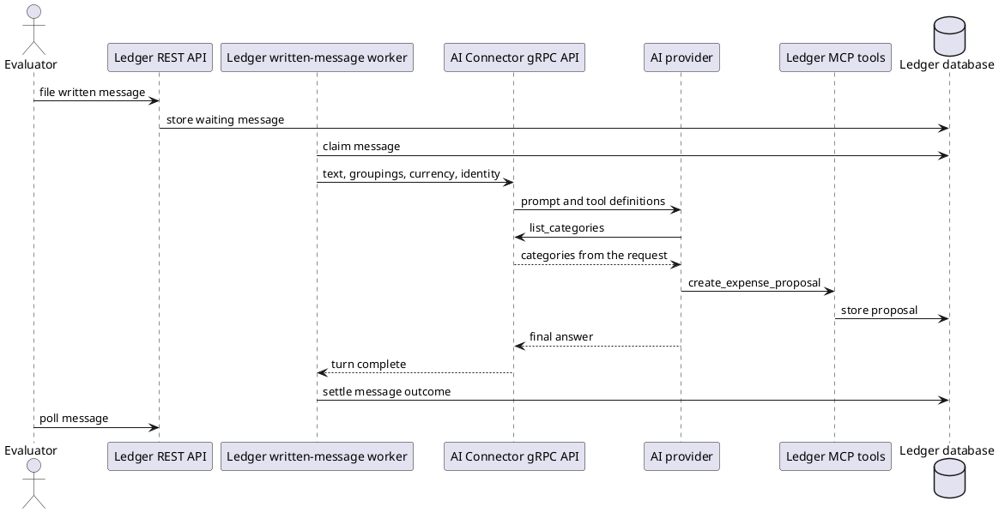

# Application Boundary

## Profile

| Item              | Rule                                                    |
|-------------------|---------------------------------------------------------|
| Name              | `application`                                           |
| Observed boundary | the outcome visible to the person using the application |
| Excluded          | direct invocation of the AI Connector                   |

## Message Path

## Completion and Result

| Item                | Requirement                                                           |
|---------------------|-----------------------------------------------------------------------|
| Completion          | the message reaches a terminal outcome                                |
| Terminal outcomes   | `RECORDED`, `PARTIAL`, `NOTHING_IDENTIFIED`, `ANSWERED`, `FAILED`     |
| Proposal precondition | `GET /api/v1/expenses?status=PENDING&limit=1` returns `total: 0` |
| Proposals             | after terminal outcome, read all pages of `GET /api/v1/expenses?status=PENDING&limit=100&offset=0`, advancing `offset` by the number of returned items |
| Completeness          | the number of unique proposal IDs across all pages equals `total`; a changed `total`, duplicate ID, or empty page before completion is an inspection error |
| Target selection      | exclude tracked learning-proposal IDs from the complete result before evaluating target expectations |
| Category resolution   | map each proposal's `categoryId` through `GET /api/v1/categories` |
| Attribution basis     | verified empty pending state and no unrelated traffic |
| Invalid attribution   | time windows or an unverified precondition |

## Memory Cases

[Case steps](case-steps.md) defines the message, decision, propagation, and inspection steps inside this boundary.
