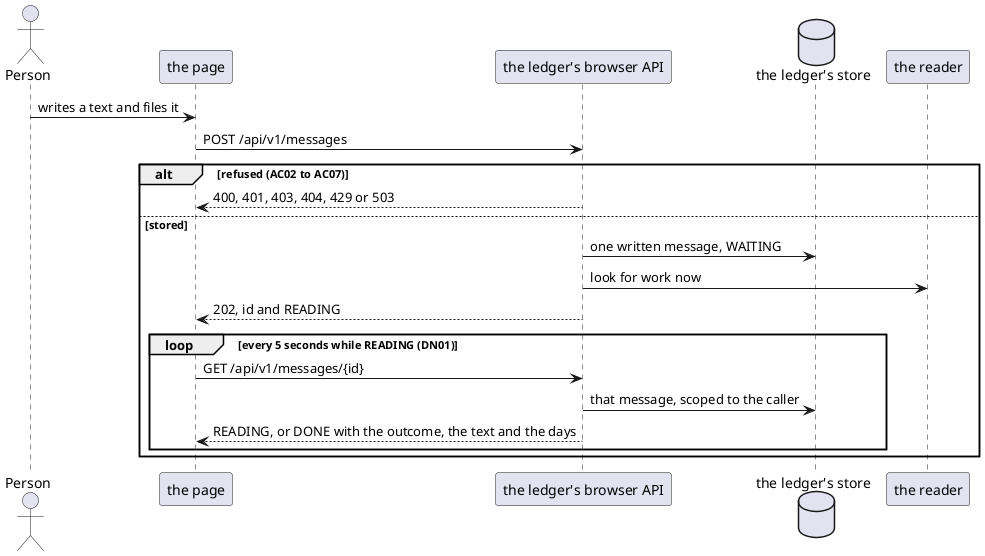
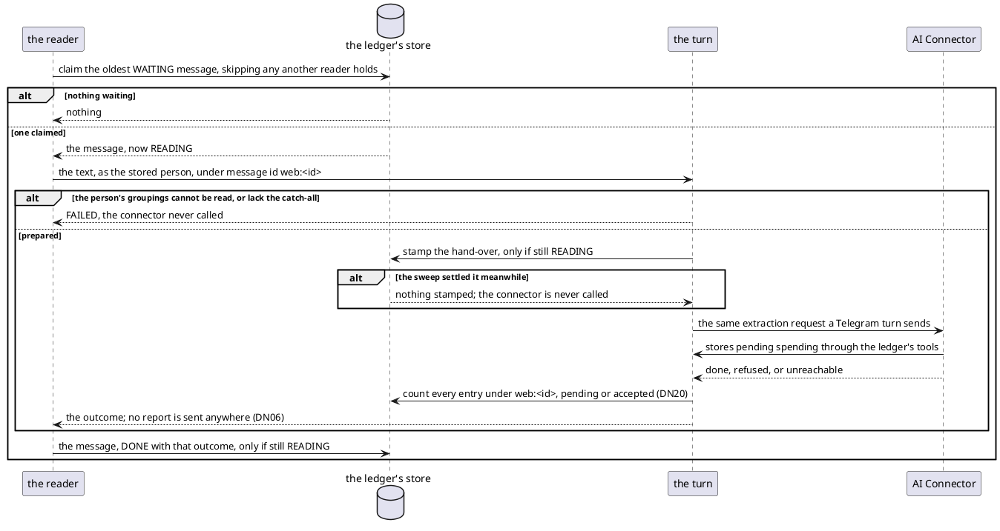
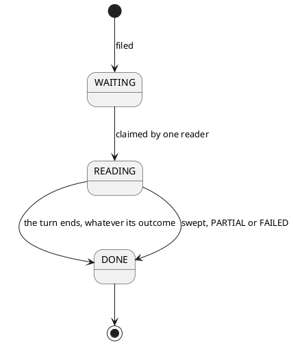

# Reading a Written Message

Every box is `ledger-service` except the browser and the AI connector. Nothing in the AI connector changes: it
receives a turn exactly as it does from Telegram.

## Filing and asking

A dropped "look for work now" costs nothing: the reader's next poll finds the message.

## Reading

The reader runs inside the ledger, apart from any request, on work of its own. It looks for work every
`<reader poll interval setting>`, and when filing asks it to.

The turn is the one a Telegram message runs, resolving the person by the stored id rather than finding or
creating them. The credential is minted only after the hand-over is stamped. A failure after the connector was
called leaves the message `READING` for the sweep.

A pass of the reader or the sweep that fails is logged, and the next interval runs as usual.

## The sweep

Every `<reader poll interval setting>`, beside the claim:

| `updated_at` older than …        | with … under `web:<id>`, pending or accepted | becomes           |
|----------------------------------|----------------------------------------------|-------------------|
| the turn's longest possible life | at least one entry                           | `DONE`, `PARTIAL` |
| the turn's longest possible life | nothing                                      | `DONE`, `FAILED`  |
| anything more recent             | anything                                     | left alone        |

The turn's longest possible life is the credential's lifetime, plus the leeway its validation allows past expiry,
plus a margin for a tool call accepted just before that. Each is read from the setting that already holds it,
never copied. No tool call of the turn is accepted after it, so what is stored by then is final (DN07). The
sweep, like settling, writes only where the message is still `READING`, and logs a warning per text it settles.

## The stored message

`written_message`, one row per text filed:

| Column        | Holds                                                                              |
|---------------|------------------------------------------------------------------------------------|
| `id`          | the message's own id, as the browser names it                                      |
| `user_id`     | who filed it; every read is scoped to it; removed with its user                   |
| `text`        | the text as filed, 1 to 1000 UTF-16 code units, never blank                       |
| `status`      | `WAITING`, `READING` or `DONE`, and nothing else                                   |
| `outcome`     | `RECORDED`, `PARTIAL`, `NOTHING_IDENTIFIED`, `ANSWERED` or `FAILED`               |
| `created_at`  | when it was filed                                                                  |
| `updated_at`  | when it last moved: the claim, the hand-over, and settling each set it            |

- `outcome` is present exactly when `status` is `DONE`, checked by the store.
- At most one row per `user_id` is `WAITING` or `READING`, enforced by a unique index over those rows. A second
  filing that violates that index, and only that one, answers 429 (DN15).
- The claim reads the oldest `WAITING` row through an index over those rows alone.

Pending spending stored by its turn carries `web:<id>` as its incoming message id, as a Telegram turn's carries
`<conversation>:<message>`. The days an answer names are the UTC days of every entry under `web:<id>`, pending or
since accepted.

The browser sees `WAITING` and `READING` alike, as `READING`.
