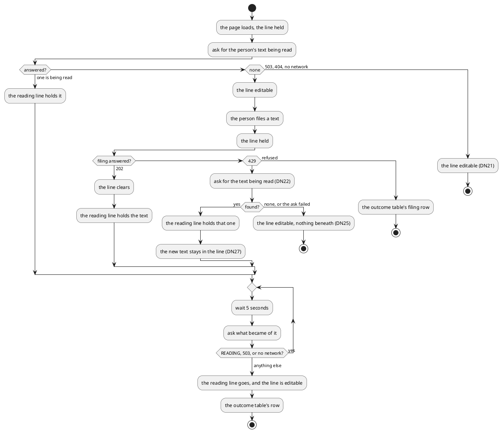

# The Write-In Line

What the expenses page decides between loading and showing a text's outcome. The candidate look is
the mockup in this task's directory. Where it disagrees with the rules below, the rules hold: the day headers, ticks and
fields stay as the page already draws them.

## Order on the page

1. the refusal banner, when the listing failed
2. the filters
3. the write-in line: the field, then the hint and the file control in one row that always stands
4. beneath it, at most one of: the reading line, a pencil note, or a refusal; the next filing replaces it
5. the acceptance's "moved on" line and the awaiting headline, as today
6. the days

## The loop

"Held" is read-only, focus kept (DN23).

A 401 from any ask or filing drops the session to anonymous.

## Outcomes

| Answer                     | The page                                                                                   |
|----------------------------|--------------------------------------------------------------------------------------------|
| `RECORDED`                 | reads back each day the answer names that the listing can show, opens it, ticks nothing    |
| `RECORDED`, no day shown   | a pencil note: the list on screen does not show those days (DN24)                          |
| `PARTIAL`                  | as `RECORDED`, and a pencil note: the list may be incomplete, shown or not (DN26)          |
| `NOTHING_IDENTIFIED`       | the text returns to the line, with a pencil note: nothing found (DN04)                     |
| `ANSWERED`                 | the text returns to the line, with a pencil note: only spending is filed here (DN05)       |
| `FAILED`, or asking is 404 | the text returns to the line, with a refusal: it could not be read                         |
| filing 400, 403, 404, 503  | the text stays in the line, editable, with the refusal                                     |

A text that returns while the line holds a newer one leaves the newer one in place (DN27).

The listing can show a day when that day is already on the page, or when the page is the first one and the
filter's period and status include it.

## The field

| Rule             | Holds                                                                              |
|------------------|------------------------------------------------------------------------------------|
| height           | 3 lines, growing to 8, then scrolling (DN17)                                       |
| length           | at most 1000 characters, counted as UTF-16 code units on both sides (DN09)         |
| Enter            | files, except while an input method is composing                                   |
| Shift+Enter      | breaks a line                                                                      |
| the hint         | shown only where the pointer is fine (DN18)                                        |
| the file control | disabled while the line is blank or only spaces, or held                           |
| held             | read-only and focusable, from filing until the outcome (DN23)                      |
| the reading line | at most 3 lines of the text, wrapping an unbroken string anywhere (DN17)           |
| reduced motion   | the reading mark stands still                                                      |
| the outcome      | announced politely to assistive technology when the reading line goes              |

## Wording

Decided by DN19:

| Key                   | Text                                                          |
|-----------------------|---------------------------------------------------------------|
| the line's label      | Write what you spent                                          |
| placeholder           | e.g. lunch 12.50, cinema 2×11                                 |
| file control          | File                                                          |
| hint                  | Enter to file · Shift+Enter for a new line                    |
| reading mark          | Reading…                                                      |
| reading line, spoken  | Reading your text: followed by the text                       |
| the held line, spoken | A text is being read                                          |
| recorded, spoken      | Filed. The new entries await a decision.                      |
| list incomplete       | Something went wrong partway, so this list may be incomplete. |
| out of view           | Filed, but the list on screen does not show those days.       |
| nothing found         | Nothing to file was found in this text.                       |
| only a question       | Only spending is filed here. Ask about totals in Telegram.    |
| could not be read     | This text could not be read. Try filing it again.             |
| filing refused        | The text was not filed. Please try again.                     |

## Checked by Eye

- The line at 320px: does the hint wrap under the file control rather than squeeze it below 40px?
- The line at 1000 characters: does it stop at 8 lines and scroll inside, without moving the hint row?
- The reading line on 3 lines of an unbroken string: does it clip at the third line, without widening the page?
- A reading line appearing while scrolled down: does the day in view stay put?
- The reading line arriving on load, after the days drew: how far do the days jump?
- `RECORDED` on a closed day and an open one: can the person see which lines are new?
- The reading mark under reduced motion, in both themes: is it still, not flickering?
- The pencil notes against the refusal, in both themes: does a note read as information?
- The held line in the dark theme: does it still read as the write-in line, with the focus underline visible?
- The 8-line field on a phone with the keyboard open: is the file control still above the keyboard?
- Enter on an Android keyboard right after a word: does it file, or insert an unasked line break?
