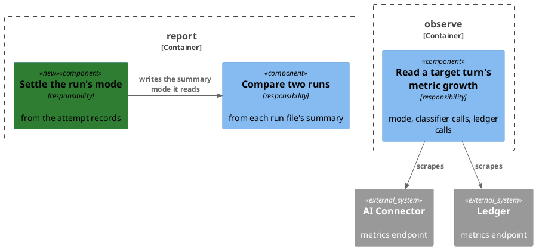

# Plan: The Runner Measures a Classifier Turn

**Format:** 2
**Affected Modules:** `eval-runner`
**Spec:** [The Runner Measures a Classifier Turn](spec.md)

## Architecture Decisions

### The turn's mode is observed beside the API; the run's mode is reported



**Placement:** The attempt's mode and counts are read in `observe`, inside the scrape window that already exists;
the run's mode is derived in `report` from the attempt records alone, and the comparison reads it from the summary.

## Step-by-Step Implementation Map (To-Do List)

### Stabilization

#### Interface-First / Build Stabilization

**Interface & Signature Sync**

- [x] ST01 · In `docs/eval/corpus/cases/7-004-category-lookup.yaml`, remove the `expected.mcpCalls` block and reword
  `notes` to say the case checks the category the message is filed under, not how it was looked up (DN01 — 7-004
  drops its `mcpCalls`)
  - writes: `docs/eval/corpus/cases/7-004-category-lookup.yaml`
- [x] ST02 · Add three components to the `TargetUsage` record, after `ledgerToolCalls`: `String extractionMode`,
  `Double classifierCalls`, `Double classifierSeconds`; `TargetMetrics.Window.close()` passes `null` for the three,
  with a `TODO` saying they are read from the connector's growth
  - writes: `eval-runner/src/main/java/bot/finance/eval/observe/TargetUsage.java`,
    `eval-runner/src/main/java/bot/finance/eval/observe/TargetMetrics.java`
- [x] ST03 · Stub `MetricSnapshot.labelValues(String name, String label): Set<String>`
  - writes: `eval-runner/src/main/java/bot/finance/eval/observe/MetricSnapshot.java`
  ```java
  public Set<String> labelValues(String name, String label) {
      // the distinct values of `label` across every series of `name` that carries it
      return Set.of();
  }
  ```
- [x] ST04 · Add the package-private final class `RunMode` in `bot.finance.eval.report`, with a stubbed static
  `of(List<Attempt> attempts): String`; `Summary.of()` puts `extractionMode` → `RunMode.of(attempts)` into the
  summary, after `discardedRolloverAttempts`, passing every recorded attempt, discarded rollovers included, not
  `counted`
  - writes: `eval-runner/src/main/java/bot/finance/eval/report/RunMode.java`,
    `eval-runner/src/main/java/bot/finance/eval/report/Summary.java`
  ```java
  static String of(List<Attempt> attempts) {
      // the one mode the attempts' usage records, "mixed" where two differ, null where none recorded one
      return null;
  }
  ```

### Red Phase

#### TDD Unit Red Phase

AC19 and AC20 are held by ST01 and the existing `Oracle`, which checks only the tools a case declares under
`mcpCalls`. AC06 is held by the existing `OracleTest.mcpCountsSeparateAttemptedFromAcceptedCalls`: a `count: 0`
expectation passes with no such call, and no check reads the mode. `Summary.of()` putting `RunMode.of()` under
`extractionMode` is a one-line delegation, made in ST04.

- [x] RU01 · `MetricSnapshot` · test: `MetricSnapshotTest` · covers: `labelValues()` · scenarios: AC01, AC02
  - `labelValues()`:
    - given: a scrape holding `ai_turns_total{mode="tools",outcome="acted_on"}`,
      `ai_turns_total{mode="tools",outcome="unavailable"}` and `ai_turns_total{mode="classifier",outcome="acted_on"}`
      when: `labelValues("ai_turns_total", "mode")` is called
      then: returns exactly `tools` and `classifier`
    - given: a scrape with no `ai_turns_total` series
      when: `labelValues("ai_turns_total", "mode")` is called
      then: returns an empty set
    - given: a scrape whose only series of the name carries no `mode` label
      when: `labelValues` is called for `mode`
      then: returns an empty set
- [x] RU02 · `TargetMetrics` · test: `TargetMetricsTest` · covers: `open()`, `Window.close()` · scenarios: AC01, AC02, AC14, AC07, AC08, AC09, AC15, AC16
  - Both services are stubs served by the JDK's `HttpServer` on a random port, each answering its first scrape with a
    "before" body and its second with an "after" body.
  - `Window.close()`:
    - given: the connector's `ai_turns_total{mode="tools",outcome="acted_on"}` grows from 3 to 4
      when: the window is opened and closed
      then: `extractionMode` is `tools`
    - given: the connector's `before` body has no `ai_turns_total`, and its `after` body has
      `ai_turns_total{mode="classifier",outcome="acted_on"} 1`
      when: the window is opened and closed
      then: `extractionMode` is `classifier`
    - given: the connector's `ai_turns_total` series are the same in both bodies
      when: the window is opened and closed
      then: `extractionMode` is null
    - given: both a `tools` and a `classifier` series of `ai_turns_total` grow
      when: the window is opened and closed
      then: `extractionMode` is null
    - given: the connector's `ai_classifier_seconds_count` grows by 1 under `outcome="answered"` and by 1 under
      `outcome="failed"`, and `ai_classifier_seconds_sum` grows by 0.25 and 0.5
      when: the window is opened and closed
      then: `classifierCalls` is 2 and `classifierSeconds` is 0.75
    - given: neither connector body carries `ai_classifier_seconds`
      when: the window is opened and closed
      then: `classifierCalls` is 0 and `classifierSeconds` is 0
    - given: the ledger's `ledger_mcp_tool_calls_total` is unchanged and its
      `grpc_server_seconds_count{rpc_service="bot.finance.ledger.v1.LedgerTurnService",rpc_method="FileExpenseProposal",grpc_status_code="OK"}`
      and the same series for `RecordSpendingPeriod` each grow by 1, while a `grpc_server_seconds_count` series of
      another `rpc_service` grows by 5
      when: the window is opened and closed
      then: `ledgerToolCalls` is 2
    - given: the ledger's `ledger_mcp_tool_calls_total` grows by 3 and it carries no `grpc_server_seconds_count`
      when: the window is opened and closed
      then: `ledgerToolCalls` is 3
    - given: the connector answers its second scrape with 500, and the ledger's counters grow
      when: the window is opened and closed
      then: `extractionMode`, `classifierCalls`, `classifierSeconds` and the provider values are null, `ledgerToolCalls`
      holds the ledger's growth, and the failure is handed to the consumer given to `open()`
    - given: the ledger answers its first scrape with 500, and the connector's `ai_turns_total` grows under `tools`
      when: the window is opened and closed
      then: `ledgerToolCalls` is null and `extractionMode` is `tools`
- [x] RU03 · `RunMode` · test: `RunModeTest` · covers: `of()` · scenarios: AC10, AC17, AC11, AC12
  - `of()`:
    - given: every attempt's usage records `classifier`
      when: `of()` is called
      then: returns `classifier`
    - given: one attempt's usage records `classifier`, another's records no mode, and a third has no usage
      when: `of()` is called
      then: returns `classifier`
    - given: one attempt's usage records `tools` and another's `classifier`
      when: `of()` is called
      then: returns `mixed`
    - given: no attempt's usage records a mode
      when: `of()` is called
      then: returns null
    - given: no attempts
      when: `of()` is called
      then: returns null
- [x] RU04 · `Comparison` · test: `ComparisonTest` · covers: `render()` · scenarios: AC13, AC18
  - `render()`:
    - given: one run's summary records `extractionMode` `tools` and the other's `classifier`
      when: `render()` is called
      then: the table's first row is `extraction mode`, holding `tools` and `classifier` with `differs` as its
      change, and the `pass rate` row still follows
    - given: both summaries record `classifier`
      when: `render()` is called
      then: the `extraction mode` row holds `classifier` twice and an empty change
    - given: the first run's summary has no `extractionMode`, the second's records `classifier`
      when: `render()` is called
      then: the `extraction mode` row holds `n/a` and `classifier`, and its change does not say `differs`

### Green Phase

#### TDD Unit Green Phase

- [x] GU01 · `MetricSnapshot` · test: `MetricSnapshotTest`
- [x] GU02 · `TargetMetrics` · test: `TargetMetricsTest` · after: GU01
- [x] GU03 · `RunMode` · test: `RunModeTest`
- [x] GU04 · `Comparison` · test: `ComparisonTest`

### Post-Implementation Steps

#### Documentation

- [x] PI01 · `eval-runner/README.md`: the **Measurements** table gains `usage.extractionMode` (which `mode` of
  `ai_turns_total` grew), `usage.classifierCalls` and `classifierSeconds` (`ai_classifier_seconds`, every outcome),
  and a new `usage.ledgerToolCalls` row naming both sources (`ledger_mcp_tool_calls_total` and the ledger's
  `grpc_server_seconds_count` for `LedgerTurnService`); the **What It Needs Running** rows for ledger and connector
  metrics name what each is now read for; the paragraph on `compare` says the table opens with each
  run's extraction mode, and that the summary records the run's mode, or `mixed`
- [x] PI02 · `docs/backlog.md`, BT08: drop the sentence saying the evaluation case expecting a ledger-side
  `list_categories` call changes with it, since 7-004 no longer expects one
- [x] PI03 · `docs/eval/implementation/demo-plan.md`: drop 7-004 from the row naming the cases that expect
  `list_categories`; `docs/eval/cases.md`: reword 7-004's coverage entry to match its new notes

## Open Questions

None.
