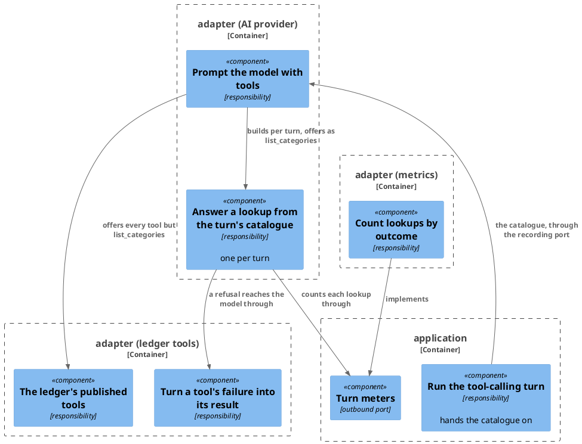

# Plan: The Connector Answers a Category Lookup Itself

**Format:** 2
**Affected Modules:** `ai-connector-service`
**Spec:** [The Connector Answers a Category Lookup Itself](spec.md)

## Architecture Decisions

### The lookup is a tool the AI adapter builds per turn



**Placement:** The AI adapter answers `list_categories` with a callback it builds per turn from that turn's
catalogue (DF05, a lookup never held on the shared client), drops the ledger's tool of the same name, counts
through the existing turn-meters port, and hands a refusal to the ledger adapter's existing tool-failure processor,
which now serves a local tool too.

## Step-by-Step Implementation Map (To-Do List)

### Stabilization

#### Interface-First / Build Stabilization

**Interface & Signature Sync**

- [x] ST01 · In the five case files below, remove the `list_categories` entry under `expected.mcpCalls`, leaving the
  other tools' expectations and `executionLimits` as they are (DN01 — the cases drop their lookup expectations)
  - writes: `docs/eval/corpus/cases/9-007-prompt-like-instruction.yaml`,
    `docs/eval/corpus/cases/9-008-prompt-injection-other-user.yaml`,
    `docs/eval/corpus/cases/9-009-prompt-injection-recipe.yaml`,
    `docs/eval/corpus/cases/9-010-prompt-injection-role-spoofing.yaml`,
    `docs/eval/corpus/cases/9-011-prompt-injection-call-amplification.yaml`
- [x] ST02 · `ExpenseRecordingPort.record()`: replace the `List<String> categoryGroupings` parameter with
  `List<CatalogueEntry> catalogue`. `ToolCallingTurn.run()` passes `command.catalogue()`.
  `AiExpenseRecordingAdapter.record()` takes the catalogue and renders `{categoryGroupings}` from its entries'
  groupings, in order. `ExtractIntentsUseCaseTest`'s pass-through test verifies `eq(command.catalogue())` in place
  of the groupings; `AiExpenseRecordingAdapterTest`'s two `record` helpers and its no-token test pass a catalogue
  built from `RequestFixtures.DEFAULT_CATEGORY_GROUPINGS`, each grouping holding one category of its own name, as
  `RequestFixtures.request()` builds it
  - writes: `ai-connector-service/src/main/java/bot/finance/ai/application/port/ExpenseRecordingPort.java`,
    `ai-connector-service/src/main/java/bot/finance/ai/application/usecase/ToolCallingTurn.java`,
    `ai-connector-service/src/main/java/bot/finance/ai/adapter/ai/AiExpenseRecordingAdapter.java`,
    `ai-connector-service/src/test/java/bot/finance/ai/application/usecase/ExtractIntentsUseCaseTest.java`,
    `ai-connector-service/src/test/java/bot/finance/ai/adapter/ai/AiExpenseRecordingAdapterTest.java`
- [x] ST03 · Add `countCategoryLookup(boolean answered)` to `TurnMeters`, and `CATEGORY_LOOKUPS("ai_category_lookups_total")`
  to `MeterName`. Stub `MicrometerTurnMeters.countCategoryLookup()`:
  - writes: `ai-connector-service/src/main/java/bot/finance/ai/application/port/TurnMeters.java`,
    `ai-connector-service/src/main/java/bot/finance/ai/adapter/metrics/MeterName.java`,
    `ai-connector-service/src/main/java/bot/finance/ai/adapter/metrics/MicrometerTurnMeters.java`
  ```java
  @Override
  public void countCategoryLookup(boolean answered) {
      // increments ai_category_lookups_total tagged outcome=answered or outcome=refused
  }
  ```
- [x] ST04 · Stub `CategoryLookupToolCallback` in `adapter/ai`, implementing Spring AI's `ToolCallback`, constructed
  from a turn's `List<CatalogueEntry>` and a `TurnMeters`. `getToolDefinition()` is complete here: name
  `list_categories`, the description and the one required string argument `grouping` with its description copied
  from the ledger's `ListCategoriesMcpTool`, to the letter (DF02, the ledger's texts to the letter). A refusal is a
  `ToolExecutionException` whose cause is a `RuntimeException` carrying the refusal text, which
  `LedgerToolFailureProcessor` returns to the model as the call's result · after: ST03
  - writes: `ai-connector-service/src/main/java/bot/finance/ai/adapter/ai/CategoryLookupToolCallback.java`
  ```java
  @Override
  public String call(String toolInput) {
      // reads the grouping out of the call's arguments, answers that grouping's categories from the turn's
      // catalogue in the ledger's answer form, or refuses with the ledger's refusal text; counts the lookup
      return "";
  }
  ```
- [x] ST05 · `AiExpenseRecordingAdapter` takes `TurnMeters` as a constructor parameter, unused until GI02.
  `@AiAdapterTest` boots a mocked `TurnMeters` so its context still loads · after: ST02, ST03
  - writes: `ai-connector-service/src/main/java/bot/finance/ai/adapter/ai/AiExpenseRecordingAdapter.java`,
    `ai-connector-service/src/test/java/bot/finance/ai/common/boot/AiAdapterTest.java`

- [x] ST06 · Confirm `bot.finance.ai.architecture.CleanArchitectureTest` passes
  - writes: none

### Red Phase

#### TDD Unit Red Phase

AC08 is held by the existing `AiExpenseRecordingAdapterTest` test that drives `summarize_spending` to the ledger.
AC12 and AC13 are held by ST01 and the runner's existing oracle, which checks only the tools a case names under
`mcpCalls`. AC09 is held by ST02, which builds the prompt from the catalogue's groupings alone, and the existing
`AiExpenseRecordingAdapterTest` test naming every grouping in the user message.

- [x] RU01 · `CategoryLookupToolCallback` · test: `CategoryLookupToolCallbackTest` · covers: `call()` · scenarios: AC01, AC02, AC03, AC04, AC05, AC11
  - `call()`:
    - given: a catalogue holding `Food` with `Groceries` and `Restaurants`
      when: `call()` is given `{"grouping":"Food"}`
      then: it returns `{"grouping":"Food","categories":["Groceries","Restaurants"]}` and counts one answered
      lookup
    - given: a catalogue holding `Groceries` only as a category under `Food`
      when: `call()` is given `{"grouping":"Groceries"}`
      then: it throws a `ToolExecutionException` whose cause is a `RuntimeException` with the message
      `Groceries is a category, not a grouping`, and counts one refused lookup
    - given: a catalogue holding no grouping or category named `Travel`
      when: `call()` is given `{"grouping":"Travel"}`
      then: it throws a `ToolExecutionException` whose cause is a `RuntimeException` with the message
      `no grouping named Travel is stored for this user`, and counts one refused lookup
    - given: any catalogue
      when: `call()` is given a blank `grouping`, `{"grouping":null}`, or arguments carrying none (parameterized)
      then: it throws a `ToolExecutionException` whose cause is a `RuntimeException` with the message
      `list categories command has no grouping name`, and counts one refused lookup
    - given: any catalogue
      when: `call()` is given arguments that are not JSON, or a `grouping` that is not a string (parameterized)
      then: it refuses the call the same way, and counts one refused lookup (DF13, unreadable arguments are
      refused)
    - given: a catalogue holding `Food`
      when: `call()` is given `{"grouping":"food"}`
      then: it refuses `food` as not stored, since a name is matched exactly
    - given: a catalogue holding `Other` as a grouping whose one category is also `Other`
      when: `call()` is given `{"grouping":"Other"}`
      then: it answers `Other`'s categories
    - given: a catalogue holding `Food`
      when: `call()` is given `{"grouping":"Food"}` twice
      then: both calls return the same answer, and two answered lookups are counted
    - (added) given: any catalogue
      when: `call()` is given `{"grouping":""}`
      then: it refuses with `list categories command has no grouping name`, and counts one refused lookup
    - (added) given: any catalogue
      when: `call()` is given empty arguments, or a `grouping` that is an object
      then: it refuses the call as unreadable, and counts one refused lookup

#### TDD Integration Red Phase

- [x] RI01 · `MicrometerTurnMeters` · test: `MicrometerTurnMetersTest` · covers: `countCategoryLookup()` · scenarios: AC11
  - `countCategoryLookup()`:
    - given: a scrape taken before the calls
      when: one answered and one refused lookup are counted
      then: `ai_category_lookups_total` grows by one under `outcome="answered"` and by one under
      `outcome="refused"`
- [x] RI02 · `AiExpenseRecordingAdapter` · test: `AiExpenseRecordingAdapterTest` · covers: `record()` · scenarios: AC01, AC02, AC06, AC07
  - `record()`:
    - given: a catalogue holding the lookup grouping with `Lunch`, and a provider that looks that grouping up and
      then records
      when: `record()` runs
      then: the lookup's result reaching the provider carries `Lunch`, the ledger receives no `list_categories`
      request, and the `create_expense_proposal` call reaches the ledger under the turn's token
    - given: a provider that looks up a name the catalogue holds only as a category, then records
      when: `record()` runs
      then: the refusal text reaches the provider as that call's result, the ledger receives no
      `list_categories` request, and the `create_expense_proposal` call reaches the ledger
    - given: the stubbed ledger publishes its own `list_categories`, with a description shorter than the ledger's
      real one
      when: `record()` runs
      then: the provider's request offers `list_categories` with the ledger's real description, not the stub's
    - given: two consecutive turns whose catalogues give the lookup grouping different categories, each turn
      looking that grouping up
      when: `record()` runs for each
      then: each lookup's result reaching the provider carries only its own turn's categories
    - update: `whenProviderListsCategoriesThenCreatesProposal_thenBothCallsReachLedgerUnderTheTurnsToken()` —
      delete
    - update: `whenLedgerAnswersListCategories_thenAnswerReachesProviderAsThatCallsResult()` — delete
    - update: `whenLedgerRefusesListCategoriesThenProviderCorrectsAndRecords_thenCreateCallReachesLedger()` —
      delete

#### TDD System Test Red Phase

- [x] RS01 · `ExtractIntentsSystemTest` · covers: `IntentExtractionGrpcService.extractIntents()` · scenarios: AC01, AC07, AC11
  - Happy Path:
    - given: a request whose catalogue holds the grouping with `Lunch`, and a provider that looks that grouping up
      and then records
      when: the tokened request is sent
      then: the RPC answers empty, the ledger receives the `create_expense_proposal` call under the token and no
      `list_categories` request, and `ai_category_lookups_total{outcome="answered"}` grows by one
  - update: `whenProviderLooksUpCategoriesThenRecords_thenBothToolCallsReachLedgerUnderToken()` — delete

### Green Phase

#### TDD Unit Green Phase

- [x] GU01 · `CategoryLookupToolCallback` · test: `CategoryLookupToolCallbackTest`

#### TDD Integration Green Phase

- [x] GI01 · `MicrometerTurnMeters` · test: `MicrometerTurnMetersTest`
- [x] GI02 · `AiExpenseRecordingAdapter` · test: `AiExpenseRecordingAdapterTest` · after: GU01

#### TDD System Test Green Phase

- [x] GS01 · `ExtractIntentsSystemTest` · covers: `IntentExtractionGrpcService.extractIntents()`

### Post-Implementation Steps

#### Documentation

- [x] PI01 · `docs/eval/application-boundary.md`: the diagram's lookup arrow goes from the provider to the connector,
  which answers it from the request; the ledger's arrow keeps `create_expense_proposal` (DF08, the pages the plan
  updates)
- [x] PI02 · `docs/eval/implementation/demo-plan.md`: remove the Constraints row naming `9-007`–`9-011` and
  `list_categories`, and re-pad the table
- [x] PI03 · `docs/adr/0008-the-connector-hands-expense-recording-to-the-model.md`: append one dated line to
  Consequences — since 2026-10-14 the connector answers `list_categories` itself, from the request's catalogue,
  so that tool's schema is no longer the ledger's alone

## Open Questions

- **OQ01:** Place an ADR "The connector answers `list_categories` from the request's catalogue, with a copy of the
  ledger's tool schema"? Without it, the connector's `ledger-mcp.md` contract page holds the fact, and nothing
  records that the copy must follow the ledger's tool.
  - A: no

- **OQ02:** Append a dated line to ADR 0008's Consequences saying `list_categories` is no longer the ledger's alone
  to define? Without it, 0008's "the argument schema has one owner" reads as still true.
  - A: yes
