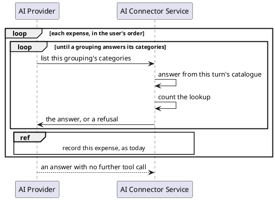

# Where a Lookup Is Answered

## Recording spending, tools mode

Recording keeps every branch of today's
[Recording spending](../../ai-connector-service/docs/usecases/extract-intents.md#recording-spending), the ledger
being unreachable included. No call reaches the ledger inside the inner loop.

## Each name's answer

Each answer is the ledger's lookup answer, to the letter. A refusal is a tool result flagged as an error.

| The name the model sends                                          | Answer                                                      | Scenario |
|-------------------------------------------------------------------|-------------------------------------------------------------|----------|
| a grouping in the catalogue                                       | `{"grouping":<name>,"categories":[…]}`, in catalogue order  | AC01     |
| a category in the catalogue, and no grouping                      | refused: `<name> is a category, not a grouping`             | AC02     |
| neither, a grouping the ledger stores with no categories included | refused: `no grouping named <name> is stored for this user` | AC03     |
| blank or absent                                                   | refused: `list categories command has no grouping name`     | AC04     |

A name is matched exactly, case included. A name that is both a grouping and a category answers as the grouping.

## What the model is offered

| Offered                   | Answered by                                                     | Scenario |
|---------------------------|-----------------------------------------------------------------|----------|
| `list_categories`         | the connector, with the ledger's name, description and argument | AC06     |
| `create_expense_proposal` | the ledger                                                      | AC07     |
| `summarize_spending`      | the ledger                                                      | AC08     |
| any tool the ledger adds  | the ledger                                                      | AC06     |
| the prompt                | groupings and the catch-all; no category                        | AC09     |

The ledger's own `list_categories` is never offered, whether or not the ledger still publishes it.
