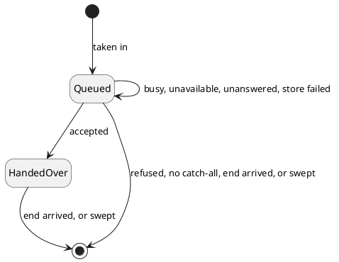

# A Turn Awaiting Its End

## What is kept

A text filed from the web already has its row. `WAITING` is queued, and `READING` is handed over (DN10). Each
hand-over sent touches the instant it last moved, which is its last attempt. A Telegram message gets a row of
its own while its turn is in flight.

| Field          | Bound                                                     |
|----------------|-----------------------------------------------------------|
| person         | a stored user                                             |
| message        | the message reference; unique                             |
| text           | what the person wrote; non-blank, at most Telegram's 4096 UTF-16 units |
| conversation   | where the report goes                                     |
| reply-to       | which message in it the report is threaded on             |
| kept at        | the instant the row was written; its day is the turn's day |
| last attempt   | the instant of the latest hand-over sent; empty before the first |
| handed over    | the instant the connector accepted it; empty while queued |

Settling deletes the row (DN07). The delete that removes a row is the one that reports.

A text's day is the day it was filed, as a Telegram turn's is the day it was kept (AC31).

## How it moves

| Leaving by         | Report                                                 |
|--------------------|--------------------------------------------------------|
| refused            | Failed                                                 |
| no catch-all       | none, counted unreported; a text settled `FAILED`      |
| end arrived        | the one it earned, as today                            |
| swept              | Partial if anything is under the message, else Failed  |

- A turn leaves once, whichever gets there first. The one that moves it sends the report; the others change
  nothing.
- The move matches the person and the message together.
- A report that cannot be delivered after the move counts as unreported, as today (AC33).

A web text moves the same way: `WAITING` to `READING` on acceptance, and to `DONE` from either, settled only if
not yet `DONE`. Acceptance moves it only from `WAITING`.

A gauge of the oldest queued turn's age, by channel, shows a queue that is not draining (DN12).

## The sweep

| Turn                       | Past                                                                                  | Settled as                                            |
|----------------------------|---------------------------------------------------------------------------------------|-------------------------------------------------------|
| queued Telegram turn       | the wait setting, from when it was kept, and the turn's longest life since its last attempt (DN09) | Partial if anything is under the message, else Failed |
| queued text, `WAITING`     | the same                                                                              | today's sweep rule: `PARTIAL` if an entry is under it, else `FAILED` |
| handed-over Telegram turn  | the turn's longest life, from the stamp                                               | Partial if anything is under the message, else Failed |
| handed-over text, `READING` | the turn's longest life, from the stamp                                              | today's sweep, unchanged                              |

- The turn's longest life is today's text sweep's: the credential's lifetime, its clock skew and the sweep margin.
  A queued turn's last attempt may have been accepted with its answer lost, so it waits as long.
- One warning per settled turn names the message and the person.
- Each settled turn counts once on the swept counter, under its channel (DN08).
- A store failure is logged, and the rest wait for the next run.
