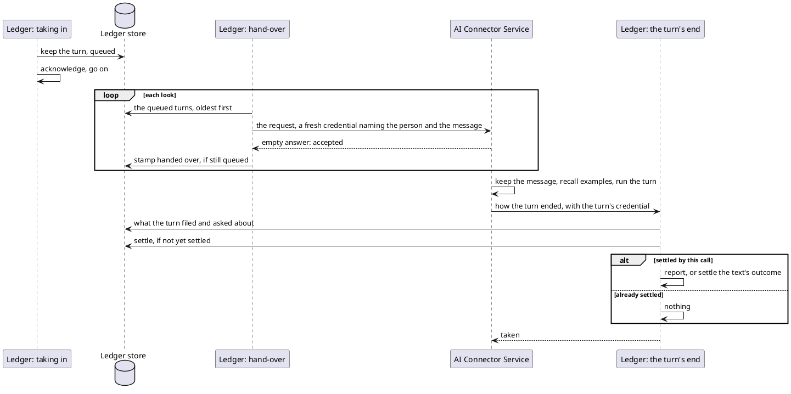

# The Turn in Two Halves

## The order

- Taking in never calls the connector. A web text is taken in by filing it, as today.
- The look and the sweep run one at a time, on one schedule. Taking a Telegram message in wakes the look, as
  filing a text does today.
- The request's day is the day the turn was kept, not the day of the hand-over.
- The stamp, the end and the sweep run concurrently. The end may reach the ledger before the stamp, and settles
  a queued turn as it would a handed-over one.
- What the turn left is read before the settle, so a refused read leaves the turn unsettled.
- Only the call whose settle moved the turn reports. Every other path ends in "nothing".

## Taking a Telegram message in

| Condition                                  | Then                                                     | Scenario |
|--------------------------------------------|----------------------------------------------------------|----------|
| the message is kept                        | queued; the look is woken; the batch is acknowledged     | AC01     |
| a turn is already kept under the message   | nothing kept; one info line                              | AC17     |
| the store refuses the write                | nothing kept; logged; counted unreported, as today        | AC04     |

## The look

| Before the hand-over                                       | Then                                                    | Scenario |
|------------------------------------------------------------|---------------------------------------------------------|----------|
| the person's catalogue lacks the catch-all                 | settled with no call: removed, unreported; or `FAILED`  | AC28     |
| the catalogue or the currency cannot be read               | stays queued; the look stops                            | AC29     |

| The hand-over gets                                                                  | Then                                              | Scenario   |
|-------------------------------------------------------------------------------------|---------------------------------------------------|------------|
| accepted                                                                            | stamped; the look goes on                         | AC02       |
| refused as unauthenticated or as an invalid argument                                | settle as failed, if not yet settled; report; the look goes on | AC03 |
| refused as busy, or unavailable; unreachable; no answer within the hand-over's deadline | stays queued; the look stops                   | AC18, AC25, AC30 |

Every hand-over sent records its attempt. A turn already settled is never picked up (AC19). One settled between
the look's read and its send can still be sent; its run's filings stand until task 56 (DF16). A turn queued past
its wait is the sweep's (AC27).

## The connector's answer to a hand-over

| Condition                                              | Answer                 | Scenario |
|--------------------------------------------------------|------------------------|----------|
| the credential or the request does not hold            | today's refusals       | AC03     |
| the key set cannot be read                             | unavailable            | AC18     |
| a run for the same person and message is in flight (DN11) | accepted; no second run, whatever the cap | AC26 |
| as many turns run as its cap allows (DN01)             | busy, before accepting | AC25     |
| otherwise                                              | accepted; the run starts | AC05   |

## The end's answer

| Condition                                                           | Answer          | Changes                          | Scenario   |
|---------------------------------------------------------------------|-----------------|----------------------------------|------------|
| no credential, an expired one, or one naming no message             | unauthenticated | nothing                          | AC13       |
| no turn is kept under the credential's person and message           | taken           | nothing                          | AC11, AC22 |
| the store refuses the read or the settle                            | unavailable     | nothing; the turn stays unsettled | AC14      |
| another end, a refusal or the sweep settled it first                | taken           | nothing                          | AC12       |
| unsettled, and this end settles it                                  | taken           | the report, or the text's outcome | AC09, AC10 |

The connector tells the ledger again on unavailable or no answer, until the credential expires (AC21).

## What crosses

| Call            | Direction            | Carries                                                                     | Answers                        |
|-----------------|----------------------|-----------------------------------------------------------------------------|--------------------------------|
| The hand-over   | ledger → connector   | today's extraction request and credential, unchanged                        | empty: accepted; or busy        |
| The turn's end  | connector → ledger   | how the turn ended (DN05); the person and the message ride the credential   | empty: the end was taken        |

- Busy is a status of its own, distinct from unavailable.
- The turn's end is served on the port of the ledger's turn operations, behind the same credential check, as a
  service of its own. The check guards it by name, as it guards the two operations. Only the operations that file count as a turn's ledger calls.
- The end writes no turn call line: it files nothing.
- The connector reaches it in either mode, so its address is required in the tools mode too.
- The hand-over's empty answer stops meaning "acted on" and starts meaning "accepted".

## How a turn ended

| End         | Raised by                                                                                       | The ledger treats it as |
|-------------|-------------------------------------------------------------------------------------------------|-------------------------|
| acted on    | the turn finished                                                                               | today's handled call    |
| unavailable | what fails the call as unavailable today: provider, ledger tools, turn operations; the run's bound | today's failed call  |
| failed      | anything else, or a value the ledger does not know                                              | today's failed call     |

The report or the outcome then follows from what is stored under the message, exactly as today.

## Timing

| Bound                                    | Covers                                                     |
|------------------------------------------|------------------------------------------------------------|
| The hand-over's deadline, a setting      | one hand-over, above the connector's key-set timeout        |
| The look's schedule                      | how often queued turns are handed over, besides each wake   |
| The wait before giving up, a setting     | a turn queued and never accepted, from when it was kept, never under the longest life since its last attempt (DN09) |
| The run's own bound, a setting           | the connector's run, from acceptance to its end             |
| The credential's lifetime                | every call the run makes, its end and its retries included  |

The run's bound sits inside the credential's lifetime, so an end that arrives at all arrives with a valid
credential. The sweep waits past that lifetime from the stamp, so it never settles a turn whose end can still be
taken.
