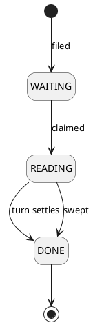

# Written message

One text a person filed from the web, and how far its reading has got.

## Invariants

| Field                                 | Bound                         |
|---------------------------------------|-------------------------------|
| `id`                                  | only once stored              |
| `userId`                              | `> 0`                         |
| `text`                                | mandatory, not blank          |
| [`status`](written-message-status.md) | mandatory, `WAITING` when new |
| `createdAt`                           | mandatory                     |

- Two stored messages with the same `id` are the same message. An unstored one equals only itself.
- `text` is at most `1000` UTF-16 code units, checked where it is stored
  ([ADR 0004](../adr/0004-column-widths-are-checked-in-the-persistence-adapter.md)).
- At most one message per person is `WAITING` or `READING`.

## Lifecycle

| Event   | By                                                                         | Notes                                                  |
|---------|----------------------------------------------------------------------------|--------------------------------------------------------|
| Created | [File a text for reading](../usecases/file-written-message.md)             |                                                        |
| Changed | [Act on a text filed from the web](../usecases/handle-written-message.md)  | claimed `READING`, then settled `DONE` with an outcome |
| Changed | [Settle the texts left reading](../usecases/sweep-written-messages.md)     | a stale `READING` one settled `DONE`                   |
| Removed | never                                                                      | only with its user, by the store's own cascade         |

A `READING` message moves to `DONE` once, whichever of the two gets there first.

## Made of / held by

The filing person's id, the text, a status, and the instant it was filed.

- [User](user.md) — who filed it.
- [Written message status](written-message-status.md) — how far its reading has got.
- [Incoming message id](incoming-message-id.md) — what the entries its reading stores are recorded under,
  derived from its `id`.
- [File a text for reading](../usecases/file-written-message.md) — stores a new one.
- [Act on a text filed from the web](../usecases/handle-written-message.md) — reads it and settles it.
- [Settle the texts left reading](../usecases/sweep-written-messages.md) — settles one whose reading stalled.
- [Read what became of a filed text](../usecases/read-written-message.md) — answers one by its `id`.
- [List a person's texts being read](../usecases/browse-written-messages.md) — answers the unsettled one.
- [Database](../contracts/out/database.md) — where one is kept.
