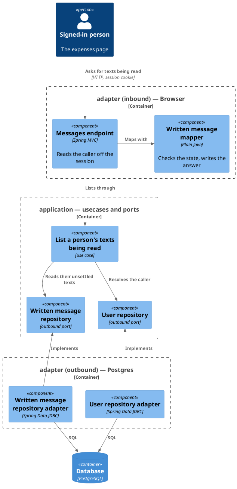
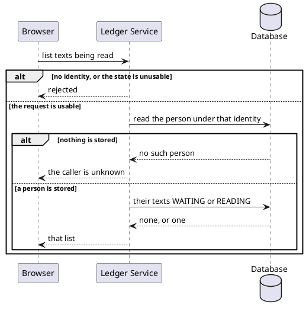

# List a person's texts being read

- **In**
  - the identity of the authenticated caller
  - the state asked for, `READING`
- **Out**
  - the caller's [texts](../domain/written-message.md) still `WAITING` or `READING`
- **Why:** a page opened or reloaded mid-reading picks the text up again and goes on following it

*Implemented by `BrowseWrittenMessagesUseCase`.*

## Prerequisites

- The caller is authenticated. The request never names whose texts they are.
- A user is stored under that identity.

## Collaborators

| Direction | Collaborator                                                                     | Through                                                                 | For                                                          |
|-----------|----------------------------------------------------------------------------------|-------------------------------------------------------------------------|--------------------------------------------------------------|
| in        | [File expenses as text](../../../web-app/docs/usecases/file-expenses-as-text.md) | [Browsing the ledger from a browser](../contracts/in/web-browse-api.md) | finding a text being read on load, or after a refused filing |
| out       | [Database](../contracts/out/database.md)                                         | [Users, categories and expenses](../contracts/out/database.md)          | resolving the identity, and reading their texts              |

## Outcomes

| Outcome          | When                                              | Result                                               |
|------------------|---------------------------------------------------|------------------------------------------------------|
| Text listed      | the caller has a text `WAITING` or `READING`      | a list of that one text                              |
| Nothing reading  | every text of theirs is `DONE`, or they have none | an empty list                                        |
| State unusable   | the state is absent, or anything but `READING`    | the request is rejected naming `state`               |
| Identity unknown | nothing is stored under the identity              | the request is rejected, and no text is read         |
| Request rejected | the request carries no identity                   | no browser session is open, and nothing is looked up |
| Storage failed   | the store cannot be reached                       | the failure reaches the caller                       |

## Components

## Flow

## References

- [Read what became of a filed text](read-written-message.md) — how the page follows the text it finds
- [File a text for reading](file-written-message.md) — how a text comes to be read
