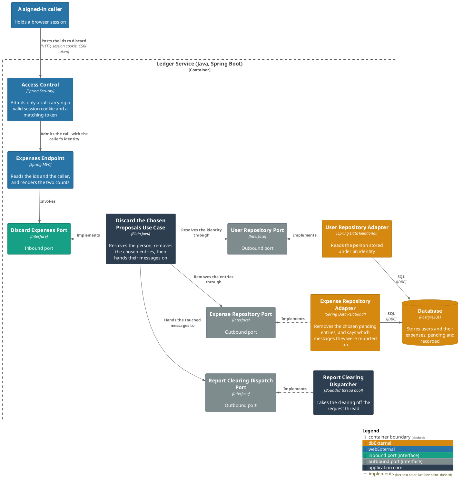
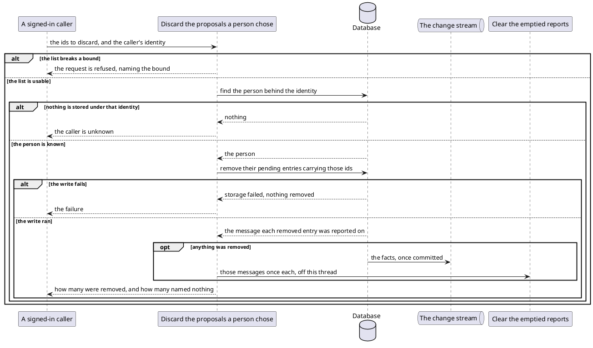

# Discard the proposals a person chose

- **In**
  - the identity of the authenticated caller
  - the [ids of the pending entries](../domain/proposal-ids.md) to discard
- **Out**
  - how many pending entries were thrown away
  - how many of the ids named nothing
- **Why:** a person throws away chosen pending spending by id

*Implemented by `DiscardExpensesUseCase`.*

## Prerequisites

- The caller is authenticated.
- A user is stored under that identity.

## Collaborators

| Direction | Collaborator                                                            | Through                                                                 | For                                                                   |
|-----------|-------------------------------------------------------------------------|-------------------------------------------------------------------------|-----------------------------------------------------------------------|
| in        | [A signed-in caller](../contracts/in/web-browse-api.md)                 | [Browsing the ledger from a browser](../contracts/in/web-browse-api.md) | throwing away the pending entries it names                            |
| out       | [Database](../contracts/out/database.md)                                | [Users, categories and expenses](../contracts/out/database.md)          | resolving the identity, and removing the pending entries the ids name |
| out       | [Clear the emptied reports](clear-emptied-reports.md)                   | [Clear the emptied reports](clear-emptied-reports.md)                   | handing over the messages this discard may have emptied               |
| out       | [A consumer of the ledger's changes](../contracts/out/change-stream.md) | [The change stream](../contracts/out/change-stream.md)                  | publishing the fact each discard produces                             |

## Outcomes

| Outcome            | When                                                                   | Result                                                                                     |
|--------------------|------------------------------------------------------------------------|--------------------------------------------------------------------------------------------|
| Spending discarded | the ids name pending entries of the caller's                           | those are removed, both counts are answered, and their messages go to the clearing         |
| Nothing matched    | no id names a pending entry of theirs                                  | both counts are answered, and no clearing is handed over                                   |
| List rejected      | the list breaks a bound [proposal ids](../domain/proposal-ids.md) sets | the request is refused, naming the bound — nothing is discarded                            |
| Body rejected      | the body is not JSON                                                   | the request is refused — nothing is discarded                                              |
| Request rejected   | the request is absent                                                  | rejected as invalid — nothing is looked up                                                 |
| Identity unknown   | nothing is stored under the caller's identity                          | the request is rejected, and nothing is removed or handed over                             |
| Storage failed     | the write fails                                                        | the failure reaches the caller, and nothing is removed or handed over                      |

## Components

## Flow

## References

- [Resolve a reported proposal](resolve-a-reported-proposal.md) — what a report's buttons answer once its
  entries are gone
