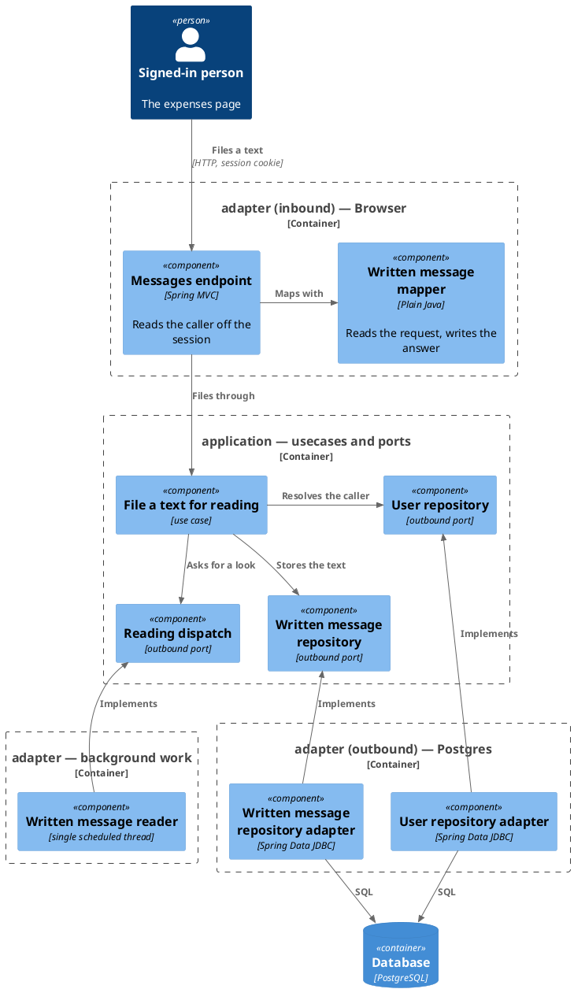
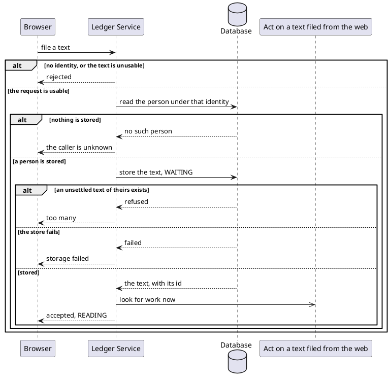

# File a text for reading

- **In**
  - the identity of the authenticated caller
  - the text they wrote
- **Out**
  - the [text as stored](../domain/written-message.md), waiting to be read, with the id it is followed by
- **Why:** a person files spending from the expenses page, and is answered before it is read

*Implemented by `FileWrittenMessageUseCase`.*

## Prerequisites

- The caller is authenticated. The request never names whose text it is.
- A user is stored under that identity.

## Collaborators

| Direction | Collaborator                                                                       | Through                                                                 | For                                          |
|-----------|------------------------------------------------------------------------------------|-------------------------------------------------------------------------|----------------------------------------------|
| in        | [File expenses as text](../../../web-app/docs/usecases/file-expenses-as-text.md)   | [Browsing the ledger from a browser](../contracts/in/web-browse-api.md) | filing what the person wrote                 |
| out       | [Database](../contracts/out/database.md)                                           | [Users, categories and expenses](../contracts/out/database.md)          | resolving the identity, and storing the text |
| out       | [Act on a text filed from the web](handle-written-message.md)                      | [Act on a text filed from the web](handle-written-message.md)           | asking the reader to look for work now       |

## Outcomes

| Outcome          | When                                                      | Result                                                             |
|------------------|-----------------------------------------------------------|--------------------------------------------------------------------|
| Text filed       | the identity names a stored person with no unsettled text | the text, stored `WAITING`, and the reader is asked to look now    |
| Already reading  | the person has a text `WAITING` or `READING`              | refused as too many, and nothing is stored                         |
| Filings race     | two filings of one person's arrive at once                | exactly one is stored, and the other is refused as too many        |
| Text unusable    | the text is absent, blank, or longer than the store holds | the request is rejected naming `text`, and nothing is stored       |
| Identity unknown | nothing is stored under the identity                      | the request is rejected, and nothing is stored                     |
| Request rejected | the request carries no identity                           | no browser session is open — nothing is looked up                  |
| Storage failed   | the store cannot be reached                               | the failure reaches the caller, and the reader is not asked        |
| Look refused     | the reader cannot take the request to look                | logged; the text stays filed, and the next scheduled look finds it |

## Components

## Flow

## References

- [ADR 0013: A browser session is a cookie-borne token with its own audience](../adr/0013-a-browser-session-is-a-cookie-borne-token-with-its-own-audience.md) —
  what the caller is holding when it reaches here
- [ADR 0004: Column widths are checked in the persistence adapter](../adr/0004-column-widths-are-checked-in-the-persistence-adapter.md) —
  where the text's length is refused
- [Read what became of a filed text](read-written-message.md) — how the person follows the text by its id
