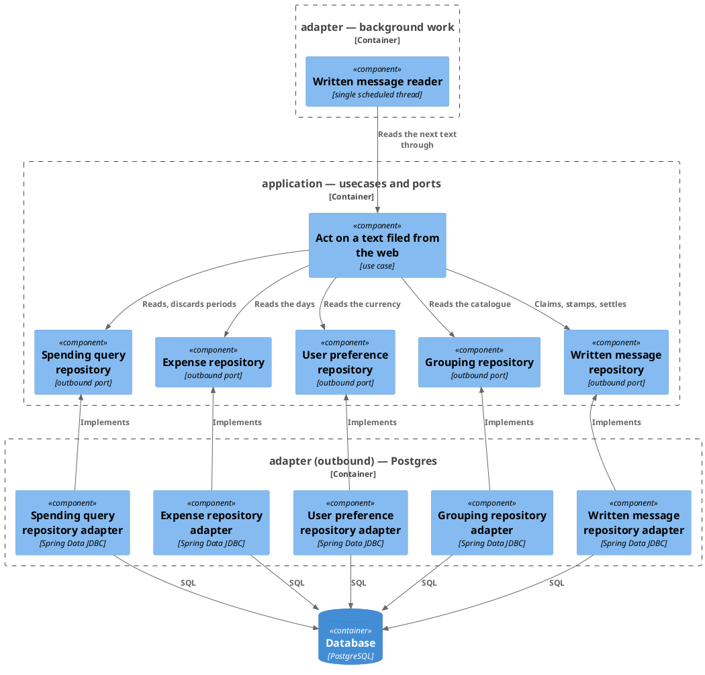
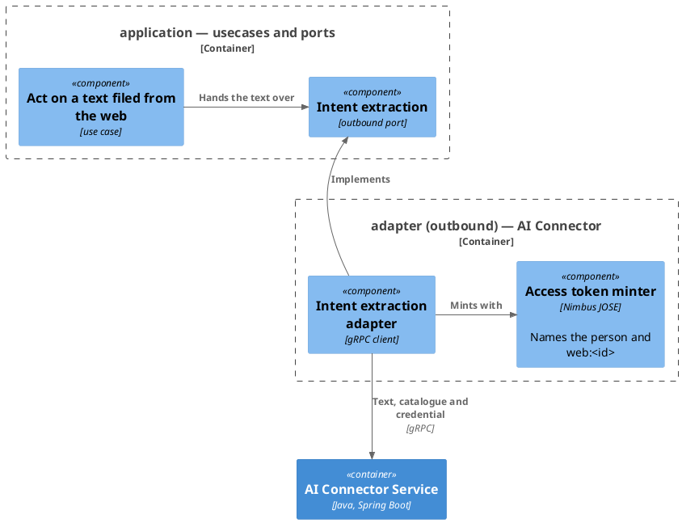
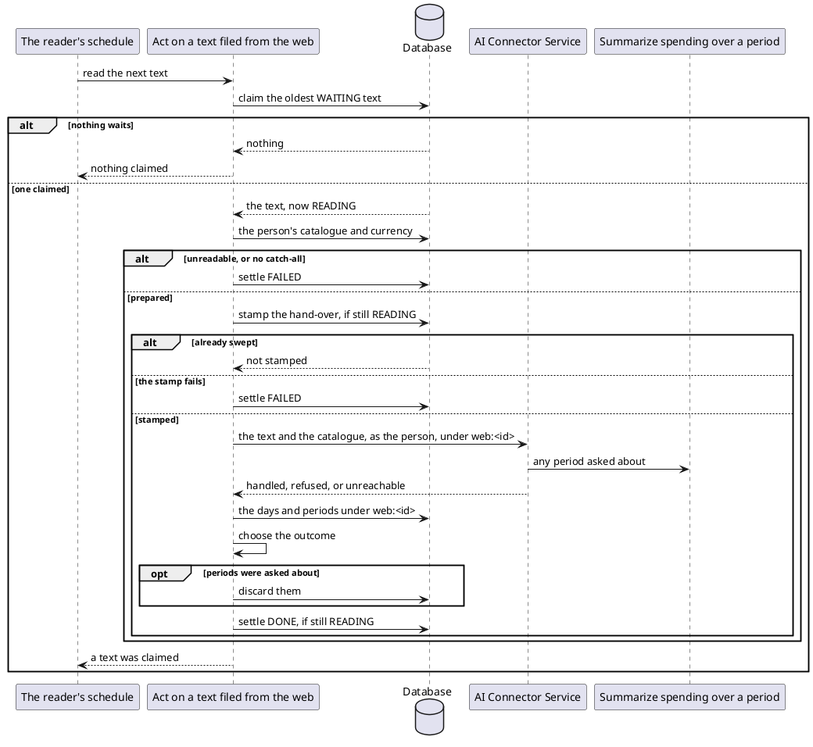

# Act on a text filed from the web

- **In**
  - the oldest [text](../domain/written-message.md) waiting to be read, whoever filed it
- **Out**
  - whatever spending the text names, pending under the text's own [message id](../domain/incoming-message-id.md)
  - the text, settled `DONE` with what its reading came to
  - whether a text was claimed
- **Why:** a text filed from the expenses page becomes pending spending, and the page learns what it came to

*Implemented by `HandleWrittenMessageUseCase`.*

## Prerequisites

- It runs on the reader's own thread.
- Each look reads one text after another until none waits.
- The person is the one stored on the text.

## Collaborators

| Direction | Collaborator                                                                                                 | Through                                                                        | For                                                                                 |
|-----------|--------------------------------------------------------------------------------------------------------------|--------------------------------------------------------------------------------|-------------------------------------------------------------------------------------|
| in        | [File a text for reading](file-written-message.md)                                                           | [File a text for reading](file-written-message.md)                             | waking the reader the moment a text is filed                                        |
| in        | [The reader's schedule](../configuration.md)                                                                 | [Configuration](../configuration.md)                                           | looking for a waiting text every poll interval                                      |
| out       | [Database](../contracts/out/database.md)                                                                     | [Users, categories and expenses](../contracts/out/database.md)                 | claiming and settling the text, reading the person, reading back what the turn left |
| out       | [Record the spending a user's message names](../../../ai-connector-service/docs/usecases/extract-intents.md) | [AI Connector Service — intent extraction](../contracts/out/ai-connector.md) | acting on the text, as that person                                                  |
| out       | [Summarize spending over a period](summarize-spending.md)                                                    | [Users, categories and expenses](../contracts/out/database.md)                 | picking up the periods the text asked about, so they can be discarded               |

## Outcomes

| Outcome                | When                                                                             | Result                                                                              |
|------------------------|----------------------------------------------------------------------------------|-------------------------------------------------------------------------------------|
| Nothing waiting        | no text is `WAITING`                                                             | nothing claimed, and nothing else is read                                           |
| Spending recorded      | the connector finished, and an entry is under the text                           | settled `RECORDED`                                                                  |
| Period answered        | the connector finished, no entry is under the text, and a period was asked about | settled `ANSWERED`                                                                  |
| Nothing identified     | the connector finished, and nothing is under the text                            | settled `NOTHING_IDENTIFIED`                                                        |
| Person unprepared      | the person's catalogue cannot be read, or lacks the designated catch-all         | settled `FAILED`, the connector never called, and a warning logged                  |
| Currency unread        | the person's assumed currency cannot be read                                     | the turn runs, assuming no currency, and the failure is logged                      |
| Swept before hand-over | the text stopped being `READING` before the connector was called                 | the connector is never called, and the text is left as it was settled               |
| Hand-over unstamped    | recording the hand-over fails                                                    | settled `FAILED`, and the connector never called                                    |
| Connector failed       | the connector refuses the turn, or cannot be reached                             | settled `PARTIAL` if an entry is under the text, else `FAILED`, and an error logged |
| Periods kept           | the periods asked about cannot be discarded                                      | logged, and the text is still settled `ANSWERED`                                    |
| Swept during the turn  | the text stopped being `READING` before it could be settled                      | the outcome already stored stands                                                   |
| Storage failed         | the claim, the read-back or the settle fails                                     | the failure reaches the reader, and a claimed text stays `READING` for the sweep    |
| Look failed            | any failure reaches the reader                                                   | logged at error, and the next look runs as usual                                    |

- An entry counts whether it is still pending or already accepted.
- An info line names the text's message id and the person when a text is claimed, and again when it is settled.

## Components

The stores the turn reaches:

The connector the turn hands the text to:

## Flow

## References

- [ADR 0015: A turn is named by the message that started it](../adr/0015-a-turn-is-named-by-the-message-that-started-it-not-by-a-value-minted-beside-it.md) —
  why everything the turn stores carries `web:<id>`
- [ADR 0007: An MCP caller is identified by a signed token, not a tool argument](../adr/0007-an-mcp-caller-is-identified-by-a-signed-token-not-a-tool-argument.md) —
  how the connector acts as the person for the length of the turn
- [Settle the texts left reading](sweep-written-messages.md) — what settles a text this leaves `READING`
- [Read what became of a filed text](read-written-message.md) — how the page learns the outcome
