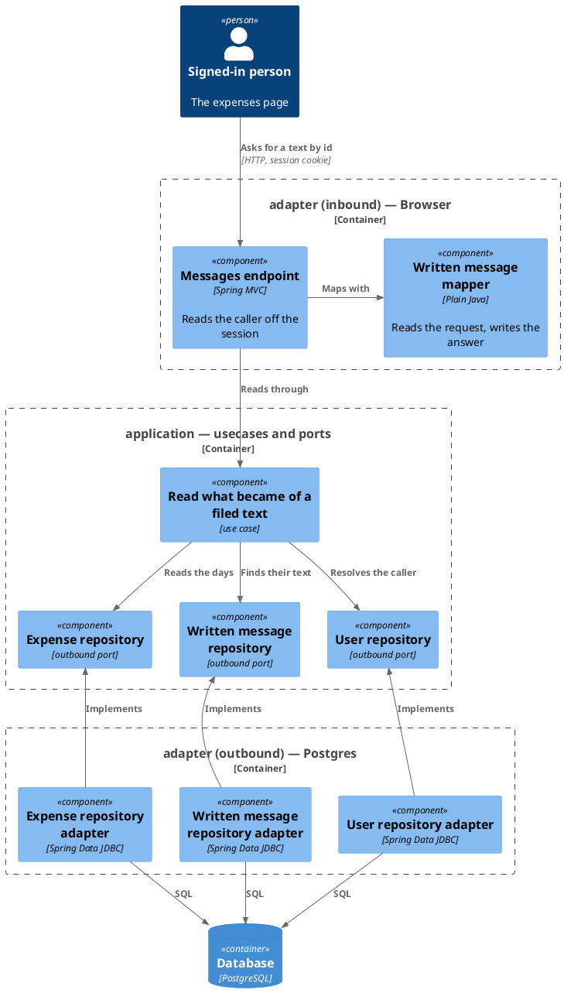
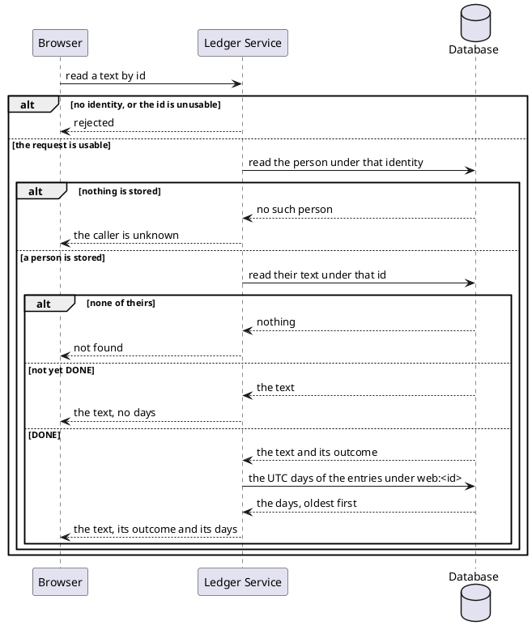

# Read what became of a filed text

- **In**
  - the identity of the authenticated caller
  - the id filing the text answered
- **Out**
  - the [text](../domain/written-message.md) as it now stands
  - once its reading is done, the UTC days the entries it produced were stored on, pending or since accepted
- **Why:** the page learns when a filed text is read, what it came to, and which days to open

*Implemented by `ReadWrittenMessageUseCase`.*

## Prerequisites

- The caller is authenticated. The request never names whose text it is.
- A user is stored under that identity.

## Collaborators

| Direction | Collaborator                                                                     | Through                                                                 | For                                                                    |
|-----------|----------------------------------------------------------------------------------|-------------------------------------------------------------------------|------------------------------------------------------------------------|
| in        | [File expenses as text](../../../web-app/docs/usecases/file-expenses-as-text.md) | [Browsing the ledger from a browser](../contracts/in/web-browse-api.md) | following a filed text until its reading ends                          |
| out       | [Database](../contracts/out/database.md)                                         | [Users, categories and expenses](../contracts/out/database.md)          | resolving the identity, reading the text, and the days of its entries  |

## Outcomes

| Outcome          | When                                                       | Result                                                     |
|------------------|------------------------------------------------------------|------------------------------------------------------------|
| Still reading    | the caller's text is `WAITING` or `READING`                | the text, with no days, and no entry is read               |
| Reading done     | the caller's text is `DONE`                                | the text, what it came to, and its days, oldest first      |
| Nothing stored   | the text is `DONE` and no entry carries its id             | the text, what it came to, and no days                     |
| Text not found   | the id names another person's text, or nothing at all      | the request is rejected the same way for both              |
| Id unusable      | the id is below `1`                                        | the request is rejected naming `id`, and nothing is read   |
| Identity unknown | nothing is stored under the identity                       | the request is rejected, and no text is looked for         |
| Request rejected | the request carries no identity                            | no browser session is open, and nothing is looked up       |
| Storage failed   | the store cannot be reached                                | the failure reaches the caller                             |

## Components

## Flow

## References

- [ADR 0015: A turn is named by the message that started it](../adr/0015-a-turn-is-named-by-the-message-that-started-it-not-by-a-value-minted-beside-it.md) —
  why the entries are found by the text's own id
- [Act on a text filed from the web](handle-written-message.md) — what each outcome means
- [File a text for reading](file-written-message.md) — where the id comes from
