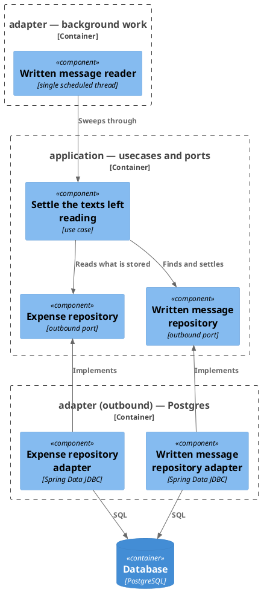
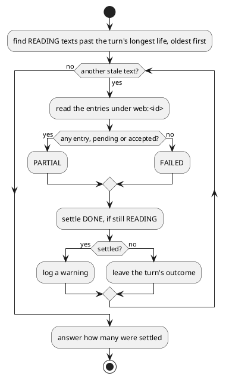

# Settle the texts left reading

- **In**
  - every [text](../domain/written-message.md) still `READING` past the turn's longest possible life
- **Out**
  - each of those settled `DONE`, by what is stored under it
  - how many it settled
- **Why:** a text whose reading was cut short still ends with an outcome, and is never read again

*Implemented by `SweepWrittenMessagesUseCase`.*

## Prerequisites

- It runs at the start of every look the [reader](handle-written-message.md#prerequisites) takes.
- The turn's longest possible life is `MCP_JWT_TTL`, plus `MCP_JWT_CLOCK_SKEW`, plus
  `WRITTEN_MESSAGE_SWEEP_MARGIN`, counted from when the text last moved.

## Collaborators

| Direction | Collaborator                                       | Through                                                        | For                                                                  |
|-----------|----------------------------------------------------|----------------------------------------------------------------|----------------------------------------------------------------------|
| in        | [The reader's schedule](../configuration.md)       | [Configuration](../configuration.md)                           | settling stale texts every poll interval                             |
| in        | [File a text for reading](file-written-message.md) | [File a text for reading](file-written-message.md)             | the extra look a filing asks for                                     |
| out       | [Database](../contracts/out/database.md)           | [Users, categories and expenses](../contracts/out/database.md) | finding the stale texts, reading what is under each, and settling it |

## Outcomes

| Outcome           | When                                                              | Result                                                                            |
|-------------------|-------------------------------------------------------------------|-----------------------------------------------------------------------------------|
| Nothing stale     | no `READING` text is older than the turn's longest life           | nothing is settled                                                                |
| Spending stored   | a stale text has at least one entry under it, pending or accepted | settled `PARTIAL`, and a warning names its message id, the person and the outcome |
| Nothing stored    | a stale text has no entry under it                                | settled `FAILED`, and the same warning                                            |
| Settled meanwhile | its turn settled the text first                                   | the turn's outcome stands                                                         |
| Storage failed    | finding the texts, reading under one, or settling one fails       | the failure reaches the reader, and the rest wait for the next look               |

## Components

## Flow

## References

- [Act on a text filed from the web](handle-written-message.md) — the turn whose stalled texts this settles
