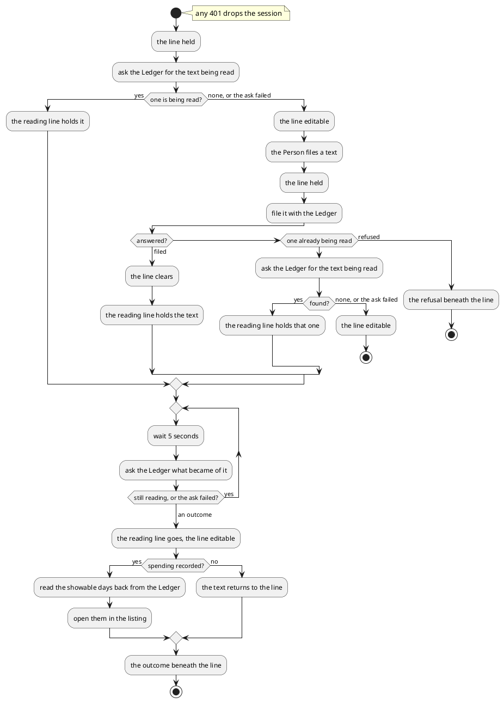
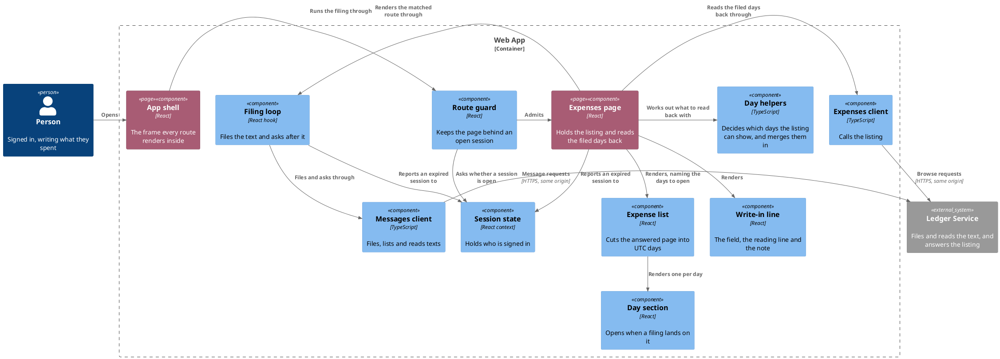

# File expenses as text

- **At:** `/`, behind the route guard
- **In:** a signed-in person
- **In:** a text naming what they spent, written in the write-in line
- **Out:** the text filed with the ledger and read there
- **Out:** the days its entries landed on, read back and opened, nothing ticked
- **Out:** the text returned to the line, where nothing was filed from it
- **Why:** spending reaches the ledger from the page, without writing to the bot

*Implemented by the expenses page, its filing loop, the write-in line, the messages client and the day helpers.*

## Collaborators

| Direction | Collaborator                                                                                          | Through                                                 | For                                     |
|-----------|-------------------------------------------------------------------------------------------------------|---------------------------------------------------------|-----------------------------------------|
| in        | [A signed-in person's browser](sign-in-with-telegram.md)                                              | the expenses page                                       | filing spending without Telegram        |
| out       | [List a person's texts being read](../../../ledger-service/docs/usecases/browse-written-messages.md)  | [the browse API](../contracts/out/ledger-browse-api.md) | finding the text being read             |
| out       | [File a text for reading](../../../ledger-service/docs/usecases/file-written-message.md)              | [the browse API](../contracts/out/ledger-browse-api.md) | handing the text over                   |
| out       | [Read what became of a filed text](../../../ledger-service/docs/usecases/read-written-message.md)     | [the browse API](../contracts/out/ledger-browse-api.md) | learning what became of it              |
| out       | [Browse expenses](../../../ledger-service/docs/usecases/browse-expenses.md)                           | [the browse API](../contracts/out/ledger-browse-api.md) | reading the filed days back             |
| out       | [Sign in with Telegram](sign-in-with-telegram.md)                                                     | [the session state it owns](sign-in-with-telegram.md)   | dropping to anonymous on a refused call |

## Prerequisites

- A session is open.

## Outcomes

| Outcome                  | When                                                                   | Result                                                                          |
|--------------------------|------------------------------------------------------------------------|---------------------------------------------------------------------------------|
| Held                     | the page is still asking which text is being read                      | the line is read-only                                                           |
| Resumed                  | the page loads while a text of theirs is being read                    | the reading line holds it                                                       |
| Ready                    | none is being read, or asking fails for any reason but a session       | the line is editable, nothing beneath it                                        |
| Filed                    | the filing is answered                                                 | the line clears and is held, and the reading line holds the text                |
| Another was being read   | the filing is refused as one already being read, and that one is found | the new text stays in the held line, and the reading line holds the one found   |
| None found behind it     | the same, and asking finds none or fails                               | the line is editable, holding the new text, nothing beneath it                  |
| Filing refused           | the filing is refused for any other reason but a session               | the text stays in the editable line, with the refusal beneath it                |
| Still reading            | asking after the text answers it still being read, or fails but a 404  | the reading line stands                                                         |
| Recorded                 | the outcome is `RECORDED`, naming a day the listing can show           | those days are merged and opened, and the filing is announced                   |
| Recorded out of view     | the outcome is `RECORDED`, naming no day the listing can show          | nothing is read back, and a pencil note says the list does not show those days  |
| Partly recorded          | the outcome is `PARTIAL`                                               | as Recorded, with a pencil note that the list may be incomplete                 |
| Nothing found            | the outcome is `NOTHING_IDENTIFIED`                                    | the text returns to the line, with a pencil note saying so                      |
| Only a question          | the outcome is `ANSWERED`                                              | the text returns to the line, with a pencil note that only spending is filed    |
| Could not be read        | the outcome is `FAILED` or any other, or asking answers 404            | the text returns to the line, with a refusal                                    |
| The newer text stays     | a text returns while the line holds another                            | the line keeps the newer one, and only the note or refusal appears              |
| The days stand           | the read back fails                                                    | the listing's failure is shown, and the days on screen stay                     |
| Sent to sign in          | any call here is refused for want of a session                         | the sign-in page is shown                                                       |

The listing can show a day already on the page. On the first page, it can also show any day the filter's status
and period include.

## Flow

## Components

## References

- [ADR 0014: The web app and the ledger are served from one origin](../../../docs/adr/0014-the-web-app-and-the-ledger-are-served-from-one-origin.md) —
  why the filing carries a CSRF token read from a cookie
- [Accept pending expenses](accept-pending-expenses.md) — what a person does with the entries a filed text
  produced
